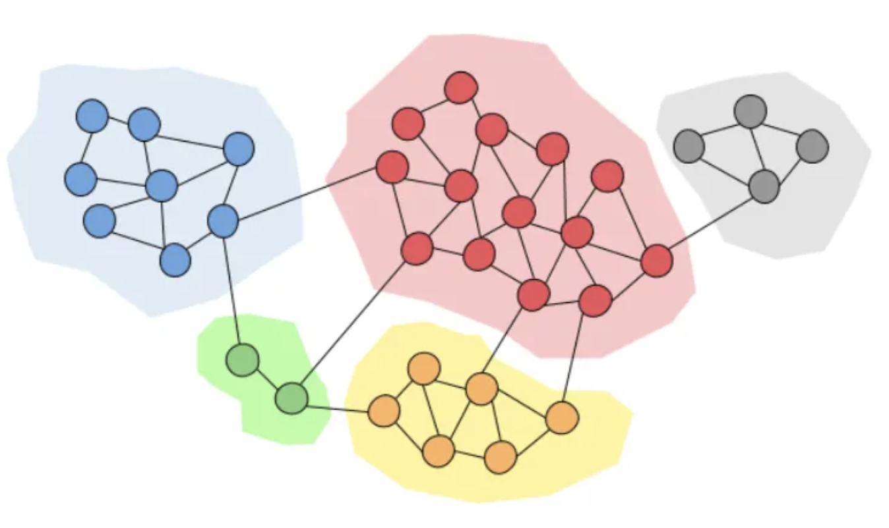

# Introduction
<!-- Source: manuscript_english/5_detection_communautes/detection_communautes.tex -->

## The community detection problem (1/2)

- [Nodes]{.blue} are people; an [edge]{.blue} is a connection (messages, friendship, collaboration).
- **Goal:** find groups of nodes that are more densely connected to one another than to the rest of the graph.
- These groups may be groups of friends, or people who share interests.
- Once the communities are found, we may: 

1. Look for **influencers** and send them advertisements, or approach them directly.

2.  Understand the **common features** of the nodes inside this community to understand how the community was created and what share the people inside of it.


## The community detection problem (2/2)

{width=46% fig-align="center" fig-alt="Community detection network diagram"}

::: {.callout-tip title="Idea: density, not just connectivity" icon=false style="font-size: 0.85em;"}
A community is not a connected component. It is a set of nodes with a **higher density of internal edges** than of edges leaving the set.
:::

## What is a graph?

::: {.callout-note title="Definition (graph)" icon=false}
A **graph** is a pair $(V,E)$: $V$ is the set of **nodes**, and $E\subset V\times V$ is the set of **edges**.

A **weighted graph** is a triple $(V,E,W)$ with $W\in\R^{|V|\times|V|}$. The entries of $W$ are the **weights**.
:::

- **Undirected graph:** $(i,j)\in E$ implies $(j,i)\in E$.
- **Undirected weighted graph:** the graph is undirected and $W=W^\top$.
- Four classical types: directed or not, weighted or not.

## Four types of graphs

```{tikz}
%| label: graph-types
%| echo: false
%| fig-align: center
%| out-width: 70%
%| fig-cap: "Undirected/directed and unweighted/weighted graphs."

\begin{tikzpicture}[>=stealth, shorten >=1pt, thick,
  main node/.style={circle, fill=blue!20, draw, font=\sffamily\large\bfseries, minimum size=8mm}]
\begin{scope}
  \node[main node] (a1) at (0,0) {1};
  \node[main node] (a2) at (1.8,0) {2};
  \node[main node] (a3) at (0,1.8) {3};
  \node[main node] (a4) at (3.6,0) {4};
  \draw (a1) -- (a2) -- (a3) -- (a1) (a2) -- (a4);
  \node at (1.8,-0.85) {\small undirected, unweighted};
\end{scope}
\begin{scope}[xshift=8.2cm]
  \node[main node] (b1) at (0,0.7) {1};
  \node[main node] (b2) at (1.8,0.7) {2};
  \node[main node] (b4) at (3.6,0.7) {4};
  \draw[->] (b1) -- (b2);
  \draw[->] (b2) -- (b4);
  \node at (1.8,-0.85) {\small directed, unweighted};
\end{scope}
\begin{scope}[yshift=-4.3cm]
  \node[main node] (c1) at (0,0.7) {1};
  \node[main node] (c2) at (1.8,0.7) {2};
  \node[main node] (c4) at (3.6,0.7) {4};
  \draw (c1) -- node[above] {2} (c2);
  \draw (c2) -- node[above] {3} (c4);
  \node at (1.8,-0.85) {\small undirected, weighted};
\end{scope}
\begin{scope}[xshift=8.2cm, yshift=-4.3cm]
  \node[main node] (d1) at (0,0) {1};
  \node[main node] (d2) at (1.8,0) {2};
  \node[main node] (d3) at (1.8,1.8) {3};
  \node[main node] (d4) at (3.6,0) {4};
  \path (d1) edge [loop above] node {5} (d1);
  \draw[->] (d1) -- node[above] {10} (d2);
  \draw[->, bend left=18] (d3) to node[right] {1} (d2);
  \draw[->, bend left=18] (d2) to node[left] {7} (d3);
  \draw[->] (d2) -- node[above] {10} (d4);
  \path (d4) edge [loop above] node {2} (d4);
  \node at (1.8,-0.85) {\small directed, weighted};
\end{scope}
\end{tikzpicture}
```

## Complete graphs and a ring graph

:::: {.columns style="display: flex; align-items: center;"}
::: {.column width="62%"}
```{tikz}
%| label: complete-graphs
%| echo: false
%| fig-align: center
%| out-width: 100%
%| fig-cap: "Complete graphs $K_4$, $K_5$ and $K_6$."

\begin{tikzpicture}[scale=0.78]
\begin{scope}
  \foreach \s/\a in {1/45,2/135,3/225,4/315} {
    \node[draw, circle, fill=blue!15, minimum size=7mm, font=\small] (k4-\s) at ({1.45*cos(\a)},{1.45*sin(\a)}) {$\s$};
  }
  \foreach \i in {1,2,3,4} {
    \foreach \j in {1,2,3,4} {
      \ifnum\i<\j \draw (k4-\i) -- (k4-\j); \fi
    }
  }
  \node[fill=magenta!25, inner sep=2pt] at (0,-2.2) {$K_4$};
\end{scope}
\begin{scope}[xshift=5.3cm]
  \foreach \s in {1,...,5} {
    \node[draw, circle, fill=blue!15, minimum size=7mm, font=\small] (k5-\s) at ({360/5 * (\s - 1)+90}:1.55) {$\s$};
  }
  \foreach \i in {1,...,5} {
    \foreach \j in {1,...,5} {
      \ifnum\i<\j \draw (k5-\i) -- (k5-\j); \fi
    }
  }
  \node[fill=magenta!25, inner sep=2pt] at (0,-2.2) {$K_5$};
\end{scope}
\begin{scope}[xshift=10.6cm]
  \foreach \s in {1,...,6} {
    \node[draw, circle, fill=blue!15, minimum size=7mm, font=\small] (k6-\s) at ({360/6 * (\s - 1)}:1.55) {$\s$};
  }
  \foreach \i in {1,...,6} {
    \foreach \j in {1,...,6} {
      \ifnum\i<\j \draw (k6-\i) -- (k6-\j); \fi
    }
  }
  \node[fill=magenta!25, inner sep=2pt] at (0,-2.2) {$K_6$};
\end{scope}
\end{tikzpicture}
```
:::

::: {.column width="38%"}
```{tikz}
%| label: ring-graph
%| echo: false
%| fig-align: center
%| out-width: 85%
%| fig-cap: "A directed ring graph."

\begin{tikzpicture}
\def \n {5}
\def \radius {1.55cm}
\def \margin {12}
\foreach \s in {1,...,\n} {
  \node[draw, circle, fill=blue!15, minimum size=8mm] at ({360/\n * (\s - 1)}:\radius) {$\s$};
  \draw[->, >=latex] ({360/\n * (\s - 1)+\margin}:\radius)
    arc ({360/\n * (\s - 1)+\margin}:{360/\n * (\s)-\margin}:\radius);
}
\end{tikzpicture}
```
:::
::::

## Adjacency matrix

::: {.callout-note title="Definition (adjacency matrix)" icon=false}
Let $G=(V,E)$. The **adjacency matrix** $A\in\{0,1\}^{|V|\times|V|}$ is
$$A_{ij}=1\quad\text{if }(i,j)\in E,\qquad A_{ij}=0\quad\text{otherwise.}$$
For a weighted graph, $A_{ij}=W_{ij}$ when $(i,j)\in E$ and $A_{ij}=0$ otherwise.
:::

- If $G$ is undirected, then $A$ is **symmetric**.
- Community detection is about the **connectivity** of $G$, which is encoded in $A$.
- Everything is inside $A$ (all graphs problems are matrix problems): **Adjacency matrix** is the central mathematical object in graph theory.

## Connectivity and connected components {.smaller}

::: {.callout-note title="Definition (connected graph)" icon=false}
$G=(V,E)$ is **connected** if a path of edges links all the nodes. A **connected component** is a connected subgraph with no edge to its complement. A **connected partition** is a partition of $V$ into connected components.
:::

- Weighted version: the edges of the path must have **nonzero weight**. Unweighted graphs correspond to $W=(1)_{i,j}$.

::: {.callout-caution title="Remark" icon=false}
A nontrivial connected partition is an **ideal** setting: the communities do not interact. Rare in practice, but a good guide for algorithms.
:::

# The Laplacian of a graph

## Definition of the Laplacian {.smaller}

::: {.callout-note title="Definition (Laplacian)" icon=false}
Let $A$ be the adjacency matrix of $G$. The **Laplacian** is
$$L=D-A,\qquad D={\rm diag}(d),\qquad d_i=\sum_{j\in V}A_{ij}$$
where $d_i$ is the **degree** of node $i$.
:::

- Other definitions exist; we use this one throughout.
- If $G$ is undirected, then $L$ is **symmetric**: the spectral theorem applies, and $L=PDP^\top$ with $P$ orthogonal.
- The **spectrum** of $L$ is the key object of spectral community detection.

## Quadratic form and first properties {.smaller}

::: {.callout-note title="Proposition" icon=false}
Let $G=(V,E,W)$ be undirected with $W_{ij}\geq 0$. Then:

1. $f^\top Lf=\frac12\sum_{(i,j)\in E}W_{ij}(f_i-f_j)^2$ for every $f\in\R^{|V|}$;
2. $L$ is symmetric **positive semidefinite**;
3. $0$ is an eigenvalue and $L\mathbf{1}=0$.
:::

**Proof.**

. . .

1. $f^\top(D-A)f=\sum_i d_if_i^2-\sum_{(i,j)\in E}f_iW_{ij}f_j=\frac12\sum_{(i,j)\in E}W_{ij}(f_i-f_j)^2$.
2. The right-hand side is $\geq 0$, so $L\succeq 0$.
3. $(L\mathbf{1})_i=d_i-\sum_j A_{ij}=0$. $\square$

## Multiplicity of $0$ and connected components {.smaller}

::: {.callout-note title="Proposition" icon=false}
For an undirected weighted graph with nonnegative weights, the multiplicity of the eigenvalue $0$ of $L$ equals the **number of connected components**.

Moreover ${\rm Ker}(L)$ is spanned by $\mathbf{1}_{V_1},\ldots,\mathbf{1}_{V_k}$, where $V_1\sqcup\cdots\sqcup V_k$ is the partition of $V$ into connected components.
:::

::: {.callout-tip title="Idea: the kernel of $L$ sees the communities" icon=false}
In the ideal case, the indicators of the communities are eigenvectors for $\lambda=0$. Spectral methods start from this fact.
:::

## Proof sketch: one connected component

Assume $G$ is connected and $Lf=0$. Then $f^\top Lf=0$, so
$$\sum_{(i,j)\in E}W_{ij}(f_i-f_j)^2=0.$$

. . .

- Weights are nonnegative, so $W_{ij}(f_i-f_j)^2=0$ on every edge: $W_{ij}=0$ or $f_i=f_j$.
- Connectivity: any $i,j$ are joined by a path of **positive** weights, so $f$ is constant along the path.
- Hence $f$ is constant: ${\rm Ker}(L)={\rm span}(\mathbf{1})$.

## Proof sketch: several components {.smaller}

Up to reordering the nodes,
$$L=\begin{pmatrix}L_1&&\\&\ddots&\\&&L_k\end{pmatrix},$$
where $L_i$ is the Laplacian of the $i$-th connected component.

. . .

- Each $L_i$ has kernel spanned by the constant vector on $V_i$, so $\mathbf{1}_{V_i}\in{\rm Ker}(L)$.
- Conversely $Lf=0$ if and only if $L_if=0$ on each block, so $f$ is constant on each $V_i$.
- Therefore ${\rm Ker}(L)={\rm span}(\mathbf{1}_{V_1},\ldots,\mathbf{1}_{V_k})$.

::: {.callout-caution title="Remark" icon=false}
The same statement holds for unweighted undirected graphs, by taking $W=(1)_{i,j}$.
:::

## Example: the complete graph $K_n$

The Laplacian of $K_n$ is
$$L=nI_n-\mathbf{1}\mathbf{1}^\top=\begin{pmatrix}n-1&-1&\cdots&-1\\-1&n-1&\cdots&-1\\\vdots&&\ddots&\vdots\\-1&-1&\cdots&n-1\end{pmatrix}.$$

- If $Lf=0$, then $nf=\inr{f,\mathbf{1}}\mathbf{1}$, so $f\in{\rm span}(\mathbf{1})$.
- The multiplicity of $0$ is $1$, as expected: $K_n$ is connected.

## Why is $L$ called a Laplacian? Newton's law of cooling {.smaller}

:::: {.columns style="display: flex; align-items: center;"}
::: {.column width="62%"}
Imagine temperatures $T_i$ on the nodes. Heat flows **in proportion to the temperature difference**:
$$\frac{dT_i}{dt}=-\kappa\sum_{j\in V}A_{ij}(T_i-T_j).$$

- Node $i$ exchanges heat only with its neighbours.
- In vector form: $\dfrac{dT}{dt}=-\kappa(D-A)T=-\kappa LT$.
- Compare with the heat equation $\partial_t u=\alpha\Delta u$: one identifies $L$ with $-\Delta$.
:::


::: {.column width="38%"}
{width=70% fig-align="center" fig-alt="Newton heat flow"}
:::
::::

::: {style="height: 80px;"}
:::

::: {.callout-tip title="Idea: a discrete Laplacian" icon=false}
The graph Laplacian is the *discrete analog* of the Laplacian of the heat equation.
:::

# Principle of spectral methods

## Ideal setting: disjoint communities

- **Ideal case:** the communities are the connected components. They do not interact.
- Almost never true in practice (a few inter-community edges always exist), but a good guide.
- Then ${\rm Ker}(L)={\rm span}(\mathbf{1}_{V_1},\ldots,\mathbf{1}_{V_k})$.
- The indicators $\mathbf{1}_{V_i}$ are hard to read off $L$. An **orthonormal basis** $u_1,\ldots,u_k$ of ${\rm Ker}(L)$ is easy.

## The spectral method in two steps

1. Cluster the $|V|$ **row vectors** $y_i\in\R^k$ of the matrix $[u_1|\cdots|u_k]$ into $k$ clusters $C_1,\ldots,C_k$.
2. Return $V_p=\{i\in V:y_i\in C_p\}$. These are the detected communities.

. . .

::: {.callout-tip title="Idea: cluster the rows, not the nodes" icon=false}
Each node $i$ is represented by the $i$-th row of the eigenbasis matrix. Clustering these rows clusters the nodes.
:::

## Why the rotation does not destroy the clusters {.smaller}

- $\{\mathbf{1}_{V_p}/\sqrt{|V_p|}\}_p$ is an orthonormal basis of ${\rm Ker}(L)$.
- So is $\{u_1,\ldots,u_k\}$: there is $R\in{\rm O}(k)$ with
$$[u_1|\cdots|u_k]=\big[\mathbf{1}_{V_1}/\sqrt{|V_1|}|\cdots|\mathbf{1}_{V_k}/\sqrt{|V_k|}\big]R.$$
- The rows of the indicator matrix take only $k$ distinct values. A $k$-means on these rows recovers the components **exactly**.
- A rotation of $\R^k$ preserves this clustering.

. . .

**In practice** $G$ is not a disjoint union: look at the eigenspace of the **$k$ smallest eigenvalues**, not only the kernel. Choose $k$ by an elbow in the spectrum, or by a modularity function.

## Graph cuts and modularity {.smaller}

Detecting communities $\iff$ finding a partition that **minimizes the inter-community weight** while keeping the communities **large enough**.

- A **cut** is a partition of $V$.
- A **modularity** quantifies intra- versus inter-community mass.

For $A,B\subset V$,
$$W(A,B)=\sum_{\substack{(i,j)\in E\\(i,j)\in A\times B}}(W_{ij}+W_{ji})=2\sum_{\substack{(i,j)\in E\\(i,j)\in A\times B}}W_{ij}.$$

The **cut** of a partition $V_1\sqcup\cdots\sqcup V_k$ is
$${\rm cut}(V_1,\ldots,V_k)=\frac12\sum_{i=1}^k W(V_i,V_i^c).$$

## The mincut problem {.smaller}

For two communities, encode $V_1$ by $x\in\{0,1\}^{|V|}$:
$${\rm cut}(V_1,V_1^c)=2\sum_{(i,j)\in E}x_i W_{ij}(1-x_j).$$

$$\min_{x\in\{0,1\}^{|V|}}\sum_{(i,j)\in E}x_i W_{ij}(1-x_j).$$

- Solvable by the **Stoer–Wagner** algorithm.
- In practice it often returns a singleton: the node of **smallest degree**.

. . .

::: {.callout-caution title="Remark" icon=false}
A singleton is not a community. One must force the parts to have sufficient size.
:::

## RatioCut

::: {.callout-note title="Definition (RatioCut)" icon=false}
$${\rm RatioCut}(V_1,\ldots,V_k)=\frac12\sum_{i=1}^k\frac{W(V_i,V_i^c)}{|V_i|}.$$
:::

- The factor $1/|V_i|$ penalizes small communities.
- Minimizing RatioCut over $\cP_k(V)$ is **NP-hard** in general.
- We rewrite it as a vector (then matrix) problem and **convexify the constraint**. The relaxation is the spectral method.

## Membership vector for two communities {.smaller}

For $V_1\subset V$, set
$$f_i^{V_1}=\begin{cases}\sqrt{|V_1^c|/|V_1|}& \text{if }i\in V_1,\\[4pt]-\sqrt{|V_1|/|V_1^c|}& \text{if }i\notin V_1.\end{cases}$$

::: {.callout-note title="Proposition" icon=false}
Let $L$ be the Laplacian of an undirected weighted graph, and $n=|V|$. Then

1. $\inr{f^{V_1},\mathbf{1}}=0$ and $\norm{f^{V_1}}_2^2=n$;
2. $(f^{V_1})^\top L f^{V_1}=n\,{\rm RatioCut}(V_1,V_1^c)$.
:::

- So minimizing RatioCut $\iff$ minimizing $f^\top Lf$ over these discrete vectors $f^{V_1}$.

## Proof sketch of the RatioCut identity {.smaller}

From the quadratic form,
$$(f^{V_1})^\top Lf^{V_1}=\frac12\sum_{(i,j)\in E}W_{ij}(f_i^{V_1}-f_j^{V_1})^2.$$

- The difference $f_i^{V_1}-f_j^{V_1}$ is nonzero only across the cut.
- On a cut edge,
$$\Big(\sqrt{\tfrac{|V_1^c|}{|V_1|}}+\sqrt{\tfrac{|V_1|}{|V_1^c|}}\Big)^2=\frac{n}{|V_1|}+\frac{n}{|V_1^c|}.$$
- Summing both orientations of the cut gives $n\,{\rm RatioCut}(V_1,V_1^c)$.
- The two constraints: $\norm{f^{V_1}}_2^2=|V_1|+|V_1^c|=n$ and $\inr{f^{V_1},\mathbf{1}}=0$. $\square$

## Convex relaxation for $k=2$ {.smaller}

Three equivalent **discrete** problems:
$$\min_{V_1\subset V}(f^{V_1})^\top Lf^{V_1},\qquad\min_{V_1\subset V}\big((f^{V_1})^\top Lf^{V_1}:\norm{f^{V_1}}_2^2=n,\,\inr{f^{V_1},\mathbf{1}}=0\big),$$
and $\min_{V_1}{\rm RatioCut}(V_1,V_1^c)$. All are NP-hard.

- The map $f\mapsto f^\top Lf$ is **convex** (${\rm Hess}=2L\succeq 0$).
- The difficulty is the discrete constraint $f=f^{V_1}$.
- **Relax** it to $f\in\R^{|V|}$:
$$\min_{f\in\R^{|V|}}\big(f^\top Lf:\norm{f}_2^2=1,\,\inr{f,\mathbf{1}}=0\big).$$

## The Fiedler vector {.smaller}

::: {.callout-note title="Definition (Fiedler vector)" icon=false}
A **Fiedler vector** of $L$ is an eigenvector for the **second smallest** eigenvalue. That eigenvalue is the **algebraic connectivity**.
:::

::: {.callout-note title="Proposition" icon=false}
The Fiedler vectors are exactly the solutions of the relaxed problem.
:::

**Proof.** Write $0=\lambda_1\leq\lambda_2\leq\cdots\leq\lambda_n$ and $u_1=\mathbf{1}$. If $\norm{f}_2=1$ and $\inr{f,\mathbf{1}}=0$,
$$f^\top Lf=\sum_{i=2}^n\lambda_i\inr{u_i,f}^2\geq\lambda_2,$$
with equality at $f=u_2$. $\square$

## From a Fiedler vector to two communities

- A Fiedler vector $u_2$ approximates the two-valued membership vector $f^{V_1^*}$.
- Its coordinates should concentrate around **two values**.
- Cluster the coordinates of $u_2$ into two classes $C_1,C_2$ on $\R$.
- The communities are $\{i:u_{2i}\in C_1\}$ and $\{i:u_{2i}\in C_2\}$.

. . .

This **is** the spectral method for $k=2$, with first eigenvector $u_1=\mathbf{1}$ (clustering the rows of $[u_1|u_2]$ is the same as clustering the coordinates of $u_2$).

## Membership matrix for $k$ communities {.smaller}

To a partition $V_1\sqcup\cdots\sqcup V_k$ associate $H\in\R^{|V|\times k}$ with columns $h_j=\mathbf{1}_{V_j}/\sqrt{|V_j|}$:
$$H_{ij}=\begin{cases}1/\sqrt{|V_j|}& \text{if }i\in V_j,\\0& \text{otherwise.}\end{cases}$$

::: {.callout-note title="Proposition" icon=false}
$H^\top H=I_k$ and ${\rm RatioCut}(V_1,\ldots,V_k)={\rm Tr}(H^\top LH)$.
:::

- $H^\top H=I_k$: the $V_j$ are disjoint, and $\sum_{i\in V_j}1/|V_j|=1$.
- ${\rm Tr}(H^\top LH)=\sum_p h_p^\top Lh_p=\sum_p W(V_p,V_p^c)/(2|V_p|)$.

## Relaxation for $k$ communities {.smaller}

The discrete problems $\min{\rm Tr}(H^\top LH)$ over membership matrices $H$ are NP-hard. The objective $H\mapsto{\rm Tr}(H^\top LH)$ is convex. Relax the combinatorial constraint:
$$\min_{\substack{H\in\R^{|V|\times k}\\H^\top H=I_k}}{\rm Tr}(H^\top LH).$$

Write $L=UDU^\top$ with $0=\lambda_1\leq\cdots\leq\lambda_n$. Then
$${\rm Tr}(H^\top LH)=\sum_i\lambda_i\norm{a_i}_2^2,\qquad\sum_i\norm{a_i}_2^2=k,$$
where $a_i$ is the $i$-th row of $U^\top H$. The minimum is $\sum_{i=1}^k\lambda_i$, attained when
$${\rm span}(h_1,\ldots,h_k)={\rm span}(u_1,\ldots,u_k).$$

- The solutions are orthonormal bases of the eigenspace of the **$k$ smallest eigenvalues**.
- Cluster the $n$ rows of $H$ into $k$ groups: this is again the spectral method.

## Algorithm of the spectral method {.smaller}

::: {.callout-note title="Algorithm (spectral method)" icon=false}
**Input:** Laplacian $L$ of $G$, and $k$.

1. Compute an orthonormal basis of $k$ eigenvectors for the $k$ smallest eigenvalues of $L$.
2. Form the $n\times k$ matrix $H$ with these columns.
3. Cluster the $n$ rows $y_1,\ldots,y_n\in\R^k$ into $k$ clusters $C_1,\ldots,C_k$.
4. **Output:** communities $\{i:y_i\in C_p\}$, $p=1,\ldots,k$.
:::

- Justified by the RatioCut relaxation, or by the ideal connected-component picture.
- Choose $k$ by an **elbow** in the spectrum of $L$, or by evaluating a modularity (e.g. RatioCut) as a function of $k$.

# Probabilistic graph models

## Why a random graph?

- Until now every edge was observed.
- In applications (genes, companies, \ldots) some links are **missing** or **uncertain**.
- One then assumes a **probabilistic model** under the observations, and still wants the communities.
- The same spectral method will be applied to the Laplacian of the **observed** adjacency matrix.

## The Erdős–Rényi model

::: {.callout-note title="Definition (Erdős–Rényi)" icon=false}
$G\sim G(n,p)$ is an undirected unweighted graph on $n$ nodes with
$$A_{ij}=A_{ji},\qquad A_{ii}=1,\qquad (A_{ij})_{j>i}\ \text{i.i.d. }{\rm Bern}(p).$$
:::

- Every pair of distinct nodes is connected independently with probability $p$.
- No community structure: a **null model**.

## The stochastic block model

::: {.callout-note title="Definition (SBM)" icon=false}
$G\sim G(n,p,q)$ with $0\leq q<p\leq 1$ if there is a partition $V=V_1\sqcup V_1^c$ such that, for $i<j$,
$$A_{ij}\sim\begin{cases}{\rm Bern}(p)&\text{if }i,j\text{ are in the same community},\\{\rm Bern}(q)&\text{otherwise,}\end{cases}$$
and $A_{ji}=A_{ij}$, $A_{ii}=1$.
:::

- Intra-community edges are more likely than inter-community edges ($p>q$).
- **Problem:** given one draw of $G$, recover $V_1$ and $V_1^c$.

## Likelihood in the two-community SBM {.smaller}

Given $A$, the likelihood at $(V_1,p,q)$ is
$$\cL(V_1,p,q)=\prod_{(i,j)\in\cC}p^{A_{ij}}(1-p)^{1-A_{ij}}\prod_{(i,j)\in\cC^c}q^{A_{ij}}(1-q)^{1-A_{ij}},$$
where $\cC$ is the set of intra-community pairs $i<j$ and $\cC^c$ the inter-community pairs.

- Write $N_{\cC}=\sum_{(i,j)\in\cC}A_{ij}$ and $P_{\cC}=N_{\cC}/|\cC|$ (and likewise for $\cC^c$).
- The MLE maximizes $\log\cL$ in $(V_1,p,q)$ under $p\geq q$.
- For **equal-size** communities, $|\cC|=|\cC^c|=(n^2-n)/4$.

## Maximum likelihood equals RatioCut {.smaller}

For $|V_1|=n/2$, maximizing in $(p,q)$ first (KKT) yields:

- if $P_{\cC}>P_{\cC^c}$, then $\hat p=P_{\cC}$, $\hat q=P_{\cC^c}$;
- otherwise $\hat p=\hat q=(P_{\cC}+P_{\cC^c})/2$, and the value does **not** depend on $V_1$.

The remaining problem in $V_1$ is to maximize an entropy under $P_{\cC}\geq P_{\cC^c}$. Since $P_{\cC}+P_{\cC^c}$ is constant, this is equivalent to **minimizing** $P_{\cC^c}$.

. . .

$$P_{\cC^c}={\rm RatioCut}(V_1,V_1^c).$$

::: {.callout-tip title="Idea: MLE is RatioCut" icon=false}
For two equal-size communities, the MLE in the SBM is the RatioCut problem.
:::

## An equivalent discrete program {.smaller}

::: {.callout-caution title="Remark" icon=false}
For $|V_1|=n/2$ one has $f^{V_1}\in\{-1,1\}^n$, so the MLE / RatioCut problem is
$$\min\big(x^\top Lx:\inr{x,\mathbf{1}}=0,\,x\in\{-1,1\}^n\big).$$
Since $x^\top Lx=-x^\top Ax+\sum_{i,j}A_{ij}$ and the second term is constant, this is also
$$\max\big(x^\top Ax:\inr{x,\mathbf{1}}=0,\,x\in\{-1,1\}^n\big).$$
:::

This last form is the one we shall lift to an SDP.

## Detectability: isolated nodes {.smaller}

If a node of $V_1$ has **no edge** inside $V_1$, there is no reason to assign it to $V_1$. Exact recovery then fails.

::: {.callout-note title="Proposition" icon=false}
If $p\leq\log(n/2)\,/\,(n/2-2)$, then $\PP[\text{some node of }V_1\text{ is isolated in }V_1]\geq 1/2$.
:::

**Proof idea.** Let $A_i$ be the event that $i\in V_1$ is isolated in $V_1$, and $N=|V_1|-1$. Then $\PP[A_i]=(1-p)^N$. A Bonferroni bound
$$\PP[\cup_i A_i]\geq(N+1)(1-p)^N-(N+1)N(1-p)^{2N-1}$$
is at least $1/2$ as soon as $p\leq(\log N)/(N-1)$. $\square$

- Exact recovery therefore requires $p\gtrsim\alpha\log n\,/\,n$. The hard regime is $q=\beta\log n\,/\,n$ with $\beta<\alpha$.

## Information-theoretic phase transition {.smaller}

::: {.callout-important title="Theorem (phase transition in the equal-size SBM)" icon=false}
Let $\hat V_1$ be the MLE (minimal RatioCut). If $p=\alpha\log n\,/\,n$ and $q=\beta\log n\,/\,n$, then:

- if $\sqrt{\alpha}-\sqrt{\beta}>\sqrt{2}$, then $\hat V_1,\hat V_1^c$ recover $V_1,V_1^c$ with high probability;
- if $\sqrt{\alpha}-\sqrt{\beta}<\sqrt{2}$, **no** algorithm succeeds with probability $\geq 1/2$.
:::

- A sharp threshold, but the MLE is not computable.
- The practical question: can a **spectral** or **SDP** method attain (or approach) this threshold?

## Spectral method for the equal-size SBM {.smaller}

::: {.callout-note title="Lemma" icon=false}
If $|V_1|=|V_1^c|=n/2$, the following are equivalent:

1. $u_2$ is a Fiedler vector of $\E L=\E(D-A)$;
2. $u_2$ is a leading eigenvector of
$$\E A-\Big[n\tfrac{p+q}{2}+(1-p)\Big]\Big(\tfrac{\mathbf{1}}{\sqrt n}\Big)\Big(\tfrac{\mathbf{1}}{\sqrt n}\Big)^\top.$$
:::

**Why.** All mean degrees are equal, so $\E D$ is a multiple of $I_n$. Eigenvectors of $\E L$ and $\E A$ coincide (eigenvalues reversed). The leading eigenspace of $\E A$ is ${\rm span}(\mathbf{1})$; removing it leaves the Fiedler direction.

## A practical spectral problem

We do not know $\E A$, $p$ or $q$. Estimate:

- $\E A$ by $A$;
- $(p+q)/2$ by the edge density
$$\lambda=\frac{2}{n(n-1)}\sum_{i<j}A_{ij},\qquad \E\lambda=\frac{p+q}{2}-\frac{p-q}{n-1}.$$

The spectral method becomes
$$\max_{\norm{x}_2\leq 1}\inr{x,(A-\lambda J_n)x},\qquad J_n=\mathbf{1}\mathbf{1}^\top.$$

## Matrix lifting {.smaller}

Under equal sizes, $f^{V_1}\in\{-1,1\}^n$, and the discrete problem is
$$\max_{x\in\{-1,1\}^n}x^\top(A-\lambda J_n)x=\max_{x\in\{-1,1\}^n}\inr{A-\lambda J_n,xx^\top}.$$

Passing from a **quadratic** function of $x$ to a **linear** function of $Z=xx^\top$ is **matrix lifting**.

The matrix $Z=xx^\top$ satisfies: $Z=Z^\top$, $Z\succeq 0$, ${\rm diag}(Z)=I_n$, and ${\rm rank}(Z)=1$.

. . .

::: {.callout-tip title="Idea: drop the rank" icon=false}
The only nonconvex constraint is ${\rm rank}(Z)=1$. Removing it yields an **SDP**.
:::

## SDP relaxation

$$\max_{\substack{Z\succeq 0\\{\rm diag}(Z)\preceq I_n}}\inr{A-\lambda J_n,Z}.$$

- If $\hat Z$ is a solution, take a **leading eigenvector** $\hat x$ and its **sign**.
- $\{i:{\rm sign}(\hat x_i)=1\}$ and its complement are the estimated communities.

::: {.callout-note title="Proposition" icon=false}
The oracle problem $\max\inr{\E A-\alpha u_1\otimes u_1,Z}$ (same constraints) has the **unique** solution $\bar x\otimes\bar x$, where $\bar x_i=\pm 1$ is the true membership vector and $\alpha=n(p+q)/2+(1-p)$.
:::

## Algorithm of the SDP method

::: {.callout-note title="Algorithm (SDP relaxation)" icon=false}
**Input:** adjacency matrix $A$ of a two-community equal-size SBM.

1. Compute $\lambda=\frac{2}{n(n-1)}\sum_{i<j}A_{ij}$.
2. Solve the SDP $\max\inr{A-\lambda J_n,Z}$ over $Z\succeq 0$, ${\rm diag}(Z)\preceq I_n$.
3. Take a leading eigenvector $\hat x$ of the solution $\hat Z$.
4. **Output:** $\hat V_1=\{i:{\rm sign}(\hat x_i)=1\}$ and $\hat V_1^c$.
:::

# Estimation rate and Grothendieck's inequality

## What we want to prove

Observe $A\sim{\rm SBM}(n,p,q)$ with equal-size communities. Let $\hat Z$ be the SDP solution and $\hat x$ a leading eigenvector. We want $\hat x$ close to the membership $\bar x\in\{\pm 1\}^n$.

::: {.callout-important title="Theorem (estimation of $\bar x\bar x^\top$)" icon=false}
Assume $n\geq 10^4\eps$, $\max(p(1-p),q(1-q))\geq 20/n$, $p\geq a/n$, $q\geq b/n$ and $(a-b)^2\geq 10^4\eps^{-2}(a+b)$. Then, with probability at least $1-e^3 5^{-n}$,
$$\norm{\hat Z-\bar x\bar x^\top}_2^2\leq \eps n^2=\eps\norm{\bar x\bar x^\top}_2^2.$$
:::

## From matrices to vectors: Davis–Kahan {.smaller}

::: {.callout-note title="Corollary" icon=false}
Under the same assumptions, if $\norm{\hat x}_2=\sqrt n$, then
$$\min_{\alpha\in\{\pm 1\}}\norm{\alpha\hat x-\bar x}_2^2\leq 8\eps n=8\eps\norm{\bar x}_2^2.$$
:::

::: {.callout-important title="Theorem (Davis–Kahan)" icon=false}
If $A,B$ are symmetric and $\lambda_i(A)$ has gap $\delta>0$ from the rest of the spectrum, then
$$\min_{\alpha\in\{\pm 1\}}\norm{u_i(A)-\alpha u_i(B)}_2\leq 2^{3/2}\frac{\norm{A-B}_2}{\delta}.$$
:::

Apply it to $A=\bar x\bar x^\top$ (gap $\delta=n$) and $B=\hat Z$.

## Outline of the proof

Write $\cM_{\rm opt}=\{Z:Z\succeq 0,\,{\rm diag}(Z)\preceq I_n\}$. Three steps:

1. **Oracle:** $\bar Z=\bar x\bar x^\top$ maximizes $Z\mapsto\inr{\E(A-\lambda J_n),Z}$ over $\cM_{\rm opt}$ (as in the oracle proposition).
2. **Uniform concentration:** with high probability,
$$\sup_{Z\in\cM_{\rm opt}}\big|\inr{(A-\lambda J_n)-\E(A-\lambda J_n),Z}\big|$$
is small. This is the **probabilistic** step.
3. **Curvature** at the optimum: $\inr{\E(A-\lambda J_n),\bar Z-Z}\gtrsim\norm{Z-\bar Z}_1$.

## Grothendieck's inequality {.smaller}

::: {.callout-important title="Theorem (Grothendieck)" icon=false}
If $\big|\sum_{i,j}b_{ij}s_it_j\big|\leq 1$ for all $s_i,t_j\in\{\pm 1\}$, then for every Hilbert space $H$ and unit vectors $u_i,v_j$,
$\big|\sum_{i,j}b_{ij}\inr{u_i,v_j}\big|\leq K_G$, with $K_G\leq 1.783$.
:::

Write $\cM_1=\{st^\top:s,t\in\{\pm 1\}^n\}$ and $\cM_G=\{XY^\top:\text{rows of }X,Y\text{ in }B_2^n\}$.

::: {.callout-note title="Corollary" icon=false}
$\displaystyle\sup_{Z\in\cM_G}\inr{B,Z}\leq K_G\sup_{Z\in\cM_1}\inr{B,Z}=K_G\norm{B}_{\infty\to 1}$.
:::

## Why Grothendieck applies here {.smaller}

::: {.callout-note title="Proposition" icon=false}
$\cM_{\rm opt}\subset\cM_G$.
:::

If $Z\succeq 0$ then $Z=XX^\top$, and ${\rm diag}(Z)\preceq I_n$ means $\norm{X_{i\bullet}}_2\leq 1$.

. . .

Therefore
$$\sup_{Z\in\cM_{\rm opt}}\big|\inr{(A-\lambda J_n)-\E(\cdots),Z}\big|\leq K_G\norm{A-\E A}_{\infty\to 1}+K_G|\lambda-\E\lambda|\,\norm{J_n}_{\infty\to 1}.$$

- Bound $\norm{A-\E A}_{\infty\to 1}$ and $|\lambda-\E\lambda|$ by **Bernstein** and a union bound.
- If $\bar p=\frac{2}{n(n-1)}\sum_{i<j}{\rm Var}(A_{ij})>9/n$, then with probability $1-e^3 5^{-n}$,
$$\norm{A-\E A}_{\infty\to 1}\leq 6n(n-1)\sqrt{\bar p/n}.$$

# Exact recovery by a dual certificate

## Weak duality for SDP problems {.smaller}

A standard SDP and its dual:
$$\min\big(\inr{C,X}:X\succeq 0,\,\cA(X)=b\big),\qquad\max\big(\inr{\lambda,b}:C-\cA^\top(\lambda)\succeq 0\big).$$

- **Weak duality:** $\inr{C,X}\geq\inr{\lambda,b}$ for every feasible pair.
- If a feasible pair saturates the inequality, both are optimal: this is a **dual certificate**.

::: {.callout-important title="Theorem (strong duality for SDP)" icon=false}
If there exist $X_0\succ 0$ with $\cA(X_0)=b$ and $\lambda_0$ with $C-\cA^\top(\lambda_0)\succ 0$ (Slater), then both problems attain their optima and there is no duality gap.
:::

## The dual-certificate method

::: {.callout-note title="Proposition" icon=false}
If $X^*$ is primal-feasible, $\lambda^*$ is dual-feasible, and $\inr{C,X^*}=\inr{b,\lambda^*}$, then both are optimal.
:::

**Strategy.**

1. Start from an NP-hard problem $(P_0)$ (here, recover $g=f^{V_1}$).
2. Convexify it into an SDP $(P)$.
3. Take the candidate $X_0=gg^\top$ and **build** a dual-feasible $\lambda_0$ with equal objective values.
4. Then $X_0$ solves $(P)$: one has solved $(P_0)$ by solving $(P)$.

## Another SDP, designed for exact recovery {.smaller}

The theoretical problem with $\E L$ has unique solutions $f^{V_1}$ and $f^{V_1^c}$. We observe only $L$, so we solve the empirical version
$$\max\big(x^\top Ax:\inr{x,\mathbf{1}}=0,\,x\in\{-1,1\}^n\big).$$

- Dropping $\inr{x,\mathbf{1}}=0$ makes $\mathbf{1}$ optimal: the trivial cut.
- Penalize: replace the objective by $x^\top Ax-\lambda\inr{x,\mathbf{1}}^2$, and add the constant $\lambda\norm{x}_2^2$.
- For $\lambda=1/2$ this is $x^\top Bx$ with
$$B=2A-\mathbf{1}\mathbf{1}^\top-I_n,\qquad B_{ij}=\begin{cases}0&i=j,\\1&(i,j)\in E,\\-1&(i,j)\notin E.\end{cases}$$

## Lifted SDP

$$\max\big(x^\top Bx:x\in\{-1,1\}^n\big)\quad\rightsquigarrow\quad\max\big(\inr{B,Z}:Z\succeq 0,\,Z_{ii}=1\big).$$

- The rank constraint has been dropped: this is an SDP.
- From a solution $\hat Z$: take a leading eigenvector and its sign, or **round** $G\sim\cN(0,\hat Z)$ and take ${\rm sign}(G)$.
- **Goal:** prove that $gg^\top$ is the **unique** solution, by a **strict** dual certificate.

## Dual of the community-detection SDP {.smaller}

The dual can be written
$$\min\big({\rm Tr}(Y):Y-B\succeq 0,\,Y\text{ diagonal}\big).$$

Weak duality: for primal-feasible $Z$ and dual-feasible $Y$,
$$\inr{B,Z}\leq{\rm Tr}(Y).$$

$Y$ **certifies** a feasible $Z$ when $\inr{B,Z}={\rm Tr}(Y)$, i.e. $\inr{B-Y,Z}=0$.

. . .

For uniqueness one needs a **strict** certificate: ${\rm Ker}(B-Y)$ of dimension $1$.

::: {.callout-note title="Lemma" icon=false}
If $Y$ certifies $gg^\top$ and $\dim{\rm Ker}(B-Y)=1$, then $gg^\top$ is the unique primal solution.
:::

## Construction of the certificate

Conditions on $Y$: diagonal, $Y\succeq B$, $(B-Y)g=0$, and $\lambda_2(Y-B)>0$.

The first three force
$$Y_{ii}=\frac{(Bg)_i}{g_i}=\frac{2(Ag)_i}{g_i}-1,\qquad Y_{ij}=0\text{ for }i\neq j.$$

::: {.callout-note title="Proposition" icon=false}
If $\lambda_2(Y-B)>0$, then $gg^\top$ is the unique solution of the SDP.
:::

It remains to prove $\lambda_2(Y-B)>0$ **with high probability** in the SBM.

## Deterministic plus concentration

Write $\square=(\alpha-\beta)\log n$ when $p=\alpha\log n\,/\,n$ and $q=\beta\log n\,/\,n$. Enough to show:

1. $\lambda_2(\E(Y-B))=\square$;
2. $\norm{(Y-B)-\E(Y-B)}_{\rm op}<\square$ with high probability.

Weyl / Courant–Fischer then gives
$$\lambda_2(Y-B)\geq\lambda_2(\E(Y-B))-\norm{(Y-B)-\E(Y-B)}_{\rm op}>0.$$

## Spectrum of the mean certificate {.smaller}

A computation with $g\in\{\pm 1\}^n$ and $\inr{g,\mathbf{1}}=0$ yields
$$\E(Y-B)=n(p-q)I_n-(p-q)gg^\top+(1-p-q)\mathbf{1}\mathbf{1}^\top.$$

- $g$ is an eigenvector for the eigenvalue $0$.
- On $g^\perp$, if $p+q\leq 1$ then $v^\top\E(Y-B)v\geq n(p-q)$, with equality for $v\perp\mathbf{1}$.
- Hence $\lambda_2(\E(Y-B))=n(p-q)=(\alpha-\beta)\log n$.

## Decomposing intra- and inter-community edges

```{tikz}
%| label: fig-decomp-A
%| echo: false
%| fig-align: center
%| out-width: 78%
%| fig-cap: "Adjacency matrix $A=A^{\\sim}+A^{\\not\\sim}$: intra-community blocks (blue) and inter-community blocks (red)."

\begin{tikzpicture}[scale=0.95]
\foreach \xshift/\lab/\nw/\ne/\sw/\se in {
  0/{$A$}/blue!25/red!25/red!25/blue!25,
  7.2/{$A^{\sim}$}/blue!25/white/white/blue!25,
  12.6/{$A^{\not\sim}$}/white/red!25/red!25/white} {
  \begin{scope}[xshift=\xshift cm]
    \fill[\nw] (0,1.6) rectangle (1.6,3.2);
    \fill[\ne] (1.6,1.6) rectangle (3.2,3.2);
    \fill[\sw] (0,0) rectangle (1.6,1.6);
    \fill[\se] (1.6,0) rectangle (3.2,1.6);
    \draw[thick] (0,0) rectangle (3.2,3.2);
    \draw (1.6,0) -- (1.6,3.2);
    \draw (0,1.6) -- (3.2,1.6);
    \node at (1.6,-0.55) {\lab};
  \end{scope}
}
\node at (5.2,1.6) {\Large $=$};
\node at (11.0,1.6) {\Large $+$};
\end{tikzpicture}
```

- $Y-B=2\big[(D^{\sim}-A^{\sim})-(D^{\not\sim}-A^{\not\sim})\big]+\mathbf{1}\mathbf{1}^\top$: difference of the two Laplacians.
- Each Laplacian is a sum of independent matrices $\Delta_{ij}=E_{ii}+E_{jj}-E_{ij}-E_{ji}$.

## Matrix Bernstein

::: {.callout-important title="Theorem (matrix Bernstein)" icon=false}
Let $X_k$ be independent centered symmetric $d\times d$ matrices with $\lambda_{\max}(X_k)\leq R$ a.s. Then, with probability at least $1-d\exp(-t)$,
$$\lambda_{\max}\Big(\frac1n\sum_k X_k\Big)\leq\sigma\sqrt{\frac{2t}{n}}+\frac{2Rt}{3n},\qquad\sigma^2=\Big\|\frac1n\sum_k\E X_k^2\Big\|_{\rm op}.$$
:::

- The dimension $d$ appears in the probability. Here $t\sim\log n$, so it only costs constants.
- Applied to the sum over intra- and inter-edges: $R=2$ and $\sigma^2\leq n(p+q)$.

## Exact recovery by SDP {.smaller}

::: {.callout-important title="Theorem" icon=false}
Let $p=\alpha\log n\,/\,n$, $q=\beta\log n\,/\,n$ with $0<\beta<\alpha$ and $p+q<1$, and $|V_1|=n/2$. Then
$$\{gg^\top\}=\argmax\big(\inr{B,Z}:Z\succeq 0,\,Z_{ii}=1\big)$$
with probability at least $1-2/n^\eps$, as soon as
$$\sqrt{2(1+\eps)(\alpha+\beta)}+\frac{4(1+\eps)}{3}<\alpha-\beta.$$
:::

- An NP-hard problem is solved, for most SBM graphs, by an SDP.
- The threshold is more restrictive than $\sqrt{\alpha}-\sqrt{\beta}>\sqrt{2}$.

## No computational gap {.smaller}

::: {.callout-important title="Theorem (improved analysis)" icon=false}
Under the same SBM assumptions, $gg^\top$ is the unique SDP solution with high probability as soon as
$$\sqrt{\alpha}-\sqrt{\beta}>\sqrt{2}.$$
:::

:::: {.columns}
::: {.column width="48%"}
- The SDP attains the **information-theoretic** threshold.
- There is **no computational gap** for two equal-size communities in the SBM.
:::

::: {.column width="52%"}
::: {.callout-tip title="Idea: randomness does things well" icon=false}
NP-hard problems can become easy under a natural random model. Convex relaxation — of the objective, of the constraint, or by matrix lifting — is the right device.
:::
:::
::::

## Dual certificate for basis pursuit {.smaller}

The same idea applies to
$$\min\big(\norm{t}_1:At=y\big).$$

- Subdifferential: $0\in\partial^-\norm{\cdot}_1(x^*)+\mathrm{Im}(A^\top)$ iff there is $\beta^*$ with
$$\norm{A^\top\beta^*}_\infty\leq 1,\qquad (A^\top\beta^*)_I={\rm sgn}(x^*_I),\quad I={\rm supp}(x^*).$$
- Lagrangian dual: $\max\big(\inr{\beta,y}:\norm{A^\top\beta}_\infty\leq 1\big)$.
- Weak duality: $\norm{t}_1\geq\inr{\beta,y}$. Equality plus dual feasibility certifies $t^*$.

A **strict** certificate rules out every other feasible $t$: that is uniqueness.

::: {.callout-note title="Proposition" icon=false}
Under strong duality, if $\lambda^*$ solves the dual then $x^*$ solves the primal if and only if $\varphi(x^*)=\psi(\lambda^*)$.
:::

# Matrix lifting and SDP relaxation

## The lifting device

- In compressed sensing and matrix completion one convexified the **objective** ($\ell_0$, rank).
- Here one convexifies a **combinatorial constraint**, after rewriting a quadratic $x\mapsto x^\top Mx$ as the linear map $Z\mapsto\inr{M,Z}$ on $Z=xx^\top$.
- Dropping ${\rm rank}(Z)=1$ is the **SDP relaxation**.
- Two further examples: a leading eigenvector, and MAX-CUT.

## Lifting a leading eigenvector {.smaller}

$$u_1\in\argmax_{\norm{x}_2=1}\norm{Ax}_2\qquad\Longleftrightarrow\qquad\max_{\substack{Z\succeq 0\\{\rm rank}(Z)=1\\{\rm Tr}(Z)=1}}\inr{A^2,Z}.$$

- $\norm{Ax}_2^2=\inr{A^2,xx^\top}$ and $\norm{x}_2=1\iff{\rm Tr}(xx^\top)=1$.
- Drop the rank: $\max\{\inr{A^2,Z}:Z\succeq 0,\,{\rm Tr}(Z)=1\}$.

. . .

::: {.callout-caution title="Remark" icon=false}
This relaxation is **exact**: $\inr{A^2,Z}\leq\lambda_1(A)^2$, with equality at $u_1u_1^\top$. If $\lambda_1$ is simple, the SDP has the unique solution $u_1u_1^\top$.
:::

## The MAX-CUT problem

A **cut** is a partition $S\sqcup S^c=V$. MAX-CUT maximizes the number of edges across the cut:
$$\max_{S\subset V}\sum_{(i,j)\in E}\mathbf{1}_{i\in S,\,j\in S^c}=\max_{x\in\{\pm 1\}^n}\frac12\sum_{i,j}A_{ij}(1-x_ix_j).$$

Equivalent form:
$$\min\big(x^\top Ax:x_i^2=1\big).$$

- The constraints $x_i^2=1$ make the problem combinatorial.
- Lift: $x^\top Ax=\inr{A,xx^\top}$ and $x_i^2=1\iff Z_{ii}=1$.

## The Goemans–Williamson relaxation {.smaller}

$$\min\big(\inr{A,Z}:Z\succeq 0,\,Z_{ii}=1\big).$$

**Rounding:** draw $G\sim\cN(0,Z_1)$ and set $\hat u={\rm sign}(G)$. Then
$$\E\Big[\frac12\sum_{i,j}A_{ij}(1-\hat u_i\hat u_j)\Big]\geq 0.868\cdot{\rm OPT}.$$

- The same Gaussian rounding appears in the proof of Grothendieck's inequality.

::: {.callout-tip title="Idea: bidual = SDP" icon=false}
A first Lagrangian dual of MAX-CUT, then a second dual of that dual, **is** the Goemans–Williamson SDP:
$$\max_u\big(\inr{\mathbf{1},u}:A-{\rm Diag}(u)\succeq 0\big)\leq\min_{Z\succeq 0,\,Z_{ii}=1}\inr{A,Z}\leq\min_{x_i^2=1}x^\top Ax.$$
:::

## Lifting linear and quadratic constraints {.smaller}

The constraint $\inr{x,\mathbf{1}}=0$ is **linear** in $x$, hence not a linear function of $xx^\top$. One can still lift it by adding one coordinate:
$$\begin{pmatrix}1\\x\end{pmatrix}\rightsquigarrow Z=\begin{pmatrix}1&x^\top\\x&xx^\top\end{pmatrix}.$$

The equal-size community problem becomes the SDP
$$\min\big(\inr{L,Z}:Z\succeq 0,\,Z_{00}=1,\,Z_{ii}=1,\,\inr{Z,A}=0\big),$$
after dropping the rank. Linear terms live in the first row and column of $Z$.

. . .

::: {.callout-tip title="Idea: one extra dimension" icon=false}
Quadratic terms live in $xx^\top$. Linear terms appear as soon as one lifts $(1,x)$ instead of $x$.
:::
