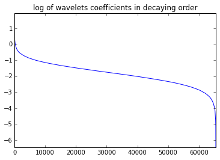
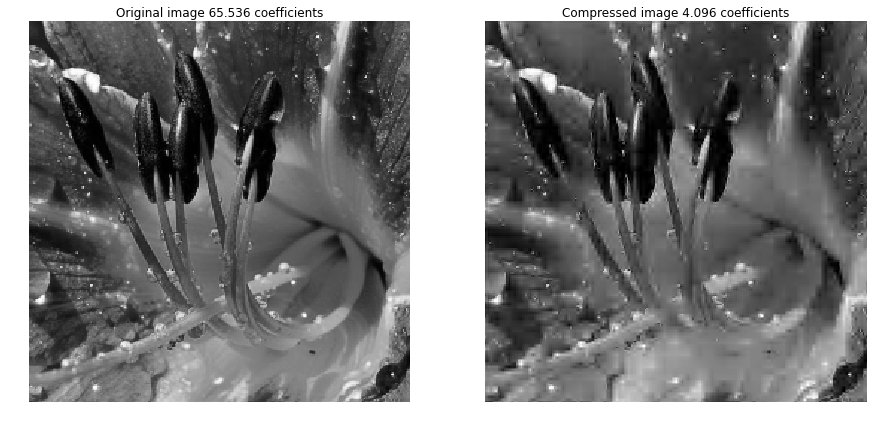
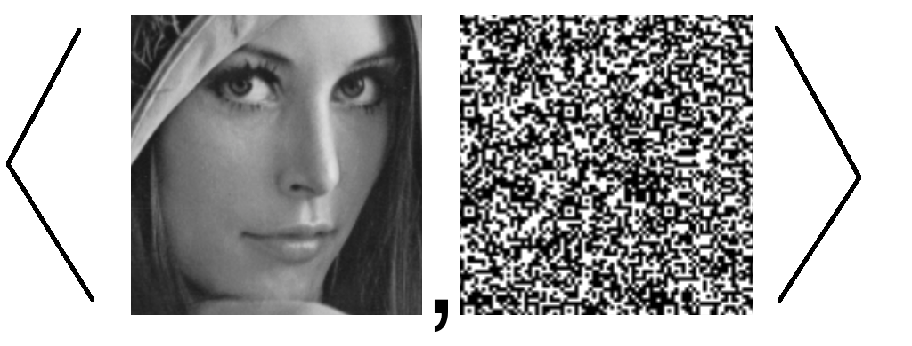
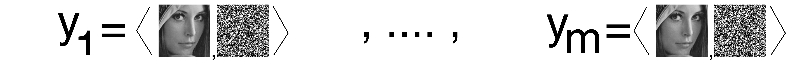
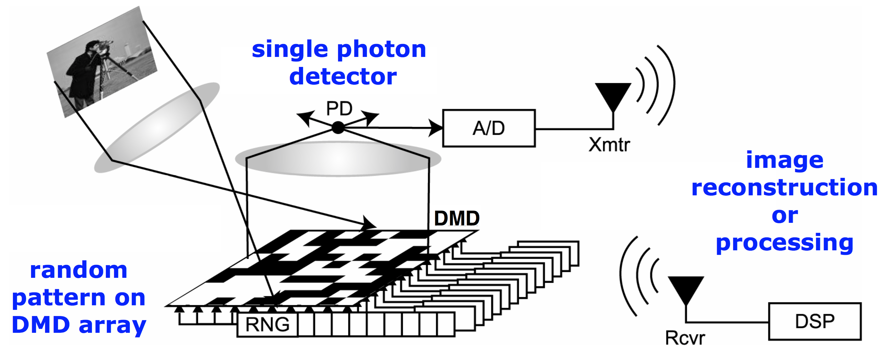
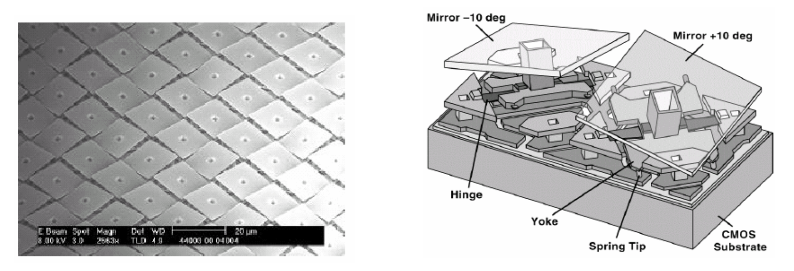
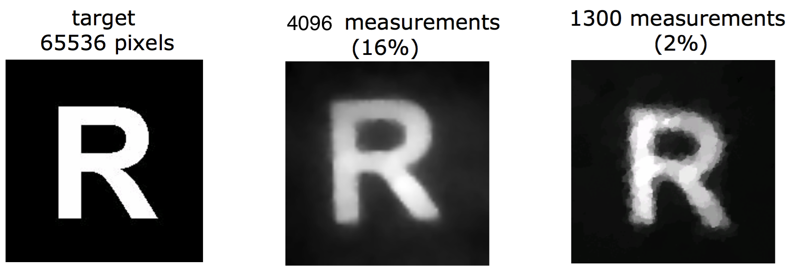
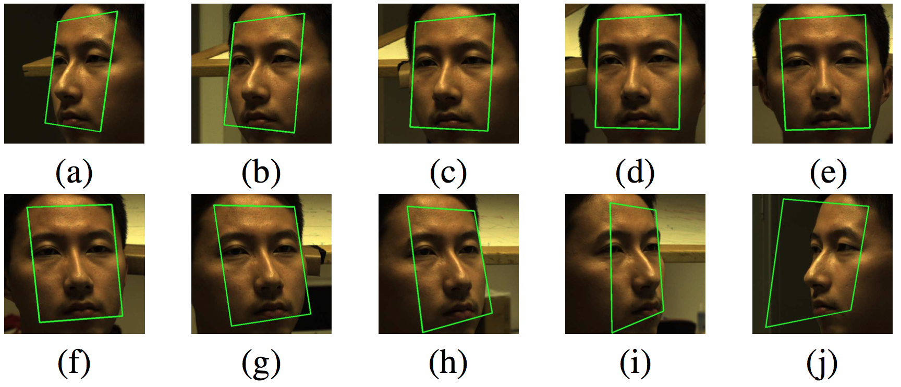

# Part 1 — Introduction to Compressed Sensing
## Why compressed sensing? 

::: {style="height: 80px;"}
:::

[**Classical approach:**]{.blue} acquisition and compression are two separate steps.

```{tikz}
%| label: classical-pipeline
%| echo: false
%| fig-align: center
%| out-width: 75%

\begin{tikzpicture}[scale=0.4]
  \draw (0,0) ellipse (2cm and 1cm);
  \draw (0,0) node {signal};
  \draw[->, thick] (3,0) -- (7,0);
  \draw (5,1) node {acquisition};
  \draw (14,0) ellipse (6cm and 1cm);
  \draw (14,0) node {RAW file};
  \draw[->, thick] (21,0) -- (26,0);
  \draw (23.5,1) node {compression};
  \draw (33,0) ellipse (6cm and 1cm);
  \draw (33,0) node {JPEG file};
\end{tikzpicture}
```

- RAW photograph: about 1 MB 
- JPEG (Discrete Cosine Transform + quantization): up to $25\times$ smaller.

. . .

::: {style="height: 90px;"}
:::

[**Compressed sensing (CS):**]{.blue} acquire and compress *in a single step*, with a few "intelligent" measurements.


```{tikz}
%| label: cs-pipeline
%| echo: false
%| fig-align: center
%| out-width: 45%

\begin{tikzpicture}[scale=0.4]
  \draw (0,0) ellipse (2cm and 1cm);
  \draw (0,0) node {signal};
  \draw[->, thick] (3,0) -- (13,0);
  \draw (8,1) node {compressed acquisition};
  \draw (17,0) ellipse (2.5cm and 1cm);
  \draw (17,0) node {data};
\end{tikzpicture}
```


## Sparsity of natural signals in a well-chosen basis {.smaller}

:::: {.columns}
::: {.column width="50%"}
An image $f\in\R^{n\times n}$ can be expanded in an orthonormal basis:
$$f=\sum_{j=1}^{n^2} \inr{f,\psi_j}\psi_j$$

If the basis $(\psi_j)$ is well-chosen then:

- Most coefficients are **negligible**; a handful carry the information: keeping the $s$ largest ones, $f^*_s=\sum_{j\in J_s}\inr{f,\psi_j}\psi_j$, is visually indistinguishable from $f$.
- a local perturbation in time produces a local perturbation in frequencies: the basis is localized in **time and frequency**.
:::

::: {.column width="50%"}
{width=80%}
:::
::::

:::{.box-red}
Orthonormal basis (such as the Trigonometric basis in $L^2([0,1])$) are used to represent functions/ signals. There are however many different ways to choose such a basis. We seek for basis that are:

1. robust to local perturbations 
2. signals can be represented in an 'economical way'; i.e. [sparse]{.red}

:::

## Sparsity in practice: hard thresholding

::: {style="text-align: center;"}
{width=68%}
:::

- Photographs are well approximated by objects of **small dimension**: sparsity holds *approximately*.

## The Haar basis in $L^2([0,1])$

:::{.box-yellow}
The Fourier basis of $L^2([0,1])$: $(1, \sqrt{2}\cos(2\pi k t), \sin(2\pi (k+1) t):k\geq1)$ is not robust to local perturbations.
:::

:::: {.columns}
::: {.column width="60%"}
- Mother wavelet $\Psi=\mathbb{1}_{[0,1/2)}-\mathbb{1}_{[1/2,1)}$, scaling function $\Phi\equiv 1$.
- Translations and dilations, for $j\in\N$ and $i=0,\ldots,2^j-1$:
$$\Psi_i^j(t)=\sqrt{2^j}\,\Psi\big(2^j(t-i/2^j)\big),$$
for all $t\in\{0, \cdots, n-1\}.$
:::

::: {.column width="40%"}
```{tikz}
%| label: haar
%| echo: false
%| fig-align: center
%| fig-cap: "Haar mother wavelet (red) and level $j=1$ (blue, green)."

\pgfplotsset{width=5cm}
\begin{tikzpicture}
\begin{axis}[scale only axis, ymin=-1.5, ymax=1.5, xmin=-0.5, xmax=1.5]
\addplot[color=red,thick] coordinates {(0, 1) (0.5,1)};
\addplot[color=red,thick] coordinates {(0.5,-1) (1, -1)};
\addplot[color=blue,thick] coordinates {(0, 1.41) (0.25,1.41)};
\addplot[color=blue,thick] coordinates {(0.25,-1.41) (0.5, -1.41)};
\addplot[color=green,thick] coordinates {(0.5, 1.41) (0.75,1.41)};
\addplot[color=green,thick] coordinates {(0.75,-1.41) (1, -1.41)};
\draw ({rel axis cs:0,0} |- {axis cs:0,0}) -- ({rel axis cs:1,0} |- {axis cs:0,0});
\end{axis}
\end{tikzpicture}
```
:::
::::


## The Haar basis  in $L^2(\{0,\cdots, n-1\}^2)$ {.smaller}

The tensor basis is used to represent images ($n\times n$): for all $t_1, t_2\in\{0, \cdots, n-1\}$,
$$
\Psi_{i_1}^{j_1}\otimes \Psi_{i_2}^{j_2}(t_1, t_2) = \Psi_{i_1}^{j_1}(t_1)\times \psi_{i_2}^{j_2}(t_2)
$$


```{tikz}
%| label: haar-2
%| echo: false
%| fig-align: center
%| fig-ext: svg
%| out-width: "100%"

\begin{tikzpicture}[
    scale=0.82,
    transform shape,
    box/.style={draw=black, line width=0.6pt},
    gridline/.style={draw=gray!40, line width=0.3pt}
]

% -------------------------------------------------------------
% Row 1: Scale j = 1 (4 functions on a 2x2 grid)
% -------------------------------------------------------------
\node[anchor=east, font=\bfseries] at (-0.5, 0.75) {Scale $j=1$:};

\foreach \idx / \bx / \by in {
    0 / 0 / 1,
    1 / 1 / 1,
    2 / 0 / 0,
    3 / 1 / 0
} {
    \begin{scope}[shift={(\idx * 2.2, 0)}]
        \fill[white] (0,0) rectangle (1.5, 1.5);
        \fill[black] (\bx * 0.75, \by * 0.75) rectangle ++(0.75, 0.75);
        \draw[gridline] (0.75, 0) -- (0.75, 1.5);
        \draw[gridline] (0, 0.75) -- (1.5, 0.75);
        \draw[box] (0,0) rectangle (1.5, 1.5);
    \end{scope}
}

% -------------------------------------------------------------
% Rows 2 & 3: Scale j = 2 (16 functions on a 4x4 grid)
% -------------------------------------------------------------
\node[anchor=east, font=\bfseries] at (-0.5, -1.85) {Scale $j=2$ (1--8):};

\foreach \i in {0,...,7} {
    \pgfmathtruncatemacro{\bx}{mod(\i, 4)}
    \pgfmathtruncatemacro{\by}{3 - int(\i / 4)}
    
    \begin{scope}[shift={(\i * 1.85, -2.6)}]
        \fill[white] (0,0) rectangle (1.5, 1.5);
        \fill[black] (\bx * 0.375, \by * 0.375) rectangle ++(0.375, 0.375);
        \foreach \g in {1, 2, 3} {
            \draw[gridline] (\g * 0.375, 0) -- (\g * 0.375, 1.5);
            \draw[gridline] (0, \g * 0.375) -- (1.5, \g * 0.375);
        }
        \draw[box] (0,0) rectangle (1.5, 1.5);
    \end{scope}
}

\node[anchor=east, font=\bfseries] at (-0.5, -4.45) {Scale $j=2$ (9--16):};

\foreach \i in {8,...,15} {
    \pgfmathtruncatemacro{\col}{\i - 8}
    \pgfmathtruncatemacro{\bx}{mod(\i, 4)}
    \pgfmathtruncatemacro{\by}{3 - int(\i / 4)}
    
    \begin{scope}[shift={(\col * 1.85, -5.2)}]
        \fill[white] (0,0) rectangle (1.5, 1.5);
        \fill[black] (\bx * 0.375, \by * 0.375) rectangle ++(0.375, 0.375);
        \foreach \g in {1, 2, 3} {
            \draw[gridline] (\g * 0.375, 0) -- (\g * 0.375, 1.5);
            \draw[gridline] (0, \g * 0.375) -- (1.5, \g * 0.375);
        }
        \draw[box] (0,0) rectangle (1.5, 1.5);
    \end{scope}
}

% -------------------------------------------------------------
% Legend
% -------------------------------------------------------------
\begin{scope}[shift={(10.5, 0.5)}]
    \fill[black] (0, 0) rectangle (0.4, 0.4);
    \draw[box] (0, 0) rectangle (0.4, 0.4);
    \node[anchor=west, font=\small] at (0.5, 0.2) {$= 1$};
    
    \fill[white] (2.0, 0) rectangle (2.4, 0.4);
    \draw[box] (2.0, 0) rectangle (2.4, 0.4);
    \node[anchor=west, font=\small] at (2.5, 0.2) {$= 0$};
\end{scope}

\end{tikzpicture}
```


## Check the sparsity of pictures in practice

::: {style="display: flex; justify-content: center; align-items: center; height: 550px;"}
::: {.box-green style="text-align: center; max-width: 850px; width: 100%;"}
Open the notebook `0_lab_wavelets_transform.ipynb`
:::
:::


## The compressed sensing problem {.smaller}

:::: {.columns}
::: {.column width="55%"}
- Linear measurements $y_i=\inr{x,X_i}$, $i=1,\ldots,m$, i.e.
$$y=Ax,\qquad A=\begin{pmatrix}X_1^\top\\ \vdots\\ X_m^\top\end{pmatrix}\in\R^{m\times N}$$
- **High-dimensional regime:** $m<N$ (often $m\ll N$).
- Highly underdetermined system: infinitely many solutions.
:::

::: {.column width="45%"}
```{tikz}
%| label: underdetermined
%| echo: false
%| fig-align: center
%| fig-cap: "Solving $y=Ax$ with far more unknowns than equations."

\begin{tikzpicture}[scale=0.4]
  \draw (0,0) rectangle (10,5); \draw (11,-5) rectangle (12,5);
  \draw (16,0) rectangle (17,5); \draw (14,2.5) node {=};\draw (5,2.5) node {$A$};
  \draw (11.5,0) node {$x$};\draw (16.5,2.5) node {$y$};
\end{tikzpicture}
```
:::
::::

::: {.callout-important title="Highly underdetermined system of linear equations"}
Given $A$ and $y$ find signal $x$ such that $Ax=y$. There are $m$ equations and $N$ unknown variables with $N>>m$.
:::

## Sparse vectors

::: {.callout-note icon=false title="Definition (sparsity)"}
${\rm supp}(x)=\{j: x_j\neq0\}$ and $\norm{x}_0=|{\rm supp}(x)|$. The vector $x$ is **$s$-sparse** when $\norm{x}_0\leq s$ and the set of all $s$-sparse vectors is
$$\Sigma_s=\{x\in\R^N:\norm{x}_0\leq s\}.$$
:::

- **Structured sparsity:** $x=F\theta$ with $\theta\in\Sigma_s$ for a dictionary $F$. Replace $A$ by $AF$.
- Good dictionaries (e.g. wavelets) come from approximation theory.

## The two CS problems {.smaller}

::: {style="height: 40px;"}
:::

::: {.callout-important title="CS problem 1 — measurement design"}
Construct, **in minimal number**, measurement vectors $X_1,\ldots,X_m$ such that **every** $x\in\Sigma_s$ can be reconstructed efficiently from $y=Ax$ and $A$.
:::

::: {style="height: 40px;"}
:::

::: {.callout-important title="CS problem 2 — reconstruction algorithm"}
Given $A$, construct an **efficiently implementable** map $\Delta:\R^m\to\R^N$ such that
$$\Delta(A, y=Ax)=x\qquad\text{for all }x\in\Sigma_s.$$
:::

. . .

- **Uniformity:** the same $A$ must work for *all* $s$-sparse signals.
- The "true" dimension of $x\in\Sigma_s$ is $s$: ideally $m\sim s$, plus a price for not knowing the support.
- Extension to noisy measurements $y=Ax+\xi$ and *approximatively sparse signals* (see the LASSO in linear regression).

<!-- ## Noisy measurements and robust procedures {.smaller}

- Observations $y=Ax+\xi$, with noise $\xi\in\R^m$ (often i.i.d. Gaussian).
- Exact reconstruction is no longer possible: we want an error **of the order of the noise**.

::: {.callout-note title="Definition (robustness of order $s$)"}
$\Delta:\R^m\to\R^N$ is **robust of order $s$** when, for every $x\in\Sigma_s$ and every $\xi\in\R^m$,
$$\norm{x-\Delta(Ax+\xi)}_2\leq c_0\norm{\xi}_2.$$
:::

- With $\xi=0$, robustness implies exact reconstruction on $\Sigma_s$.
- Feasibility is governed by the **signal-to-noise ratio** $\norm{x}_2/\norm{\xi}_2$.

## Approximately sparse signals and stable procedures {.smaller}

- Real signals are only *close* to $\Sigma_s$. Best $s$-term approximation error:
$$\sigma_s(x)_1=\min_{z\in\Sigma_s}\norm{x-z}_1=\norm{x-x_s^*}_1\quad(x_s^*:\ \text{keep the $s$ largest }|x_j|).$$

::: {.callout-note title="Definition (stable and robust of order $s$)"}
For every $x\in\R^N$ and every $\xi\in\R^m$,
$$\norm{x-\Delta(Ax+\xi)}_2\leq c_0\frac{\sigma_s(x)_1}{\sqrt s}+c_0\norm{\xi}_2.$$
Taking $\xi=0$ gives **stability**.
:::

. . .

::: {.callout-warning}
The mixed $\ell_2$/$\ell_1$ norms are unavoidable: an $\ell_2$ approximation error, even for $s=1$, forces $m\geq c_1N$.
::: -->

## Example: the single-pixel camera {.smaller}

:::: {.columns}
::: {.column width="45%"}
- Instead of one value per pixel, record a **weighted sum** of all pixel intensities:
$$y_i=\inr{x,X_i}.$$
- Classical camera: $X_i$ = indicator of one pixel, so $m=N$ (RAW files).
- CS camera: a few "global" measurements, each one a single real number.
:::

::: {.column width="55%"}
{width=100%}
:::
::::

. . .

{width=75% fig-align="center"}

. . .

::: {style="height: 50px;"}
:::

:::{.box-green style="text-align: center;"}
Is there a better way to choose the measurement vectors than all the indicators of all pixels?
:::

## Single-pixel camera: measurement protocol

:::: {.columns}
::: {.column width="50%"}
{width=100%}
:::

::: {.column width="50%"}
{width=100%}
:::
::::

- A digital micromirror device (DMD) builds $X_i$; a **single photon detector** collects $y_i$.
- Mirror orientations are drawn [**at random**]{.blue}: randomness is the key to good measurements.

## Single-pixel camera: reconstruction

{width=85% fig-align="center"}

- Photographs are approximately sparse in wavelet bases.
- A **stable and robust** algorithm therefore reconstructs the scene from few noisy measurements.

<!-- ## Partial Fourier measurements

- Discrete Fourier transform $\Gamma=\big(w^{(p-1)(q-1)}/\sqrt N\big)_{p,q}$, with $w=e^{-2\mathrm{i}\pi/N}$.
- Observe only frequencies $I\subset\{1,\ldots,N\}$: $\ y=\Gamma_I x$, $\ m=|I|$.
- Impossible in general unless $I=\{1,\ldots,N\}$, but feasible when $x$ is **$s$-sparse**.

. . .

::: {.callout-tip title="Preview"}
A **random** choice of $m\sim s$ frequencies (up to log factors) suffices to reconstruct every $x\in\Sigma_s$.
:::

## Incoherent measurements {.smaller}

::: {.callout-note title="Definition (coherence)"}
For a representation basis $\cB_f = (f_q)_{q=1}^N$ and a measurement basis $\cB_\Gamma = (\Gamma_q)_{q=1}^N$ (two orthonormal bases of $\R^N$),
$$\mu(\cB_f,\cB_\Gamma)=\max_{1\leq p,q\leq N}|\inr{\Gamma_p,f_q}|\in\Big[\tfrac{1}{\sqrt N},1\Big].$$
:::

- Lower bound from Parseval: $\sum_q|\inr{\Gamma_p,f_q}|^2=1$.
- **Low coherence** ($\sim 1/\sqrt N$): measurement vectors are *spread out* in the sparsity basis. Example: canonical basis and Fourier basis.
- **High coherence**: e.g. canonical measurements of canonically sparse signals, which need $m=N$. -->


<!-- ::: {.callout-tip title="Preview"}
- Measurement vectors and the basis where signals are sparse should be incoherent
- Random (e.g. Gaussian) vectors are incoherent with any fixed basis with high probability.
::: -->

## Other applications: face recognition, finance {.smaller}

:::: {.columns}
<!-- ::: {.column width="33%"}
**Radar**

- Scene $x=\sum_{k,l}x_{k,l}T_kM_l$: time shift (distance) and Doppler modulation (speed).
- Few targets: sparse in $\{T_kM_l\}$.
- Data $y=xg=A_gX$ with $A_g\in\C^{N\times N^2}$; Alltop pulse $g_l=e^{2\mathrm{i}\pi l^3/N}$.
::: -->

::: {.column width="50%"}
**Face recognition (SRC)**

- $y=\Phi x+\xi$, $\Phi=[\Phi_1|\cdots|\Phi_C]$ built from the database.
- $x$ is supported on one block: the support identifies the person.

{width=100%}
:::

::: {.column width="50%"}
**Finance**

- Portfolio values $y$, price matrix $A=(a_{i,j})$.
- Few assets in the portfolio: $x$ is sparse.
- Recover composition by solving $y=Ax$.

{width=100%}
:::
::::

:::{style="height: 30px;"}
:::

::: {.box-yellow style="text-align: center; font-size: 1.25em;"}
In many applications the measurements are **imposed** by the physics or the data, not designed.
:::


<!-- Part 2 source: manuscript_english/1_ell_0_bp/lecture_ell_0_cs.tex -->

# Part 2 — $\ell_0$ Minimization and Basis Pursuit

::: {style="height: 30px;"}
:::

:::{.box-green style="text-align: center;"}
**How do we retrieve a sparse signal $x$ from $(y, A)$? (when $y=Ax$)**
::: 


::: {style="height: 30px;"}
:::

:::{.smaller}
**Notation**

- $\ell_p^d$ norms $\norm{x}_p=\big(\sum_j|x_j|^p\big)^{1/p}$, unit ball $B_p^d$, unit sphere $S_p^{d-1}$.
- $\Sigma_s=\{x\in\R^N:\norm{x}_0\leq s\}$: the set of $s$-sparse vectors
-  $A\in\R^{m\times N}$: the measurement matrix
:::

## The $\ell_0$ minimization procedure

- The solution set of $At=y$ is the affine space $x+\kerA$ of dimension $\geq N-m$, $\kerA=\{t\in\R^N:At=0\}$.
- **Idea:** The target signal is sparse, hence, pick the **sparsest** element of this space.
- **Def.:** $\norm{t}_0= |\{j\in[N]: t_j\neq0\}|$ is the size of the support of $t\in\mathbb{R}^N$

::: {.callout-note icon=false title="Definition ($\ell_0$ minimization)"}
$$\hat x_0\in\argmin_{t\in\R^N:\,At=y}\norm{t}_0\tag{$P_0$}$$
:::

. . .

::: {style="font-size: 0.9em;"}
- Hope: $\kerA$ is "well positioned", so that $x+\kerA$ meets $\Sigma_s$ only at $x$.
- Geometrically: $\kerA$ should be **far from sparse vectors**, close to "diagonal" directions.
:::

## When is $x$ the unique $\ell_0$ solution? {.smaller}

::: {.callout-note title="Proposition"}
Let $x\in\R^N$ with $s=\norm{x}_0$. The following are equivalent:

1. $x$ is the unique solution of $(P_0)$, i.e. $\hat x_0=x$;
2. $\big(x+\kerA\big)\cap\Sigma_s=\{x\}$.
:::


**Proof idea.** Both statements say that every $t\neq x$ with $At=Ax$ has $\norm{t}_0>s$.

. . .

::: {style="height: 50px;"}
:::

::: {.callout-warning}
This Proposition concerns only a **single** vector $x$. CS asks for properties of $A$ that work **uniformly** over **all** $x\in\Sigma_s$.
:::

## $m\geq 2s$ necessary measurements {.smaller}

::: {.callout-note title="Proposition"}
The following are equivalent:

1. for all $x\neq z\in\Sigma_s$, $Ax\neq Az$ (necessary for exact reconstruction over $\Sigma_s$);
2. $\kerA\cap\Sigma_{2s}=\{0\}$;
3. every $m\times 2s$ submatrix of $A$ is injective (hence [$m\geq 2s$]{.red}).
:::

::: {style="height: 50px;"}
:::

:::: {.columns}
::: {.column width="55%"}
**Key steps.**

- $\Sigma_s-\Sigma_s=\Sigma_{2s}$, which gives 1 $\Leftrightarrow$ 2.
- A $2s$-sparse $x$ supported on $J$ gives $Ax=A_{\cdot J}x_J$, which gives 2 $\Leftrightarrow$ 3.
:::

::: {.column width="45%"}
```{tikz}
%| label: 2s-sparse
%| echo: false
%| fig-align: center
%| out-width: 85%

\begin{tikzpicture}[scale=0.4]
  \draw (0,0) rectangle (10,5);
  \draw[color=red] (5,-0.5) rectangle (9,5.5);
  \draw (11,-5) rectangle (12,5);
  \draw[color=red] (10.5,-4) rectangle (12.5,0);
  \draw (2,2.5) node {$A$};
  \draw (11.5,1) node {$x$};
  \draw (-2,2.5) node {$Ax = $};
  \draw[color=red] (17.8,-2) node {$= {\rm supp}(x)$ of size $\leq 2s$};
\end{tikzpicture}
```
:::
::::

## Uniform reconstruction of $\ell_0$ minimization over $\Sigma_s$ {.smaller}

::: {.callout-note title="Proposition"}
$\kerA\cap\Sigma_{2s}=\{0\}$ $\iff$ $\displaystyle\argmin_{At=Ax}\norm{t}_0=\{x\}$ for all $x\in\Sigma_s$.
:::

::: {style="height: 30px;"}
:::

**Key steps.**

- ($\Rightarrow$) If $At=Ax$ and $t\neq x$, then $x-t\in\kerA$ has $\norm{x-t}_0>2s$, so $\norm{t}_0>s\geq\norm{x}_0$.
- ($\Leftarrow$) Let $t\in\kerA\cap\Sigma_{2s}$ and write $t=x-z$ with $\norm{x}_0=\norm{z}_0\leq s$. Then $z$ is solution of $\displaystyle\min_{At=Ax}\norm{t}_0$ and so $z=x$.

::: {style="height: 50px;"}
:::

::: {.box-yellow style="text-align: center; font-size: 1.25em;"}
Exact reconstruction of all $s$-sparse vectors via $\ell_0$-minimization requires at least $2s$ measurements. Can we find $A\in\mathbb{R}^{m\times N}$ with [$m=2s$]{.blue} satisfying $\kerA\cap\Sigma_{2s}=\{0\}$?
:::

## $m = 2s$ measurements suffice {.smaller}

::: {style="display: flex; justify-content: center; align-items: center; height: 550px;"}
::: {.callout-note title="Proposition (Vandermonde matrices)"}
For every $N\geq 2s$ there is $A\in\R^{\red{2}\red{s}\times N}$ with $\kerA\cap\Sigma_{2s}=\{0\}$:
$$A=\begin{pmatrix}1&\cdots&1\\ t_1&\cdots&t_N\\ \vdots&&\vdots\\ t_1^{2s-1}&\cdots&t_N^{2s-1}\end{pmatrix},\quad 0<t_1<\cdots<t_N.$$
:::
:::


**Proof:** Every $2s\times2s$ minor is a Vandermonde determinant $\prod_{k<l}(t_{j_l}-t_{j_k})\neq0$.

## Conclusion {.smaller}

::: {style="height: 70px;"}
:::

::: {.box-blue}
- $m=2s$ is a **necessary and sufficient** number of measurements for the reconstruction of any $s$-sparse signal
- Any $(2s)\times N$ **Vandermonde matrix** can be used as a measurement matrix 
- **$\ell_0$ minimization** is a procedure that reconstruct any $s$-sparse signal given $2s$ (Vandermonde) measurements. 
:::

::: {style="height: 100px;"}
:::

::: {.callout-important title="Question" }
[Can we compute the solution of a $\ell_0$-minimization problem?]{.blue}
:::

## Procedures vs. algorithms {style="font-size: 0.91em;"}

- **Procedure:** a statistic, i.e. a measurable function of the data. No computational content.
- **Algorithm:** a concrete routine implementing a procedure.

. . .

::: {.box-yellow}
**Brute-force algorithm for $(P_0)$:**

**For** $s = 1, 2, \ldots, N$ **do**  
&emsp; **For** each $J \subset [N]$ with $|J| = s$ **do**  
&emsp;&emsp; Try to solve $A_{\cdot J} x_J = y$  
&emsp;&emsp; **If** solvable, **stop** at the first solution and return it.
:::

. . .

- Number of systems to solve: $\sum_{j\leq s}\binom{N}{j}\sim (N/s)^s$, which is **exponential** in $s$.
- **Example** $N=1000$, $s=10$: $\binom{N}{s}\geq10^{20}$ linear systems to solve. At $10^{-10}$ second each, that is about **300 years**.

. . .

::: {.box-blue }
Is there a faster algorithm to solve our $\ell_0$-minimization problems?
:::

## Complexity classes: P, NP, NP-complete, NP-hard

:::: {.columns}
::: {.column width="55%"}
- $P$: solvable in **polynomial time** (e.g. matrix product, $\cO(n^3)$).
- $NP$: a candidate solution can be **certified** in polynomial time (e.g. $k$-clique).
- $NP$-hard: at least as hard as any $NP$ problem.
- $NP$-complete: $NP\,\cap\,NP$-hard.
- **Examples:** traveling salesman, max clique, knapsack, graph coloring.
:::

::: {.column width="45%"}
```{tikz}
%| label: np-classes
%| echo: false
%| fig-align: center
%| fig-cap: "Classes of problems in decision theory."

\begin{tikzpicture}[scale=0.2]
  \draw (-20,-10) rectangle (10,10);
  \draw (25,12) rectangle (-5, -12);
  \draw[rounded corners] (-18,-8) rectangle (-7,0);
  \draw (-12,4) node {$NP$};
  \draw (-12,-4) node {$P$};
  \draw (2,0) node {$NP$-complete};
  \draw (17,0) node {$NP$-hard};
\end{tikzpicture}
```
:::
::::

::: {style="height: 50px;"}
:::

::: {.box-blue style="text-align: center; font-size: 1.25em;"}
One of the 5 out of 7 remaining Clay institute's million dollar prize: $NP\neq P$?
:::

## Advances from OpenAI 6/10 released {style="font-size: 0.85em;"}

Here are some major algorithmic and complexity advances from the $722$ manuscripts released:

::: {style="height: 40px;"}
:::

### 1. Matrix Multiplication (The 2.25 Bound)

The most heavily discussed algorithmic result is a massive asymptotic reduction in matrix multiplication time. The AI established a new upper bound exponent of $\omega \leq 2.25$ over complex numbers.

*   **Context:** Schoolbook matrix multiplication requires $O(n^3)$ operations. Successive human improvements over decades had slowly chipped the exponent down to roughly $2.37$. Dropping it to $2.25$ in a single leap is an unprecedented reduction.
*   **Caveat:** This is an asymptotic theoretical bound. Because the threshold constants in the construction are extremely large, it is not yet practically faster for real-world GPU compute.

::: {style="height: 40px;"}
:::

### 2. Integer Multiplication

The AI produced a manuscript demonstrating an integer multiplication algorithm that operates below $O(n \log n)$ time. This breaks a strict barrier that very few researchers predicted could be surpassed even slightly.

<!-- ### 3. Fine-Grained Complexity (3SUM and APSP)

The model successfully refuted long-standing hypotheses by discovering faster deterministic algorithms for fundamental problems:

*   **3SUM Problem:** Improved to $O(n^{1.9992})$, breaking the textbook quadratic bound.
*   **All-Pairs Shortest Path (APSP):** Improved to $O(n^{2.9995})$, breaking the cubic bound.
*   **Impact:** Because many other problems are classified as "3SUM-hard" or "APSP-hard" via reduction chains, breaking these foundational bottlenecks means the entire reduction chain of fine-grained complexity requires re-evaluation.


### 4. Log-Space Derandomization ($L = RL = BPL$)

The release includes a proof completing log-space derandomization, a target theoretical computer scientists have chased since 1999. It proves that bounded-error logarithmic-space computation has a deterministic simulation with explicit polynomial time.

### What about $P$ vs $NP$?

The model did not prove $P = NP$ or $P \neq NP$. Proving $P \neq NP$ requires general Boolean circuit lower bounds, which the AI did not produce. 

However, the release made significant progress on adjacent problems:

*   **Unique Games Conjecture:** The AI produced major results revealing new fundamental limits to NP-hard problems and approximation algorithms.
*   **Arithmetic Circuit Lower Bounds:** The model established lower bounds like $\Omega(n^4/\log n)$ for the permanent, though these apply to arithmetic rather than Boolean circuits. -->


## $\ell_0$ minimization is NP-hard

::: {.box-blue}
- **Idea:** we believe that $\ell_0$-minimization is a difficult optimization problem (i.e. NP-hard) because it searches the support $S\subset\{1, \cdots,N\}$ of the signal -- it is 'combinatorial in nature'.
- **Strategy:** reduce, in polynomial time, an $NP$-complete problem to the $(P_0)$ problem.
:::

::: {style="height: 40px;"}
:::

::: {.callout-note title="Theorem" style="text-align: center; font-size: 0.85em;"}
The $\ell_0$ minimization procedure $(P_0)$ is $NP$-hard in general.
:::

::: {style="height: 20px;"}
:::

**Our baseline $NP$-complete problem : Partition by 3-element sets**: given subsets $\cC_1,\ldots,\cC_N$ of $\{1,\ldots,m\}$ with $|\cC_j|=3$, is there a sub-collection forming a **partition** of $\{1,\ldots,m\}$? (Ex. with $m=6$ and $N=5$)


## Proof: reduction from partitioning by 3-element sets {.smaller}
Given a 'partitioning by 3-element sets' problem, we necessarily have $3N\geq m$ and $m$ is a multiple of $3$ (otherwise there is no partition).

. . .

1. **Encode.** Columns $a_j=\mathbb{1}_{\cC_j}\in\R^m$, $A=[a_1|\cdots|a_N]$, $y=(1,\ldots,1)^\top$. This takes polynomial time, since $N\leq\binom m3$.

. . .

2. **Lower bound.** Each $a_j$ has 3 nonzeros, so $Ax=y$ implies $\norm{x}_0\geq m/3$.

. . .

3. **If $\norm{\hat x_0}_0=m/3$:** the $m/3$ sets $\{\cC_j: j\in{\rm supp}(\hat x_0)\}$ cover all $m$ coordinates, hence are disjoint, hence form a partition.

. . .

4. **If $\norm{\hat x_0}_0>m/3$:** no partition exists, since the indicator vector $z$ of such a partition would satisfy $Az=y$ with $\norm{z}_0=m/3$.

. . .

As a consequence, if we could solve any $\ell_0$-minimization problem then we could solve the 'Partition by 3-element sets' problem. However, this problem is NP-complete, in particular, it is NP-hard and so we could solve any NP problem. Hence, the $\ell_0$-minimization problem is NP-hard.

. . .

::: {style="height: 20px;"}
:::

::: {.box-red style="text-align: center; font-size: 1.25em;"}
**Conclusion:** $\ell_0$ minimization is optimal in theory ($m=2s$) but **unusable in practice**.
:::

. . .

::: {style="height: 20px;"}
:::

::: {.box-green}
"*In general*" matters: for the first $2s$ Fourier coefficients, Prony's algorithm solves $(P_0)$ in linear time, but it is neither robust nor stable (a 1795 algorithm used in DVD players). We will see other example of measurement matrices for which an efficient algorithm can be used to solve $(P_0)$.
:::

## Convex relaxation: the convex envelope

- The objective $\norm{\cdot}_0$ is **not convex**, which is the root of the difficulty.
- **Idea:** replace the $\norm{\cdot}_0$ function by the 'closest' convex function below it.

::: {style="height: 40px;"}
:::

::: {.callout-note icon=false title="Definition (convex envelope)" style="font-size: 0.90em;"}
Let $f:C\to\R$ on a convex set $C\subset\R^N$. The **convex envelope of $f$ over $C$** is the **largest convex function** $g$ with $g\leq f$ on $C$. It is denoted by ${\rm conv}(f)$.
:::

::: {style="height: 40px;"}
:::

- Well defined: a supremum of convex functions is convex.
- On all of $\R^N$, the envelope of $\ell_0$ is $0$, which is uninformative. So we restrict $C$ to a ball.

## Convex envelope

::: {style="max-width: 600px; margin: 0 auto;"}
```{tikz}
%| label: conv_envelope
%| echo: false
%| fig-align: "center"

\begin{tikzpicture}[
    scale=0.8,
    >=stealth,
    every node/.style={font=\small}
]
  % Coordinate Axes
  \draw[->, thick, gray!70] (-3.5, 0) -- (3.8, 0) node[right, black] {$x$};
  \draw[->, thick, gray!70] (0, -0.4) -- (0, 5.0) node[above, black] {$y$};

  % Shaded region highlighting the non-convex gap
  \fill[red!12] 
    plot[domain=-2:2, samples=60] (\x, { ((\x*\x - 4)*(\x*\x - 4))/12 + 0.25*\x + 1.5 })
    -- (2, 2.0) -- (-2, 1.0) -- cycle;

  % Supporting affine line (light dashed extension)
  \draw[dashed, red!50!black, line width=0.7pt] 
    (-2.8, {0.25*(-2.8) + 1.5}) -- (2.8, {0.25*(2.8) + 1.5});

  % Non-convex function f(x)
  \draw[very thick, blue!80!black, domain=-3.1:3.05, samples=90]
    plot (\x, { ((\x*\x - 4)*(\x*\x - 4))/12 + 0.25*\x + 1.5 })
    node[right] {$f(x)$};

  % Convex envelope segment bridging the dip (thick red line)
  \draw[ultra thick, red!85!black] 
    (-2, 1.0) -- (2, 2.0);

  % Drop lines to the x-axis
  \draw[dotted, thick, gray] (-2, 1.0) -- (-2, 0) node[below, black] {$x_1$};
  \draw[dotted, thick, gray] (2, 2.0)  -- (2, 0)  node[below, black] {$x_2$};

  % Contact points of the supporting hyperplane
  \fill[red!85!black] (-2, 1.0) circle (2pt);
  \fill[red!85!black] (2, 2.0)  circle (2pt);

  % Labels and annotations
  \node[anchor=north west, text=red!85!black] at (-0.6, 1.3) 
    {$\mathrm{conv}(f)(x)$};

  \node[anchor=south, text=gray!80!black] at (0.1, 1.9) 
    {\footnotesize gap};
\end{tikzpicture}
```
:::

:::{.box-green}
**Exercise:** What is the convex envelope over $[-1, 1]$ of the $\ell_0$ function over $\mathbb{R}$? 

What is the convex envelope over $[-1, 1]^N$ of the $\ell_0$ function (over $\mathbb{R}^N$)?
:::

## $\ell_1$ is the convex envelope of $\ell_0$

::: {.callout-important title="Theorem"}
The $\ell_1$ norm is the convex envelope of the $\ell_0$ function on $B_\infty^N$.
:::

::: {style="font-size: 0.9em;"}

**Proof sketch on $B_1^N$.** Let $F={\rm conv}(\ell_0)$.

. . .

1. $\norm{x}_1\leq\norm{x}_0$ on $B_1^N$ and $\ell_1$ is convex, so $\norm{\cdot}_1\leq F$.

. . .

2. Squeeze: $F(\pm e_i)=1$ and $F(0)=0$.

. . .

3. Write $x=\sum_j|x_j|\,{\rm sign}(x_j)e_j+(1-\norm{x}_1)\,0$ and use convexity:
$$F(x)\leq\sum_j|x_j|F({\rm sign}(x_j)e_j)+(1-\norm{x}_1)F(0)=\norm{x}_1.$$
:::

## Convex envelope of the $\ell_0$ function

```{tikz}
%| echo: false
%| fig-align: "center"
%| 
\begin{tikzpicture}[
    xscale=3.2,
    yscale=3.2,
    >=stealth,
    every node/.style={font=\small}
]
  % Shaded relaxation gap (epigraph convexification)
  \fill[red!10] (-1, 1) -- (0, 0) -- (1, 1) -- cycle;

  % Axes
  \draw[->, thick, gray!70] (-1.35, 0) -- (1.45, 0) node[right, black] {$x$};
  \draw[->, thick, gray!70] (0, -0.15) -- (0, 1.35) node[above, black] {$y$};

  % Domain boundaries and reference grid at x = -1, 1 and y = 1
  \draw[dashed, gray!50, line width=0.6pt] (-1, 0) -- (-1, 1);
  \draw[dashed, gray!50, line width=0.6pt] (1, 0)  -- (1, 1);
  \draw[dashed, gray!50, line width=0.6pt] (-1, 1) -- (1, 1);

  % Axis labels
  \node[below, black] at (-1, 0) {$-1$};
  \node[below, black] at (1, 0) {$1$};
  \node[below left, black] at (0, 0) {$0$};
  \node[left, black] at (0, 1) {$1$};

  % Convex envelope: |x| (The V-shape)
  \draw[ultra thick, red!85!black] (-1, 1) -- (0, 0) -- (1, 1);

  % Function f(x) = ||x||_0: horizontal segments at y = 1
  \draw[very thick, blue!85!black] (-1, 1) -- (-0.02, 1);
  \draw[very thick, blue!85!black] (0.02, 1)  -- (1, 1);

  % Discontinuity points for f(x)
  % Open circle at (0, 1)
  \draw[thick, blue!85!black, fill=white] (0, 1) circle (2.2pt);
  
  % Closed points at boundary (-1, 1) and (1, 1)
  \fill[blue!85!black] (-1, 1) circle (2.2pt);
  \fill[blue!85!black] (1, 1) circle (2.2pt);

  % Origin point (0, 0) shared by both f and its envelope
  \fill[red!85!black] (0, 0) circle (2.2pt);

  % Annotations
  \node[anchor=south, blue!85!black] at (0.55, 1.05) 
    {$f(x) = \|x\|_0 = \mathbf{1}_{\{x \neq 0\}}$};

  \node[anchor=north west, red!85!black] at (0.35, 0.45) 
    {$\mathrm{conv}_{[-1, 1]}(f)(x) = |x| = \|x\|_1$};

  \node[text=gray!70!black] at (0, 0.62) 
    {\footnotesize relaxation gap};
\end{tikzpicture}
```

:::{.box-red}
**Convex relaxation=** Replace the (non-convex) objective $\ell_0$ function in $(P_0)$ by its convex envelope to get a **convex** optimization problem.
:::

## The Basis Pursuit procedure {.smaller}

::: {.callout-note icon=false style="font-size: 1.15em;" title="Definition (Basis Pursuit)"}
$$\hat x\in\argmin_{t\in\R^N:\,At=y}\norm{t}_1\tag{BP}$$
:::

- (BP) is the **convex relaxation** of $(P_0)$.
- $\ell_1$ methods are everywhere: geophysics, radio astronomy, spectroscopy, medical imaging, LASSO, Dantzig selector, Matching Pursuit.

::: {style="height: 50px;"}
:::

::: {.callout-important title="Take-away"}
Convex relaxation turns combinatorial searches into problems solvable with convex optimization. It is a reflex worth having.
:::

## Basis Pursuit as a linear program {.smaller}

:::: {.columns style="display: flex; align-items: center;"}
::: {.column width="50%"}
$$\min_{(z^{(+)},z^{(-)})\in\R^{2N}}\ \sum_{j=1}^N z_j^{(+)}+z_j^{(-)}$$
$$\text{s.t. } [A\,|\,-A]\begin{bmatrix}z^{(+)}\\ z^{(-)}\end{bmatrix}=y,\quad \begin{bmatrix}z^{(+)}\\ z^{(-)}\end{bmatrix}\geq0\tag{LP}$$
:::

::: {.column width="50%" style="margin-top: 0;"}
- Linear objective, 
- linear constraints.
- LP problem in $\bR^{2N}$
:::
::::

::: {style="height: 20px;"}
:::

::: {.callout-note title="Proposition: (BP) and (LP) are equivalent"}
 $\hat x\in\bR^N\mapsto(\hat x^+,\hat x^-)\in\bR^{2N}$ and $(\widehat{z^+},\widehat{z^-})\in\bR^{2N}\mapsto\widehat{z^+}-\widehat{z^-}\in\bR^N$ map solutions to solutions.

Where for all $x\in\bR^N$, $x^+=(x_j^+)_{j=1}^N$ and $x^-=(x_j^-)_{j=1}^N$  with $x^\pm_j=\max(0,\pm x_j)$.
:::

. . .

**Key inequalities:** 

- for all $t\in\bR$, $t=t^+-t^-$ and $|t| = t^+ + t^-$.
- $\norm{z^{(+)}-z^{(-)}}_{1}\leq\sum_j z_j^{(+)}+z_j^{(-)}$, with equality for $(x^+,x^-)$.


:::{.box-blue style="font-size: 1.3em;"}
 From a $NP$-hard problem to a **linear program**: the algorithmic complexity gain is big! 

$\Rightarrow$ What are the prices to pay?
:::


## Exact reconstruction property $RE(s)$

::: {.callout-note icon=false title="Definition ($RE(s)$)" style="font-size: 0.8em;"}
A measurement matrix $A\in\R^{m\times N}$ satisfies **the exact reconstruction property of order $s$** when, for every $x\in\Sigma_s$,
$$\argmin_{t\in\R^N}\big(\norm{t}_1:At=Ax\big)=\{x\}.$$
:::

::: {style="height: 50px;"}
:::

- $RE(s)$ characterizes the matrices for which Basis Pursuit solves the CS problem on $\Sigma_s$.
- **First question:** how many measurements does $RE(s)$ **require**?
- **Second question:** how can we construct $A$ satisfying $RE(s)$ with the minimal number $m$ of rows?

## Lower bound on the number of measurements for exact reconstruction over $\Sigma_s$ of Basis Pursuit {.smaller}

::: {.callout-note title="Proposition"}
If $A\in\R^{m\times N}$ satisfies $RE(2s)$, then necessarily the number of measurements must satisfy
$$
m\geq\frac{1}{\log5}\Big\lfloor\frac s2\Big\rfloor\log\Big(\Big\lfloor\frac{N}{8es}\Big\rfloor\Big)\ \gtrsim\ s\log\Big(\frac{eN}{s}\Big).
$$
:::

. . .

**Proof sketch.**

1. Quotient map $Q:\ell_1^N\to\ell_1^N/\kerA$, with $\norm{Qx}_1=\min_{h\in\kerA}\norm{x+h}_1$ and $\dim\leq m$.

. . .

2. $RE(2s)$ makes $Q$ an **isometry** on $\Sigma_s$: $\norm{Qx-Qy}_1=\norm{x-y}_1$.

. . .

3. Varshamov–Gilbert gives many well-separated points $x(S)=s^{-1}\sum_{i\in S}e_i$ in the unit ball.

. . .

4. Volumetric argument: at most $5^m$ such points in an $m$-dimensional ball. Compare.

## Proof tools: Varshamov–Gilbert and volumetric arguments {.smaller}

::: {style="height: 40px;"}
:::

::: {.callout-note title="Lemma (Varshamov–Gilbert)"}
For $s\leq N/2$ there is a family $\cS$ of $s$-subsets of $[N]$ with $|S_1\cap S_2|\leq\lfloor s/2\rfloor$ for $S_1\neq S_2$, and
$$\log|\cS|\geq\Big\lfloor\frac s2\Big\rfloor\log\Big(\Big\lfloor\frac{N}{8es}\Big\rfloor\Big).$$
:::

::: {style="height: 40px;"}
:::

::: {.callout-note title="Lemma (volumetric argument)"}
If $B$ is the unit ball of a norm on $\R^n$ and $\Lambda\subset B$ is $\eps$-separated (w.r.t. $B$), then $|\Lambda|\leq(1+2/\eps)^n$.
:::

## A first identified price for convex relaxation

::: {style="height: 50px;"}
:::

::: {.callout-important title="Conclusion"}
Basis Pursuit needs [$m\gtrsim s\log(eN/s)$ measurements]{.red}, versus [$2s$ measurements]{.red} for $\ell_0$. The huge computational gain costs **only a logarithmic factor** on the number necessary measurements.
:::

::: {style="height: 70px;"}
:::

:::{.box-blue}
- Can we construct matrices satisfying $RE(2s)$ with $m\sim s\log(eN/s)$?
- Are they much more difficult to construct than, for instance, Vandermonde matrices?
:::

<!-- Part 3 source: manuscript_english/2_nsp_rip/lecture_nsp_rip_cs.tex -->

# Part 3 — The Restricted Isometry Property (RIP)

::: {style="height: 100px;"}
:::

:::{.box-yellow}
**Our aim:**

- find properties sufficient for $RE(s)$ and that can be proved.
- construct matrices satisfying these properties with the minimal number of measurements $m\sim s \log(eN/s)$.
:::

## From $RE(s)$ to conditions that can be checked
- Part 1 introduced 'Basis Pursuit': $\hat x\in\argmin_{At=y}\norm{t}_1$ is a linear program (huge algorithmic gain compare with a NP-hard algorithm)
- Part 2 showed that $RE(s)$ forces $m\gtrsim s\log(eN/s)$.

. . .


**Goal of Part 3:** conditions on $A$ that imply $RE(s)$, and matrices that satisfy them with the optimal number of measurements $m\sim s\log(eN/s).$

. . .


::: {.callout-tip title="Roadmap" style="font-size: 0.8em;"}
$$RIP(65s)\ \Longrightarrow\ Gelfand(s)\ \Longrightarrow\ NSP(s)\ \Longleftrightarrow\ RE(s)$$

[Gaussian matrices]{.red} satisfy RIP($s$) with high probability when $m\sim s \log(eN/s)$.
:::

:::{.box-red style="text-align: center;"}
Randomness comes into the game!
:::

## The Null Space Property $NSP(s)$ {.smaller}

::: {.callout-tip title="Idea" style="font-size: 0.9em;"}
- For $\ell_0$: we needed $\kerA\cap\Sigma_{2s}=\{0\}$. 
- For $\ell_1$: $\kerA$ must be **far** from sparse vectors.
:::


::: {.callout-note icon=false title="Definition ($NSP(s)$)"}
We say that $A\in\mathbb{R}^{m\times N}$ satisfies the **Null Space Property of order $s$** when, for every $|J|=s$ and every $v\in\kerA\setminus\{0\}$, $$\norm{v_J}_1<\norm{v_{J^c}}_1.$$

**Notation:** $v_J$ coincides with $v$ on $J$ and is zero outside $J$.
:::


- Equivalently, $v_1^*+\cdots+v_s^*<\norm{v}_1/2$: no $s$ coordinates carry half of the $\ell_1$ mass. Kernel vectors are **well spread**.


::: {style="height: 10px;"}
:::

::: {.box-green}
 $NSP(s)\Rightarrow\kerA\cap\Sigma_{2s}=\{0\}$, and even "almost sparse" vectors are excluded from $\kerA$.
:::

## $NSP(s)$ is equivalent to exact reconstruction

::: {.callout-note title="Theorem" icon=false}
:::{style="text-align: center;"}
$A$ satisfies $RE(s)$ $\iff$ $A$ satisfies $NSP(s)$.
:::
:::

. . .

**$RE\Rightarrow NSP$.** For $v\in\kerA\setminus\{0\}$ and $|J|=s$, take $x=-v_J\in\Sigma_s$. Then
$$\norm{v_J}_1=\norm{x}_1<\norm{x+v}_1=\norm{v_{J^c}}_1.$$

. . .

**$NSP\Rightarrow RE$.** For $x\in\Sigma_s$ with ${\rm supp}(x)\subset J$ and $v\in\kerA\setminus\{0\}$:
$$\norm{x+v}_1=\norm{v_{J^c}}_1+\norm{x+v_J}_1\geq\norm{x}_1+\norm{v_{J^c}}_1-\norm{v_J}_1>\norm{x}_1.$$

. . .

::: {style="height: 30px;"}
:::

::: {.box-yellow style="text-align: center; font-size: 0.85em;"}
$NSP$ is necessary and sufficient, but we do not know how to check it directly on a given matrix. We need an easier way to characterize this property.
:::

## Geometric picture of $NSP$

:::: {.columns}
::: {.column width="55%"}
- $\frac{1}{\sqrt N}B_2^N\subset B_1^N\subset B_2^N$, so ${\rm diam}(B_1^N,\ell_2^N)=1$.
- The diameter is attained on the **canonical axes**, the sparsest vectors.
- $\kerA$ should avoid them and follow **diagonal directions**, where $\norm{v}_2\ll\norm{v}_1$.
- So $B_1^N\cap\kerA$ should have a **small Euclidean diameter**.
:::

::: {.column width="45%"}
```{tikz}
%| label: ell1-ball
%| echo: false
%| fig-align: center
%| out-width: 85%

\begin{tikzpicture}[scale=0.4]
\draw (0,10) .. controls (2,2) and (2,2) .. (10,0);
\draw (10,0) .. controls (2,-2) and (2,-2) .. (0,-10);
\draw (0,-10) .. controls (-2,-2) and (-2,-2) .. (-10,0);
\draw (-10,0) .. controls (-2,2) and (-2,2) .. (0,10);
\draw (-12,-8) -- (12,8);
\draw (14,8) node {$\kerA$};
\draw (1.9,7) node {$B_1^N$};
\draw (7,9) node {$B_2^N$};
\filldraw [fill=black!20] (0,0) circle (110pt);
\draw (4,-4) node {$\tfrac{1}{\sqrt{N}}B_2^N$};
\draw (0,0) circle (285pt);
\draw (-12,-8) -- (12,8);
\draw (14,8) node {$\kerA$};
\filldraw[black] (0,0) circle (3pt);
\end{tikzpicture}
```
:::
::::

:::{style="height: 30px;"}
:::

:::{.box-yellow style="text-align: center;"}
If ${\rm diam}(B_1^N\cap{\rm Ker}(A),\ell_2^N)$ is small enough, then $NSP(s)$ should be true.
:::

::: {style="height: 20px;"}
:::

:::{style="font-size: 0.75em;"}
**Remark:** $B_1^N$ is the unit ball of the $\ell_1^N$ norm in $\bR^N$, it is therefore a convex set. However, the representation of $B_1^N$ above highlights the fact that $B_1^N$ is mostly the $\frac{1}{\sqrt N}B_2^N$ ball with picks at $\pm e_j$.
:::

## The Gelfand property {.smaller}

::: {.callout-note icon=false title="Definition ($Gelfand(s)$)"}
$A$ satisfies the **Gelfand property of order $s$** when
$${\rm diam}\big(B_1^N\cap\kerA,\ \ell_2^N\big)<\frac{1}{2\sqrt s}.$$
:::

- $\dim\kerA\geq N-m$ is huge, yet its section of $B_1^N$ must have diameter $\ll1$.
- Connected to Euclidean sections of $B_1^N$ in the asymptotic theory of Banach spaces.

::: {style="height: 40px;"}
:::

:::{.callout-important title="Key Idea in CS"}
The Gelfand property is a **very restrictive** condition: we don't know (so far) how to construct in a [deterministic]{.red} way matrices having this property for the optimal number $m\sim s \log(eN/s)$. However, we will show that [random matrices]{.red} nevertheless satisfy it.
:::

## $Gelfand(s) \Rightarrow NSP(s)$ 

::: {.callout-note title="Theorem" icon=false}
:::{style="text-align: center;"}
If $A$ satisfies $Gelfand(s)$, then $A$ satisfies $NSP(s)$.
:::
:::

. . .

:::{style="font-size: 0.85em;"}
**Proof.**

1. For $v\in\kerA\setminus\{0\}$, $v/\norm{v}_1\in B_1^N\cap\kerA$, hence $\norm{v}_2<\norm{v}_1/(2\sqrt s)$.

2. For $|J|=s$, Cauchy–Schwarz on $s$ coordinates gives
$$\norm{v_J}_1\leq\sqrt s\norm{v_J}_2\leq\sqrt s\norm{v}_2<\frac{\norm{v}_1}{2}.$$
:::

. . .

::: {.box-yellow}
Gelfand is still a property of the **kernel**. It is easier to study the action of $A$ on sparse vectors directly. We therefore introduce now our last property: the RIP.
:::

## The Restricted Isometry Property $RIP(s)$ 

::: {.callout-note icon=false title="Definition ($RIP(s)$)"}
$A\in\R^{m\times N}$ satisfies the **Restricted Isometry Property of order $s$** when, for every $x\in\Sigma_s$,
$$\frac12\norm{x}_2\leq\frac{\norm{Ax}_2}{\sqrt m}\leq\frac32\norm{x}_2.$$
:::


:::{style="text-align: center; font-size: 0.8em;"}
- $A$ cannot be an isometry on $\R^N$ (huge kernel), only **restricted** to $\Sigma_s$.
- $A$ is almost an isometry on $\Sigma_s$, so $\kerA$ stays away from sparse vectors.
- **Normalization matters:** $RE$, $NSP$ and $Gelfand$ only depend on $\kerA$, but RIP depends on $A$ itself. With $\Gamma=A/\sqrt m$: $\frac12\norm{x}_2\leq\norm{\Gamma x}_2\leq\frac32\norm{x}_2$.
:::

## $RIP(s) \Rightarrow Gelfand(s/65)$ {.smaller}

::: {.callout-note title="Theorem"}
If $A$ satisfies $RIP(s)$, then $A$ satisfies $Gelfand(s/65)$. (Constant $65$ is not optimal; $s/2$ is possible.)
:::

::: {style="height: 50px;"}
:::

:::: {.columns}
::: {.column width="55%"}
**Proof sketch.** Let $v\in\kerA\setminus\{0\}$. Split its indices into blocks $I_1,I_2,\ldots$ of size $s$, sorted by decreasing $|v_j|$.

. . .

1. Block comparison: $\norm{v_{I_j}}_2\leq\sqrt s\norm{v_{I_j}}_\infty\leq\norm{v_{I_{j-1}}}_1/\sqrt s$.

2. First block, with $Av=0$ and RIP:
$$\norm{v_{I_1}}_2\leq\tfrac{2}{\sqrt m}\Big\|A\sum_{j\geq2}v_{I_j}\Big\|_2\leq3\sum_{j\geq2}\norm{v_{I_j}}_2\leq\tfrac{3}{\sqrt s}\norm{v}_1.$$

3. The tail gives $\norm{\sum_{j\geq2}v_{I_j}}_2\leq\norm{v}_1/\sqrt s$, so
$$\norm{v}_2\leq\tfrac{4}{\sqrt s}\norm{v}_1<\tfrac{1}{2\sqrt{s/65}}\norm{v}_1.$$
:::

::: {.column width="45%"}
```{tikz}
%| label: decomp-v
%| echo: false
%| fig-align: center
%| fig-cap: "Decreasing rearrangement of $|v_j|$, cut into blocks of size $s$."

\begin{tikzpicture}[scale=0.4]
\draw[->] (-1,0) -- (25,0);\draw (26, 0) node {$j$};
\draw[->] (0,-1) -- (0,15);\draw (1, 14) node {$v_j^*$};
\draw (5, -0.5) -- (5, 4);
\draw (10, -0.5) -- (10, 2);
\draw (15, -0.5) -- (15, 1.5);
\draw (0,13) .. controls (2,2) and (2,2) .. (23,0);
\draw[<->] (0.2, 2) -- (4.8, 2);\draw (2.5, 2.7) node {$s$};
\draw[<->] (5.2, 1) -- (9.8, 1);\draw (7.5, 1.4) node {$s$};
\draw (2.5,-1) node {$I_1$};
\draw (7.5,-1) node {$I_2$};
\draw (12.5,-1) node {$I_3$};
\draw (17,-1) node {$\cdots$};
\end{tikzpicture}
```
:::
::::

## The chain of implications

::: {.callout-important title="Conclusion"}
$$RIP(65s)\ \Longrightarrow\ Gelfand(s)\ \Longrightarrow\ NSP(s)\ \Longleftrightarrow\ RE(s)$$
To reconstruct every $s$-sparse vector by Basis Pursuit, it suffices to build a matrix satisfying $RIP(65s)$.
:::

. . .

:::{.box-blue}
Can we construct $A\in\mathbb{R}^{m\times N}$ satisfying $RIP(65s)$ with $m\sim s \log(ep/s)$?
:::

:::{style="font-size: 0.85em;"}
- The only known constructions of RIP matrices with $m\sim s\log(eN/s)$ rows are [**random**]{.red}.
- Deterministic constructions reach only $m\sim s^2$. Reaching $s\log(eN/s)$ deterministically is a major **open problem** (still unsolved by OpenAI even though they have results on 'derandomization').
<!-- - Checking whether a given matrix satisfies RIP is itself $NP$-hard. -->
:::

## Standard Gaussian random matrices

::: {.callout-note icon=false title="Definition"}
A **standard Gaussian matrix** $G\in\R^{m\times N}$ has $mN$ i.i.d. $\cN(0,1)$ entries. Its rows are standard Gaussian vectors $\cN_N(0,I_N)$.
:::

- [**Concentration:**]{.blue} for $g\sim\cN(\mu,\sigma^2)$, $\bP\big[|g-\mu|\geq t\sigma\big]\leq2e^{-t^2/2}, \forall t>0$.
- Not every variable concentrates: Cauchy variables have no mean for instance.
- Exponential variables concentrate "like $e^{-t}$" only.

. . .

- [**Deviation:**]{.blue} only the tail $t\mapsto\bP[|X|\geq t]$ for large $t$ matters.
  - **Sub-Gaussian** ($\psi_2$): $\bP[|X|\geq t]\leq2e^{-c_1t^2}$.
  - **Sub-exponential** ($\psi_1$): $\bP[|X|\geq t]\leq2e^{-c_1t}$.

## Sub-Gaussian and sub-exponential variables {.smaller}

::: {.callout-note title="Proposition (moments vs. tails)"}
For $\alpha\geq1$, the following are equivalent:

1. $\norm{X}_{L_p}\leq c_0\,p^{1/\alpha}$ for every $p\geq\alpha$;
2. $\bP[|X|\geq t]\leq\exp(-t^\alpha/c_2^\alpha)$ for every $t\geq c_1$.
:::

- Sub-Gaussian: moments grow like $\sqrt p$. Sub-exponential: moments grow like $p$.
- **Proof idea:** Markov with an optimized $p=[t/(ec_0)]^\alpha$ gives one direction; bounding $\E\exp\big((|X|/c)^\alpha\big)\leq e$ gives the other. (See the Proposition 3.3 in the lecture notes for a detailed proof).

. . .

::: {.callout-note title="Proposition"}
If $X$ is sub-Gaussian, then $X^2$ is sub-exponential: $\norm{X^2}_{L_q}=\norm{X}_{L_{2q}}^2\leq2c_0^2q$.
:::

- Why it matters: $\frac1m\norm{Ax}_2^2$ is an **average of squares**.

## Bernstein's inequality {.smaller}

::: {.callout-note title="Proposition (Bernstein, sub-exponential case)"}
Let $Z_1,\ldots,Z_m$ be i.i.d. copies of $Z$ with $\norm{Z}_{L_p}\leq C_0p$ for all $p\geq1$. Then for every $t>0$,
$$\bP\Big[\Big|\frac1m\sum_{i=1}^mZ_i-\E Z\Big|\geq tC_0\Big]\leq2\exp\big(-c_1m\min(t^2,t)\big)$$
where $c_1>0$ is some absolute constant.
:::

- A **non-asymptotic** CLT-type statement (with a Gaussian and exponential regimes), valid for every fixed $m$.


:::{style="font-size: 1.1em;"}
**Proof sketch (Laplace transform).**

1. Chernoff bound: $\bP[\bar Z_m\geq t]\leq\inf_{\lambda>0}e^{-\lambda t}\prod_i\E e^{\lambda Z_i/m}$.
2. Taylor expansion and $k!\geq(k/e)^k$: $\ \E e^{\mu Z}\leq\exp\big((e\mu C_0)^2/(1-e\mu C_0)\big)$.
3. Optimize $\lambda$: a Gaussian regime $e^{-cmt^2}$ for small $t$, an exponential regime $e^{-cmt}$ for large $t$.

(See Proposition 3.5 in the lecture notes for a detailed proof)
:::

## Gaussian matrices satisfy RIP {.smaller}

::: {.callout-note title="Theorem"}
Let $G\in\R^{m\times N}$ be a standard Gaussian matrix. If $m\geq c_1s\log(eN/s)$, then with probability at least $1-2\exp(-c_0m)$, for every $x\in\Sigma_s$,
$$\frac12\norm{x}_2\leq\frac{\norm{Gx}_2}{\sqrt m}\leq\frac32\norm{x}_2.$$
:::

. . .


:::{style="font-size: 0.9em;"}
**More generally**, $\Gamma=\frac{1}{\sqrt m}A$, where the rows of $A$ are i.i.d. copies of $X$ that is

- **isotropic:** $\E\inr{X,x}^2=\norm{x}_2^2, \forall x\in\bR^N$;
- **sub-Gaussian:** $\norm{\inr{X,x}}_{L_p}\leq C_0\norm{x}_2\sqrt p, \forall x\in\bR^N, p\in\bN^*$.
:::


:::{.box-green}
**Exo. 1:** Show that $X\sim\cN_N(0, I_N)$ is an isotropic and sub-Gaussian vector. 

**Exo. 2:** Show  that $RIP(s)$ is implied by $\sup_{x\in \Sigma_s\cap S_2^{N-1}}\big| \frac{\norm{Gx}_2^2}{m} - 1 \big|\leq \frac{1}{4}$, where $S_2^{N-1}=\{x\in\bR^N: \norm{x}_2=1\}$.

**Exo. 3:** Show that $\Sigma_s\cap S_2^{N-1} = \cup_{J:|J|=s} S_2^J$ where $S_2^J = \{x\in\bR^N: \norm{x}_2=1, {\rm supp x}\subset J\}$.
:::

## Proof tools: $\varepsilon$-nets and operator norm {.smaller}

::: {.callout-note title="Lemma (Size of an $\varepsilon$-net of $S_2^{s-1}$)"}
For $0<\eps<1$, there is $\Lambda_\eps\subset S_2^{s-1}$ with $|\Lambda_\eps|\leq(5/\eps)^s$ such that every $x\in S_2^{s-1}$ is within $\eps$ of $\Lambda_\eps$.
:::

- Proof: take a maximal $\eps$-separated set. The disjoint balls $x+\frac\eps2B_2^s$ fit inside $(1+\frac\eps2)B_2^s$; compare volumes.

. . .

::: {style="height: 30px;"}
:::

::: {.callout-note title="Lemma"}
For $B\in\R^{s\times s}$ symmetric, $0<\eps<1/2$ and $\Lambda_\eps$ an $\eps$-net of $S_2^{s-1}$, we have
$$\norm{B}_{op}=\sup_{x\in S_2^{s-1}}|\inr{Bx,x}|\leq(1-2\eps)^{-1}\max_{y\in\Lambda_\eps}|\inr{By,y}|$$
where $\norm{B}_{op}:= \sup_{\norm{x}_2=1}\norm{Bx}_2$.
:::

- Proof: diagonalize $B$ for the first equality; then approximate $x\in S_2^{s-1}$ by $y\in\Lambda_\eps$ and show $|\inr{Bx,x}|\leq |\inr{By,y}|+2\norm{x-y}_2\norm{B}$.

## Proof sketch: union bound over supports {.spaced-list}

**Goal:** Prove that $\displaystyle\sup_{x\in\Sigma_s\cap S_2^{N-1}}\big|\norm{\Gamma x}_2^2-1\big|\leq\frac14$ holds w.h.p. for $\Gamma=A/\sqrt{m}$.

. . .


::: {style="font-size: 0.9em;"}
1. **One point.** $\norm{\Gamma x}_2^2=\frac1m\sum_i\inr{X_i,x}^2$ is an average of sub-exponential variables with mean $1$. Bernstein gives $\big|\norm{\Gamma x}_2^2-1\big|\leq\frac18$ with probability $\geq1-2e^{-c_0m}$.

. . .

2. **Reduce to finitely many points.** $\Sigma_s\cap S_2^{N-1}=\bigcup_{|J|=s}S^J$. Apply the operator-norm lemma to $B=\Gamma_J^\top\Gamma_J-I_s$ on each support:
$$\sup_{x\in\Sigma_s\cap S_2^{N-1}}\big|\norm{\Gamma x}_2^2-1\big|\leq(1-2\eps)^{-1}\max_{x\in\Lambda_\eps}\big|\norm{\Gamma x}_2^2-1\big|.$$


3. **Count.** $|\Lambda_\eps|\leq\binom Ns(5/\eps)^s\leq\big(5eN/(s\eps)\big)^s$.


4. **Union bound.** If $\frac{c_0}{2}m\geq s\log\big(5eN/(s\eps)\big)$, all points of $\Lambda_\eps$ succeed with probability $\geq1-2e^{-c_0m/2}$. Take $\eps=1/4$.
:::

## Conclusion: $m \sim s\log(eN/s)$ random measurements for BP are enough

::: {.box-red}
- With high probability, Gaussian matrices satisfy $RIP(s)$ with the **optimal** number of rows $m\sim s\log(eN/s)$.

- Taking $m\sim s\log(eN/s)$ i.i.d. Gaussian measurement vectors, **every** $s$-sparse signal is recovered exactly by Basis Pursuit, i.e. by **linear programming**.
:::

. . .

::: {style="height: 40px;"}
:::

| Procedure | Measurements needed | Computation |
|:--|:--|:--|
| $\ell_0$ minimization | [$m=2s$ deterministic]{.blue} | $NP$-hard |
| Basis Pursuit | [$m\sim s\log(eN/s)$ random]{.blue} | linear program |

::: {style="height: 40px;"}
:::

:::{.box-red style="text-align: center;"}
The cost of convex relaxation is pretty low compare to the algorithmic gain!
:::

## Lab session on the phase transition diagram

::: {style="display: flex; justify-content: center; align-items: center; height: 450px;"}
::: {.box-green style="text-align: center; max-width: 850px; width: 100%;"}
Open the notebook `0_lab_phase_transition_cvx.ipynb`
:::
:::

:::{.box-yellow}
**Aim:** Given a sparsity level $s$, find the minimum number of measurements $m$ needed to recover a signal $x$ from its measurements $y=Ax$.
:::

<!-- Part 4 source: manuscript_english/3_lasso/lasso_ridge_aggregation.tex -->
<!-- (OLS, ell0 model selection and LASSO only; no ERM, Ridge or aggregation) -->

# Part 4 — High-Dimensional Statistics and the LASSO

- Business Data Science (Y3)
- Augmented Decision (elective Y4).

## The linear model with deterministic design

- Input/output data $(X_i,Y_i)$, $X_i\in\R^p$, $Y_i\in\R$. Statistical modeling turns a real problem into a mathematical one.
- **Deterministic design** ($n$ noisy linear deterministic measurements with signals in $\mathbb{R}^p$): the $X_i\in\mathbb{R}^p$ are fixed and
$$
Y_i=\inr{X_i,\beta^*}+\varepsilon_i,\qquad\E\varepsilon_i=0,\quad i=1,\ldots,n.
$$

**notation:** $m\to n$ number of measurements = number of data and $N \to p$: dimensional of the signal $\beta^*$.
. . .

- Matrix form: $y=x\beta^*+\varepsilon$, with design matrix $x\in\R^{n\times p}$ whose rows are $X_i^\top$ 
- Normalization: $x^\top x/n$ has **ones on the diagonal**, and the columns of $x$ are centered.
- Empirical risk: $\ r(\beta)=\frac1n\sum_{i=1}^n(Y_i-\inr{X_i,\beta})^2$.

## Prediction risk and estimation risk {.smaller}

- **Prediction (denoising) risk:**
$$R(\beta)=\frac1n\sum_{i=1}^n\big(\inr{X_i,\beta}-\inr{X_i,\beta^*}\big)^2=\frac1n\norm{x(\beta-\beta^*)}_2^2.$$
- **Estimation risk:** $\norm{\hat\beta-\beta^*}_q$ for some $q\geq1$.
- Results are stated **with high probability** or **in expectation**.

. . .

::: {.callout-tip title="Other models"}
Random design ("statistical" model $Y=\inr{X,\beta^*}+\varepsilon$, or learning theory with no model) uses the same estimators but harder tools: concentration and complexity. Here we stick to the deterministic design.
:::

## The least-squares estimator (OLS)

::: {.callout-note icon=false title="Definition (OLS)"}
$$\hat\beta_{OLS}\in\argmin_{\beta\in\R^p}\norm{y-x\beta}_2^2.$$
It is unique iff ${\rm rank}(x)=p$, i.e. $x^\top x$ is invertible, and then
$$\hat\beta_{OLS}=(x^\top x)^{-1}x^\top y.$$
:::

- $F(\beta)=\norm{y-x\beta}_2^2$ is convex, and $\nabla F(\hat\beta)=-2x^\top(y-x\hat\beta)=0$.
- ${\rm rank}(x)=p$ requires $p\leq n$: **more observations than parameters**.

## OLS risk: $p\sigma^2/n$ {.smaller}

::: {.callout-note title="Theorem"}
If the $\varepsilon_i$ are independent, centered, with variance $\sigma^2$, then
$$\E\norm{x(\hat\beta_{OLS}-\beta^*)}_2^2=p\sigma^2,\qquad\text{i.e.}\qquad\E\,R(\hat\beta_{OLS})=\frac{p\sigma^2}{n}.$$
:::

. . .

**Proof.**

1. $x(\hat\beta_{OLS}-\beta^*)=x(x^\top x)^{-1}x^\top\varepsilon=P\varepsilon$, with $P$ the projection onto ${\rm Im}(x)$.
2. $\norm{P\varepsilon}_2^2={\rm Tr}\big[(x^\top x)^{-1}x^\top\varepsilon\varepsilon^\top x\big]$.
3. Take expectations with $\E\varepsilon\varepsilon^\top=\sigma^2I_n$: the result is $\sigma^2{\rm Tr}(I_p)=p\sigma^2$.

. . .

- Rate $=\dfrac{(\#\text{parameters})\times(\text{noise variance})}{\#\text{observations}}$: each parameter costs $\sigma^2/n$.

## High-dimensional problems: $p \gg n$

- OLS needs $p\leq n$, and its risk grows linearly with $p$.
- **Genomics example:** $n\approx30$ patients, $p\approx30\,000$ genes.
- Without extra assumptions, $\beta^*$ cannot be estimated.

. . .

::: {.callout-important title="Sparsity assumption"}
Only a few genes are responsible for the disease: $\beta^*$ is **sparse**, $\ |{\rm supp}(\beta^*)|\leq n\ll p$, but its support is **unknown**.
:::

## Sparsity and the oracle that knows the support {.smaller}

- If an oracle revealed $S^*={\rm supp}(\beta^*)$, we would run OLS on the coordinates in $S^*$:
$$\hat\beta^{(S^*)}=\argmin\big\{r(\beta):\beta_j=0\ \text{for } j\notin S^*\big\}.$$

. . .

- The OLS theorem then gives
$$\E\norm{x(\hat\beta^{(S^*)}-\beta^*)}_2^2=\sigma^2|S^*|\ \ll\ \sigma^2p.$$

. . .

::: {.callout-warning}
$S^*$ is unknown. The question is how much we pay for not knowing it.
:::

## $\ell_0$ penalization: AIC and BIC {.smaller}

::: {.callout-note icon=false title="Definition ($\ell_0$-penalized least squares)"}
$$\hat\beta_\lambda\in\argmin_{\beta\in\R^p}\Big\{\norm{y-x\beta}_2^2+\lambda\norm{\beta}_0\Big\}$$
More generally, $\hat\beta_f\in\argmin_\beta\big\{\norm{y-x\beta}_2^2+f(\norm{\beta}_0)\big\}$ with $f$ increasing.
:::

- Penalize vectors that are **not sparse enough**.
- **AIC:** $\lambda=2\sigma^2$ (Akaike, after Mallows' $C_p$).
- **BIC:** $\lambda=\sigma^2\log n$ (Schwarz).
- Both require knowing $\sigma^2$.

## Optimal rate for $\ell_0$ penalization: $s\log(ep/s)$ {.smaller}

::: {.callout-note title="Theorem [BTW07]"}
Deterministic design, $\varepsilon_i$ i.i.d. $\cN(0,\sigma^2)$. With
$$f(k)=\frac{2\sigma^2k}{n}\Big(1+\tfrac{3}{\sqrt2}\sqrt{2\log\tfrac{ep}{k\vee1}}+4\log\tfrac{ep}{k\vee1}\Big),$$
$$\E\norm{x(\hat\beta_f-\beta^*)}_2^2\leq5\norm{\beta^*}_0\,\sigma^2\Big(1+\log\frac{ep}{\norm{\beta^*}_0\vee1}\Big)+7\sigma^2.$$
:::

- The order $\norm{\beta^*}_0\log(p/\norm{\beta^*}_0)$ is **optimal**, up to constants.
- Compared with the oracle: the price for not knowing the support is only a $\log(p/s)$ factor.

## The implementation problem: $2^p$ subsets {.smaller}

- No known algorithm is really faster than **exhaustive search**: for each $J\subset\{1,\ldots,p\}$, compute $\hat\beta^{(J)}$ and compare
$$\norm{y-x\hat\beta^{(J)}}_2^2+\lambda\norm{\hat\beta^{(J)}}_0.$$
- This means $2^p$ least-squares problems.

. . .

- $p=10$: fine. Genomics, $p=30\,000$: $2^{30000}>10^{9030}$ subsets.

::: {.callout-warning}
The same obstruction as in Part 2: the $\ell_0$ "norm" is optimal in theory, **unusable in practice**.
:::

## The LASSO: $\ell_1$ penalization

::: {.callout-note icon=false title="Definition (LASSO, Tibshirani 1996)"}
$$\tilde\beta_\lambda\in\argmin_{\beta\in\R^p}\Big\{\norm{y-x\beta}_2^2+\lambda\norm{\beta}_1\Big\},\qquad\lambda>0.$$
:::

- Replace $\norm{\beta}_0$ by the **convex** $\norm{\beta}_1$, giving a convex optimization problem.
- Computable very fast, even for very large $p$.
- Theoretical guarantees close to those of $\ell_0$ penalization, **at the price of an assumption on the design** $x$.

## $\ell_1$ as the convex envelope of $\ell_0$ (again)

::: {.callout-note title="Theorem"}
The $\ell_1$ norm is the convex envelope of $\ell_0$ on $B_\infty^p$.
:::

- Same argument as in Part 2: $\norm{\cdot}_1\leq{\rm conv}(\ell_0)$ by convexity, and the squeeze $F(\pm e_i)=1$, $F(0)=0$ gives the reverse inequality.

. . .

:::: {.columns}
::: {.column width="50%"}
**Compressed sensing (Part 2)**
$$\min_{At=y}\norm{t}_0\ \leadsto\ \min_{At=y}\norm{t}_1$$
:::

::: {.column width="50%"}
**Regression (Part 4)**
$$\norm{y-x\beta}_2^2+\lambda\norm{\beta}_0\ \leadsto\ \norm{y-x\beta}_2^2+\lambda\norm{\beta}_1$$
:::
::::

## Conditions on the design: RIP and compatibility $\Phi(L,S)$ {.smaller}

- All conditions in the literature resemble **RIP**: $(1-\delta)\norm{\beta}_2\leq\norm{A\beta}_2\leq(1+\delta)\norm{\beta}_2$ for $\beta\in\Sigma_s$.
- Unlike CS, we estimate a **single** $\beta^*$, so conditions may depend on $S^*={\rm supp}(\beta^*)$ only.
- The **lower** bound (a restricted smallest singular value) is the hard part.

. . .

::: {.callout-note icon=false title="Definition (compatibility constant)"}
For $L>0$ and $S\subset\{1,\ldots,p\}$,
$$\Phi(L,S)=\min\Big\{\frac{|S|}{n}\norm{x\beta}_2^2:\ \norm{\beta_S}_1=1,\ \norm{\beta_{S^c}}_1\leq L\Big\}.$$
:::

- $\Phi(L,S^*)>0$ asks $x$ to be injective on a **cone** of vectors concentrated on $S^*$.

## Oracle inequality under the compatibility condition {.smaller}

::: {.callout-note title="Theorem"}
Let $\Omega_0=\{2\norm{x^\top\varepsilon}_\infty\leq\lambda_0\}$, $\lambda>\lambda_0$, $L=\frac{\lambda+\lambda_0}{\lambda-\lambda_0}$, and assume $\Phi(L,S^*)>0$. On $\Omega_0$:

1. $\displaystyle\norm{x\tilde\beta_\lambda-x\beta^*}_2^2\leq\frac{4\lambda^2|S^*|}{n\,\Phi(L,S^*)}$;
2. $\displaystyle\norm{\tilde\beta_\lambda-\beta^*}_1\leq\frac{4\lambda^2|S^*|}{n(\lambda-\lambda_0)\Phi(L,S^*)}$.
:::

. . .

**Proof sketch.**

1. **Dual bound:** $|\inr{\varepsilon,x(\tilde\beta-\beta^*)}|\leq\norm{x^\top\varepsilon}_\infty\norm{\tilde\beta-\beta^*}_1$.
2. **Basic inequality** from the definition of $\tilde\beta_\lambda$, split on $S^*$ and $(S^*)^c$:
$\norm{x(\tilde\beta-\beta^*)}_2^2\leq2\lambda\norm{(\tilde\beta-\beta^*)_{S^*}}_1$ and $\norm{\tilde\beta_{(S^*)^c}}_1\leq L\norm{(\tilde\beta-\beta^*)_{S^*}}_1$.
3. The error lies in the cone, so $\Phi(L,S^*)$ turns the $\ell_1$ bound into a prediction bound.

## Controlling the noise: the event $\Omega_0$ {.smaller}

- We need $2\norm{x^\top\varepsilon}_\infty\leq\lambda_0$ **with high probability**.

. . .

1. Chernoff and a union bound over the $p$ columns $C_j$ of $x$:
$$\bP\big[\norm{x^\top\varepsilon}_\infty\geq t\big]\leq e^{-\lambda t}\sum_{j=1}^p\E e^{\lambda\inr{C_j,\varepsilon}}.$$
2. Gaussian Laplace transform ($\E e^{\mu g}=e^{\mu^2\sigma^2/2}$) with $\norm{C_j}_2^2=n$ gives $\bP[\cdot]\leq p\,e^{-t^2/(2n\sigma^2)}$.
3. With probability $\geq1-\eta$: $\ \norm{x^\top\varepsilon}_\infty\leq\sigma\sqrt{2n\log(p/\eta)}$.

. . .

::: {.callout-tip title="Consequence"}
Taking $\lambda_0=2\sigma\sqrt{2n\log(p/\eta)}$ and $\lambda=2\lambda_0$ (so $L=3$), with probability $\geq1-\eta$,
$$\norm{x(\tilde\beta_\lambda-\beta^*)}_2^2\leq\frac{128\,\sigma^2|S^*|\log(p/\eta)}{\Phi(3,S^*)}.$$
This is the oracle rate $\sigma^2|S^*|$, up to a $\log p$ factor. Bounded noise also works (Hoeffding).
:::

## Oracle inequality under the restricted eigenvalue condition {.smaller}

::: {.callout-note title="Theorem ([Lasso3])"}
Deterministic design, $\varepsilon_i$ i.i.d. $\cN(0,\sigma^2)$. Assume that for some $c>0$,
$$\frac1c\leq\inf\Big\{\frac{v^\top(x^\top x/n)v}{\sum_{j\in J}v_j^2}:\ \sum_{j\notin J}|v_j|\leq3\sum_{j\in J}|v_j|,\ |J|\leq\norm{\beta^*}_0\Big\}.$$
With $\lambda=4\sigma\sqrt{2n\log(p/\eta)}$, with probability $\geq1-\eta$,
$$\norm{x(\tilde\beta_\lambda-\beta^*)}_2^2\leq128\,c\,\sigma^2\norm{\beta^*}_0\log\frac p\eta.$$
:::

- Without the cone constraint, this is the smallest eigenvalue of $x^\top x/n$, which is $0$ when $p>n$.
- Restricted to the **cone** $\{\norm{v_{J^c}}_1\leq3\norm{v_J}_1\}$, it can stay positive.

## Proof sketch for the LASSO bound {.smaller}

1. **Noise event** (lemma): $\norm{x^\top\varepsilon}_\infty\leq\sigma\sqrt{2n\log(p/\eta)}=\lambda/4$ with probability $\geq1-\eta$.

. . .

2. **Basic inequality** with $v=\tilde\beta_\lambda-\beta^*$ and $J={\rm supp}(\beta^*)$:
$$\norm{xv}_2^2+\frac\lambda2\norm{v}_1\leq2\lambda\sum_{j\in J}|v_j|.$$

. . .

3. **Cone:** this gives $\sum_{j\notin J}|v_j|\leq3\sum_{j\in J}|v_j|$, so the restricted eigenvalue condition applies:
$$\sum_{j\in J}v_j^2\leq\frac cn\norm{xv}_2^2.$$

. . .

4. **Close:** Cauchy–Schwarz gives $\norm{xv}_2^2\leq2\lambda\sqrt{\norm{\beta^*}_0\frac cn}\norm{xv}_2$, hence $\norm{xv}_2^2\leq\frac{4\lambda^2c}{n}\norm{\beta^*}_0$.

## Computing the LASSO: constrained form and duality

- The penalized problem and the **constrained** problem
$$\min_{b\in\R^p}\norm{y-xb}_2^2\quad\text{subject to}\quad\norm{b}_1\leq t$$
have the same solution sets as $\lambda$ ranges over $\R_+$ and $t$ over $\R_+^*$.
- Reason: a convex objective with a convex constraint under constraint qualification, so **Lagrangian duality** applies.

. . .

**Forward stagewise heuristic:** start at $\beta(0)=0$. At each step, find the column most correlated with the residual,
$$j(k)=\argmax_j|x_j^\top(y-x\beta(k))|,$$
and move by a small step: $\beta(k+1)=\beta(k)+\zeta\,{\rm sgn}(c_{j(k)})e_{j(k)}$.

## The LARS algorithm and the regularization path {.smaller}

- **LARS** (Efron, Hastie, Johnstone, Tibshirani): an exact, refined version that detects when a new variable enters.
- Active set $\cA(k)$, with $\norm{\beta(k)}_0=k$ up to $k=n$:
$$\cA(k+1)=\cA(k)\cup\argmax_j|x_j^\top(y-x\beta(k))|.$$
- Update along an equiangular direction: $\beta(k+1)=\beta(k)+\gamma_{k+1}w_{k+1}$, where $w_{k+1}$ solves $x_{\cA}^\top x_{\cA}u=\mathbf 1$.

::: {.callout-note title="Proposition"}
The set of LASSO solutions, as $t$ varies, is a **piecewise linear path** whose nodes are $\beta(0),\beta(1),\ldots$
:::

- In practice: `lars(y, x)` in R computes the whole path, and `plot(lars(y, x))` draws the **regularization path**.

## Link with compressed sensing

:::: {.columns}
::: {.column width="50%"}
**Noiseless regression = CS.** We observe $y=x\beta$ with $p>n$, so the system has infinitely many solutions.

- Sparsest solution: $\beta^*=\argmin_b\{\norm{b}_0:y=xb\}$ is $NP$-hard.
- Convex relaxation: $\tilde\beta=\argmin_b\{\norm{b}_1:y=xb\}$ is LP.
:::

::: {.column width="50%"}
::: {.callout-important title="Answer"}
Under design conditions very similar to the restricted eigenvalue condition (NSP, RIP), $\tilde\beta=\beta^*$.
:::

- LASSO is the **noisy** version of Basis Pursuit: the same $\ell_1$ relaxation, the same cone geometry, and the same RIP-type conditions.
:::
::::


# Take-home messages

- Convex relaxation is used to overcome computational complexity of some non-convex optimization problems
- the price of convex relaxation is pretty low: 
1. it requires slightly more data / measurements
2. it requires (so far) random measurements instead of deterministic ones
- implementation of convex relaxation procedure may rely on the vast 'convex optimization toolbox'