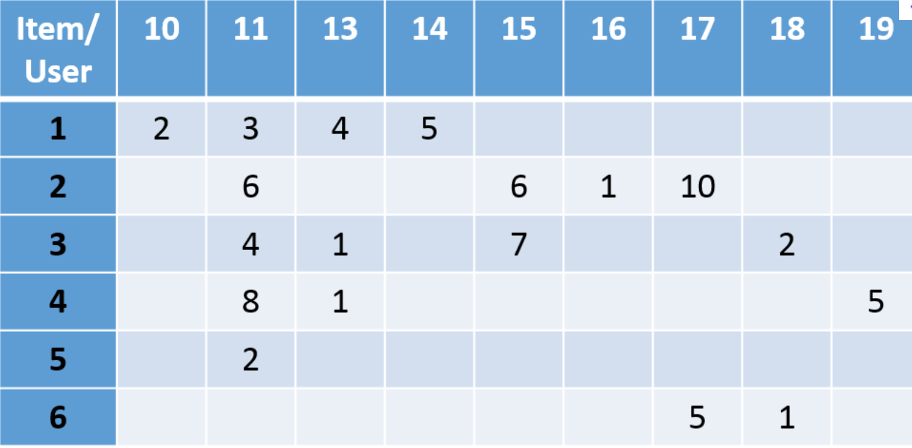
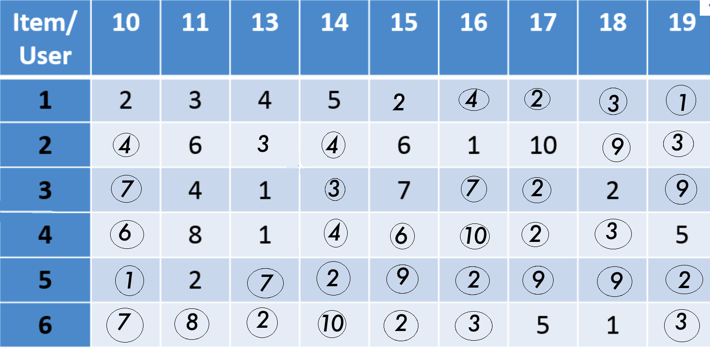
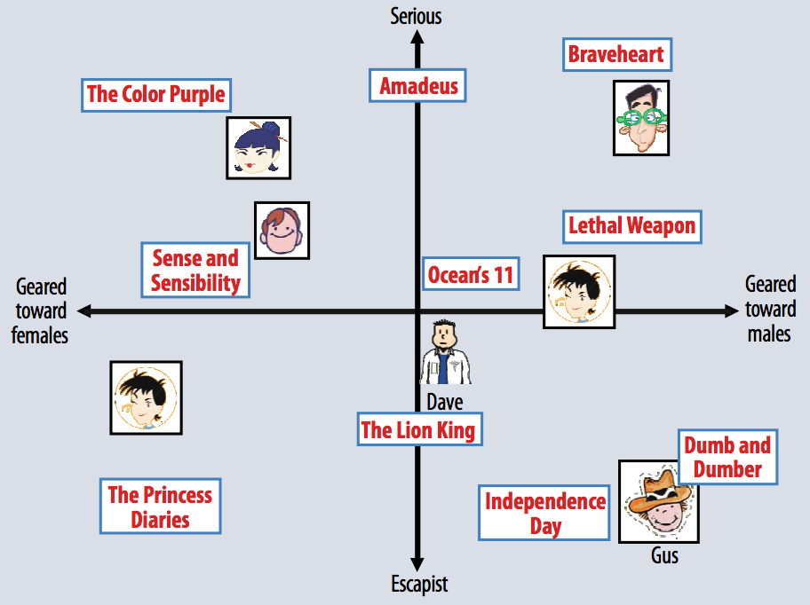
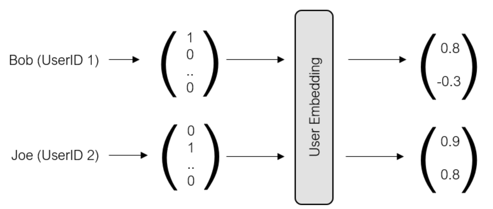
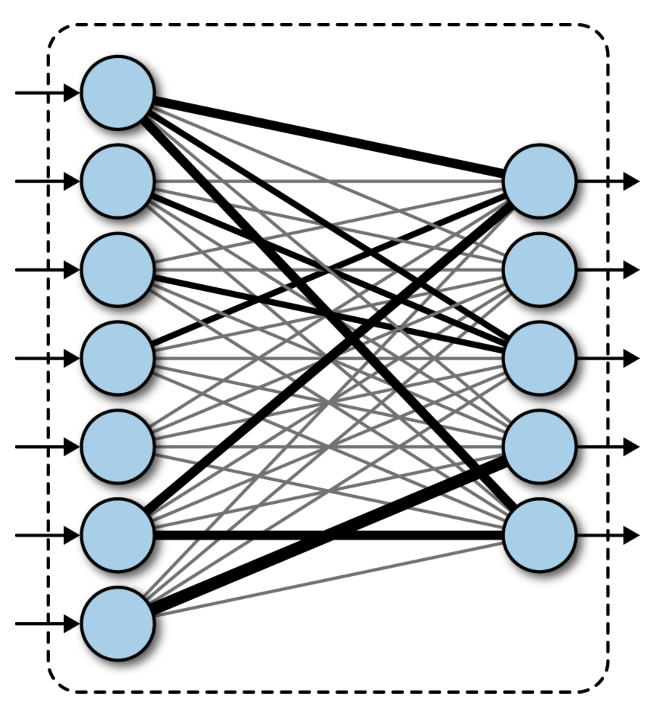
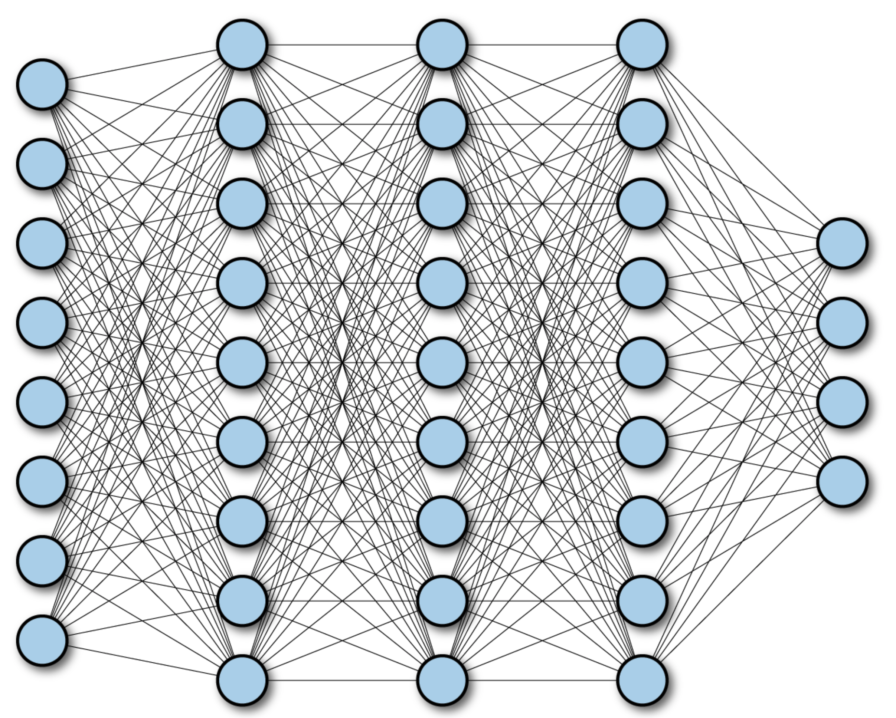
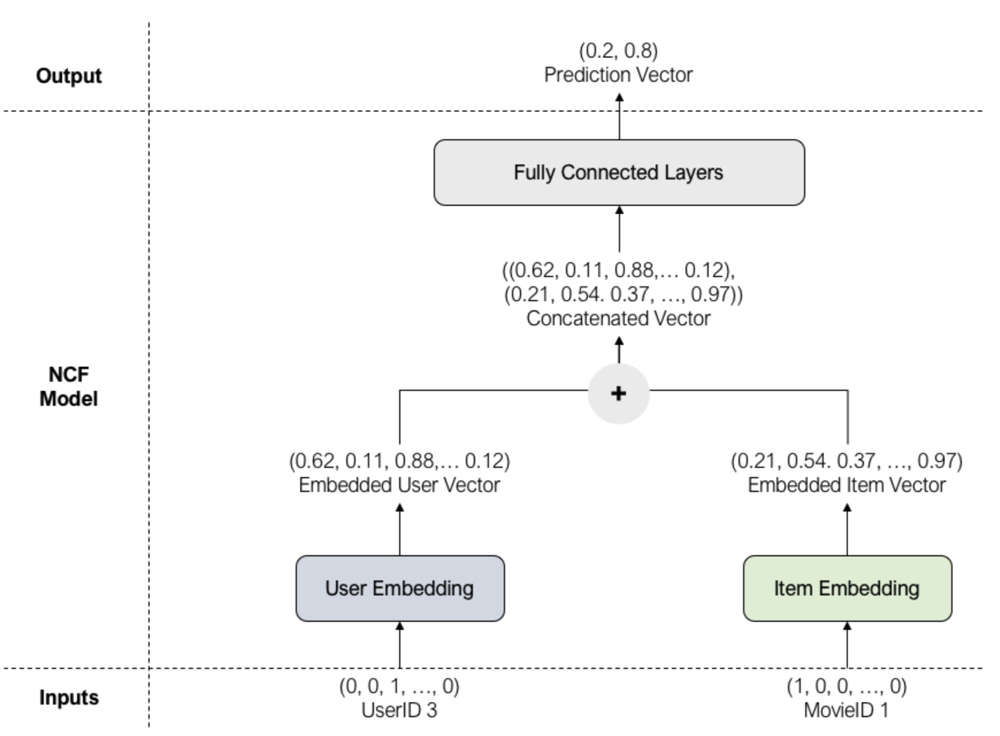
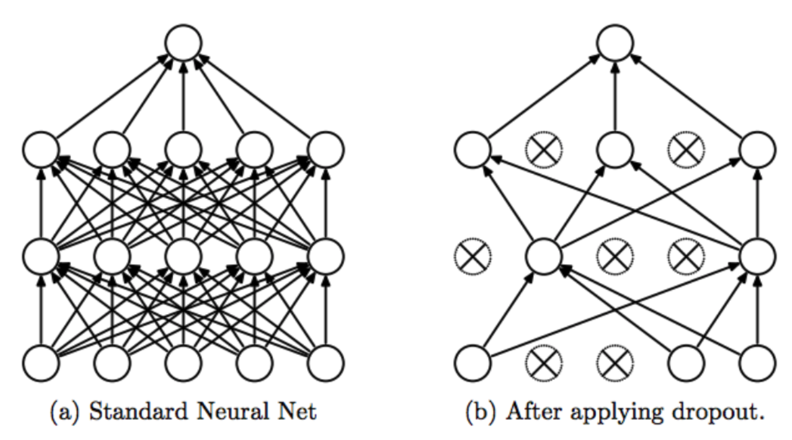

# Introduction

<!-- Source: manuscript_english/4_matrice_completion/10_matrice_completion.tex -->

## Reconstructing a matrix from few linear measurements {.smaller}

:::{.box-red style="font-size: 1.15em;"}
Unknown matrix $A^*\in\R^{u\times v}$, observed through $m$ linear measurements
$$y_i=\inr{A^*,X_i},\qquad i=1,\ldots,m,\qquad\text{where }\inr{A,B}=\sum_{i,j}A_{ij}B_{ij}.$$
:::


- $uv$ unknowns parameters but only $m\ll uv$ equations: a **highly underdetermined** problem, as in compressed sensing.
- It becomes solvable when the [true dimension]{.red} of $A^*$ is much smaller than $uv$, and in particular smaller than $m$.
- The natural structure here is **low rank**: ${\rm rank}(A^*)=r\ll u\wedge v$.

. . .

::: {.callout-tip title="Idea: low rank is the low-dimensional structure of the 'signal'$A^*$" icon=false}
To reconstruct a matrix from a small number of linear measurements, the low-rank assumption plays the role that sparsity played for vectors.
:::

## The rank of a matrix {.smaller}
::: {.box-blue}
The [rank]{.red} of a matrix $A\in\R^{u\times v}$ is the number of non-zero singular values of $A$, i.e. the number of non-zero entries in the spectrum of $A$.
:::

It is also the number of linearly independent rows or columns of $A$, i.e. the dimension of the row space or column space of $A$, which is the same as the dimension of the image of $A$.

:::{.box-green}
What are the rank of the following matrices?

-  the identity matrix $I\in\R^{u\times u}$? The matrix full of zeros? 
-  the diagonal matrix $D={\rm diag}(d_1,\ldots,d_s, 0, \ldots, 0)$?
-  $A=\begin{pmatrix}1 & 2 & 3 \\ 4 & 5 & 6 \\ 7 & 8 & 9\end{pmatrix}$?
-  the $u\times v$ matrix with all entries equal to $1$?
-  The block matrix $B=\begin{pmatrix}A & 0 \\ 0 & A\end{pmatrix}$, where $A$ is a $u\times v$ matrix full of ones?
- the matrix $A= x x^\top$, where $x\in\R^u$ is a vector?
:::

## Recommender systems by completion of the users/items matrix {.smaller}

- The **users/items matrix** has entry $(i,j)$ equal to the rating of user $i$ for item $j$ when it exists, and is empty otherwise.
- A **matrix completion** algorithm fills in the empty entries.
- On each row (that is, for each user), recommend the items with the highest predicted ratings.

:::: {.columns}
::: {.column width="44%"}
{width="100%"}
:::

::: {.column width="12%"}
<br><br><br>
$$\Longrightarrow$$
<center>[Matrix completion]{style="color:#b22222"}</center>
:::

::: {.column width="44%"}
{width="100%"}
:::
::::

After matrix completion, we recommend:

1. *item 14* to *user 6*,
2. *item 16* to *user 4*, etc.

## The Netflix Prize {.spread-out}

- The matrix-completion viewpoint became very popular after the **Netflix Prize**.
- $480\,189$ users and $17\,770$ items (movies).
- Ratings range from $1$ ("did not like it") to $5$ ("liked it very much").
- Only $100\,480\,507$ ratings were observed, about $1.2\%$ of all possible entries.

. . .

::: {.box-green}
**Idea:** One can build a recommender system by completing the users/items matrix.
:::

. . .

::: {.box-yellow}
- **Q1:** Write the data in the Netflix Prize as a matrix $A^*\in\R^{u\times v}$ and a set of linear measurements $y_i=\inr{A^*,X_i}$ (what are the $X_i$'s, $u,v$ and $m$?).
- **Q2:** Imagine that you have a matrix completion algorithm that can complete the matrix $A^*$ from the linear measurements $y_i$. How would you use this algorithm to build a recommender system?
:::

## Matrix completion as linear measurements {.spread-out}

- Let $E_{p,q}$ be the matrix with a $1$ at entry $(p,q)$ and $0$ elsewhere: $(E_{p,q})_{p,q}$ is the canonical basis of $\mathbb{R}^{u\times v}$. 
- If user $p$ rated item $q$ with grade $y_{p,q}$, then [$y_{p,q}=A^*_{p,q}=\inr{A^*,E_{p,q}}.$]{.blue}
- With $\Omega=\{(p,q):\text{user }p\text{ rated item }q\}$, we observe $(A^*_{p,q})_{(p,q)\in\Omega}$.

. . .

- Completing the matrix is therefore reconstructing $A^*$ from $m=|\Omega|$ linear measurements, with $X_i\in\{E_{p,q}:1\leq p\leq u,\ 1\leq q\leq v\}$.

. . .

:::{.box-green}
The solution set $\{A:\inr{A,X_i}=y_i,\ i=1,\ldots,m\}$ is an **affine space**, so without extra structure the problem has no unique solution.

**Q.:** Why is the low-rank assumption a natural assumption for the users/items matrix in the Netflix Prize?
:::

## The low-rank assumption {.smaller .spread-out}

:::: {.columns}
::: {.column width="55%"}
- Users fall into a small number of **profiles**: fans of science fiction, of crime films, of adventure films, and so on.
- Movies fall into a small number of **themes**.
- Homogeneous groups give (more or less) the same ratings to movies of the same category.
- So $A^*$ is close to a **block matrix**, whose rank is of the order of the number of groups.
- We assume $A^*$ is exactly low rank. The approximately low-rank and noisy cases need no new ideas.
:::

::: {.column width="45%"}
```{tikz}
%| label: block-matrix
%| echo: false
%| fig-align: center
%| out-width: 65%
%| fig-cap: "A block-constant users/items matrix with 3 user groups and 3 item groups has rank at most 3."

\begin{tikzpicture}[scale=0.45]
\fill[black!80] (0,5) rectangle (4,8);
\fill[black!20] (4,5) rectangle (7,8);
\fill[black!40] (7,5) rectangle (10,8);
\fill[black!20] (0,3) rectangle (4,5);
\fill[black!80] (4,3) rectangle (7,5);
\fill[black!30] (7,3) rectangle (10,5);
\fill[black!40] (0,0) rectangle (4,3);
\fill[black!30] (4,0) rectangle (7,3);
\fill[black!80] (7,0) rectangle (10,3);
\draw[thick] (0,0) rectangle (10,8);
\draw (2,8.7) node {SF};
\draw (5.5,8.7) node {crime};
\draw (8.5,8.7) node {adventure};
\draw (5,10) node {items};
\draw (-1,4) node[rotate=90] {users};
\end{tikzpicture}
```
:::
::::

::: {.callout-tip title="Idea: exploit the low rank structure of the users/items matrix" icon=false}
The users/items matrix is approximately low rank. Completion algorithms, and hence recommender systems, are designed to exploit this property.
:::

# Convex Relaxation in Matrix Completion

## Notation and dictionary vector/matrix {style="font-size: 0.85em;"}

- Inner product on $\R^{u\times v}$: $\inr{A,B}=\sum_{i,j}A_{ij}B_{ij}$.
- **Spectrum** $\sigma_A=(\sigma_j(A))_{j=1}^{u\wedge v}$: the singular values (square roots of the eigenvalues of $A^\top A$), with $\sigma_1(A)\geq\cdots\geq\sigma_{u\wedge v}(A)\geq0$.
- **Schatten norms:** $\norm{A}_{S_p}=\norm{\sigma_A}_{\ell_p}=\Big(\sum_j\sigma_j(A)^p\Big)^{1/p}$, $p\geq1$.
- **Rank** = number of nonzero singular values: [${\rm rank}(A)=\norm{\sigma_A}_{\ell_0}$]{.blue}.

. . .


| Norm | Name | Vector analog |
|:---:|:---:|:---:|
| $\norm{\cdot}_{S_1}$ | nuclear norm (trace norm) | $\ell_1$ |
| $\norm{\cdot}_{S_2}$ | Frobenius norm (Hilbert norm of $\inr{\cdot,\cdot}$) | $\ell_2$ |
| $\norm{\cdot}_{S_\infty}$ | operator norm $\sup_{\norm{x}_2=1}\norm{Ax}_2$ | $\ell_\infty$ |
: {tbl-colwidths="[25, 50, 25]"}

. . .

- **Duality:** $\norm{A}_{S_q}=\sup\big(\inr{A,B}:\norm{B}_{S_p}\leq1\big)$ when $p^{-1}+q^{-1}=1$.
- $\cS^p$: symmetric matrices; $\cS^p_+$: positive semidefinite ($A\succeq0$); $\cS^p_{++}$: positive definite ($A\succ0$); $\cO(p)=\{A:A^\top A=AA^\top=I_p\}$: orthogonal matrices.

## Rank minimization procedure

:::{.box-blue style="font-size: 0.85em;"}
**Problems:** Given $y_i=\inr{A^*,X_i}$ with $A^*$ of low rank:

- How can $A^*$ be reconstructed exactly?
- How many measurements $m$ are needed, and how should $X_1,\ldots,X_m$ be chosen?
- For matrix completion: what happens when the $X_i$'s must be taken in $\{E_{p,q}\}$?
:::

. . .

::: {.callout-note title="Definition (rank minimization)" icon=false style="font-size: 0.75em;"}
$$\min\Big({\rm rank}(A):\inr{A,X_i}=y_i,\ i=1,\ldots,m\Big)$$
:::


. . .

::: {style="font-size: 0.85em;"}
- The analog of $\ell_0$ minimization (the rank is the $\ell_0$ norm of the spectrum): look for the solution of smallest rank among all matrices with the same measurements.
- We could study it as we studied $\ell_0$ minimization, but it fails for the **same algorithmic reason**.
:::

## Rank minimization is NP-hard {.smaller .spread-out}

::: {.callout-note title="Proposition" icon=false}
Finding a solution to rank minimization over an affine space, $\min_{\cA(A)=y}{\rm rank}(A)$, is NP-hard in general.
:::

. . .

1. **Reduction from $\ell_0$.** Start from any problem $\min_{Bt=b}\norm{t}_0$ with $B\in\R^{m_0\times N}$. Take $u=v=N$ and $m=m_0+N^2$.
2. Define $\cA(A)=\begin{pmatrix}B\,{\rm diag}(A)\\ A-{\rm Diag}(A)\end{pmatrix}$ and $y=\begin{pmatrix}b\\0\end{pmatrix}$, where ${\rm diag}(A)=(a_{ii})_{i=1}^N$ and ${\rm Diag}(A) = {\rm diag}(a_{11}, \ldots, a_{NN})\in\bR^{N\times N}$.
3. Then $\{A:\cA(A)=y\}$ is the set of **diagonal** matrices whose diagonal $t$ satisfies $Bt=b$, and the rank of a diagonal matrix is the $\ell_0$ "norm" of its diagonal.
4. So a rank-minimization solver also solves $\ell_0$ minimization, through a polynomial-time construction. Since $\ell_0$ minimization is NP-hard, so is rank minimization.

. . .


::: {.box-blue style="font-size: 1.15em;"}
The affine constraint is easy; the **nonconvex** objective $A\mapsto{\rm rank}(A)$ is the difficulty. **Convex relaxation** replaces it by the "closest convex function". 

[Can you guess what is the convex relaxation of the rank function (on some set)?]{.blue}
:::

## Convex envelope  {.smaller .spread-out}

::: {.callout-note title="Definition (convex envelope)" icon=false}
Let $C$ be a convex subset of a vector space and $f:C\to\R$. The **convex envelope** ${\rm conv}(f)$ is the largest convex function below $f$ on $C$: for all $x\in C$,
$${\rm conv}(f)(x)=\sup\big(g(x):g\text{ convex},\ g\leq f\text{ on }C\big).$$
:::

:::: {.columns style="display: flex; align-items: center;"}
::: {.column width="55%"}
In a Hilbert space $H$, it suffices to take **affine** minorants:

$${\rm conv}(f)(x)=\sup_{a\in H,\,b\in\R}\big(\inr{a,x}+b:\ \inr{a,y}+b\leq f(y),\ \forall y\in C\big).$$
:::

::: {.column width="45%"}
```{tikz}
%| label: convex_fct_maximal_linear_fct
%| echo: false
%| fig-align: center
%| out-width: 65%
%| fig-cap: "Any convex function is a maximal function of affine functions"

\begin{tikzpicture}[scale=1.5, >=stealth]
    % Clip the drawing area so lines don't bleed past the axes
    \clip (-0.5, -0.5) rectangle (8, 6);

    % Axes
    \draw[->, thick] (0, 0) -- (7, 0) node[below] {$x$};
    \draw[->, thick] (0, 0) -- (0, 5.5);

    % Tangent lines (Affine minorants)
    % Computed using f(x) = 0.4*(x-3.5)^2 + 1
    
    % Tangent at x=1.5 (slope -1.6)
    \draw[thick, orange!50] (0.2, 4.68) -- (3.125, 0);
    
    % Tangent at x=2 (slope -1.2)
    \draw[thick, red!40] (0.2, 3.96) -- (3.5, 0);
    
    % Tangent at x=2.5 (slope -0.8)
    \draw[thick, brown!50] (0.2, 3.24) -- (4.25, 0);
    
    % Tangent at x=4.2 (slope 0.56)
    \draw[thick, green!50!black!40] (2.05, 0) -- (6.3, 2.38);

    % Tangent at x=4.8 (slope 1.04)
    \draw[thick, red!40] (3.19, 0) -- (6.3, 3.23);
    
    % Tangent at x=5.5 (slope 1.6)
    \draw[thick, green!50!black!40] (3.875, 0) -- (6.3, 3.88);

    % The convex function f(x) (drawn last so it stays on top of the tangents)
    \draw[very thick, blue!30!black, domain=0.2:6.3, samples=100]
        plot (\x, {0.4*(\x-3.5)^2 + 1});

\end{tikzpicture}
```
:::
::::

## Fenchel transform {.smaller}

::: {.callout-note title="Definition (Fenchel transform)" icon=false}
For $f:C\to\R$ with $C\subset H$ a convex set, **the Fenchel transform** of $f$ is
$$f^*: y\in H \to \sup_{x\in C}\big(\inr{x,y}-f(x)\big).$$
:::

*Note:* $f^*$ is defined over the entire space $H$ even though $f$ may only be defined over $C$.

:::{.box-green}
**Exercise:** Show that $f^*$ is convex (even when $f$ is not). 
:::

. . .

:::{.box-yellow}
**Exercise:** (Negative entropy): Let $f : \mathbb{R} \to \mathbb{R} \cup \{+\infty\}$ be the univariate negative entropy function defined by:
    $$
    f(x) = \begin{cases} x \ln(x) & \text{if } x > 0, \\ 0 & \text{if } x = 0, \\ +\infty & \text{if } x < 0. \end{cases}
    $$
    Show that $f^*(y) = e^{y-1}$ for all $y \in \mathbb{R}$.
:::

## Geometric interpretation of the Fenchel transform {center="true"}

:::: {.columns style="display: flex; align-items: center;"}

::: {.column width="50%"}
:::{.box-blue style="font-size: 1.10em;"}
Given a slope $y\in H$, the Fenchel transform finds the intercept of the largest affine function with slope $y$ below the graph of $f$.
:::
:::

::: {.column width="80%"}
```{tikz}
%| label: fenchel
%| echo: false
%| fig-align: center
%| out-width: 65%


\begin{tikzpicture}[>=stealth, scale=1.2]
  % Grid / background area (optional, kept clean)
  % Epigraph shading
  \fill[blue!7, domain=-1.1:3.0, samples=100]
    (-1.1, 5.2) -- plot (\x, {0.5*\x*\x + 1}) -- (3.0, 5.2) -- cycle;
  \node[blue!60!black, font=\small] at (0.6, 4.2) {$\operatorname{epi}(f)$};

  % Coordinate axes
  \draw[->, thick] (-1.5, 0) -- (3.8, 0) node[right] {$u$};
  \draw[->, thick] (0, -1.8) -- (0, 5.4) node[above] {$z$};
  \node[below left, font=\small] at (0, 0) {$0$};

  % Function f(u) = 0.5 * u^2 + 1
  \draw[very thick, blue!80!black, domain=-1.1:2.9, samples=100]
    plot (\x, {0.5*\x*\x + 1})
    node[above] {$f(u)$};

  % Supporting hyperplane (tangent line): L(u) = y*u - f*(y) with y = 2, f*(y) = 1
  % L(u) = 2*u - 1
  \draw[thick, red!85!black, domain=-0.35:3.1]
    plot (\x, {2*\x - 1})
    node[right, font=\small] {$L(u) = y u - f^*(y)$};

  % Key coordinates
  \coordinate (P) at (2, 3);
  \coordinate (P0) at (0, -1);
  \coordinate (Px) at (2, 0);
  \coordinate (Pz) at (0, 3);

  % Dashed projections for contact point
  \draw[dashed, gray!80] (2, 3) -- (Px) node[below, black, font=\small] {$x$};
  \draw[dashed, gray!80] (2, 3) -- (Pz) node[left, black, font=\small] {$f(x)$};

  % Tangency contact point
  \fill[blue!80!black] (P) circle (2.2pt) node[above left, black, font=\small] {$(x, f(x))$};

  % Intercept at u = 0: value is -f*(y)
  \fill[red!85!black] (P0) circle (2.2pt);
  \node[right, red!85!black, font=\small] at (0.1, -1) {$-f^*(y)$};

  % Distance indicator for f*(y)
  \draw[<->, thick, red!85!black] (-0.35, 0) -- (-0.35, -1)
    node[midway, left, font=\small] {$f^*(y)$};

  % Slope indicator triangle
  \draw[darkgray, thin] (2.2, 3.4) -- (2.7, 3.4) -- (2.7, 4.4);
  \node[right, darkgray, font=\scriptsize] at (2.7, 3.9) {$\text{slope } y$};
\end{tikzpicture}
```
:::

::::

## The biconjugate function

::: {.callout-note title="Definition (biconjugate)" icon=false style="font-size: 0.8em;"}
The **biconjugate** of $f$ is the function $f^{**}:x\in H\to\sup_{y\in H}\big(\inr{x,y}-f^*(y)\big).$
:::

. . .

:::{.box-yellow style="font-size: 0.92em;"}
**Ex.1:** Compute the biconjugate of the negative entropy function.

. . .

**Ex.2:** Let $f : x\in \mathbb{R} \to (|x| - 1)^2$ be the double-well function. 

- Show that $f$ is not convex and draw its convex envelope.
- The Fenchel conjugate is $f^*(y)=|y| + \frac{y^2}{4}$ for all $y \in \mathbb{R}$ and the Fenchel biconjugate is $f^{**}(x) = \begin{cases} 0 & \text{if } |x| \leq 1, \\ (|x| - 1)^2 & \text{if } |x| > 1. \end{cases}$ for all $x \in \mathbb{R}$.
- Draw the Fenchel biconjugate $f$ and make a conjecture about the convex envelope of $f$.
:::


## Convex envelope = biconjugate {.smaller .spread-out}


::: {.callout-important title="Theorem" icon=false}
Let $H$ be a Hilbert space, $C\subset H$ convex and $f:C\to\R$.  Then, 
$$\forall x\in C, f^{**}(x)={\rm conv}(f)(x).$$
:::

. . .

**Proof.**

1. For a fixed slope $y\in H$, the affine function $\inr{y,\cdot}+b$ is below $f$ on $C$ iff $b\leq f(x)-\inr{y,x}$ for all $x\in C$.

. . .

2. The best intercept is $b=\inf_{x\in C}\big(f(x)-\inr{y,x}\big)=-f^*(y)$.

. . .

3. Hence ${\rm conv}(f)(x)=\sup_{y\in H}\big(\inr{y,x}-f^*(y)\big)=f^{**}(x)$.

. . .

<div style="height: 1.2cm;"></div>

::: {.box-green style="text-align: center; font-size: 1.10em;"}
**Idea:** To find the convex envelope of the rank function, it suffices to compute its biconjugate.
:::

## The nuclear norm is the convex envelope of the rank {.spread-out}

::: {.callout-important title="Theorem" icon=false}
The convex envelope of the rank function on $B_{S_\infty}=\{A\in\R^{u\times v}:\norm{A}_{S_\infty}\leq1\}$ is the nuclear norm $\norm{\cdot}_{S_1}$.
:::

- The matrix analog of "$\ell_1$ is the convex envelope of $\ell_0$ on $B_\infty^N$".
- The dictionary between 'vectors' and 'matrices' goes through the spectrum:
$${\rm rank}(A)=\norm{\sigma_A}_{\ell_0},\qquad\norm{A}_{S_1}=\norm{\sigma_A}_{\ell_1},\qquad\norm{A}_{S_\infty}=\norm{\sigma_A}_{\ell_\infty}.$$
- The key tool for reducing matrix problems to problems on spectra is **von Neumann's inequality**.

## von Neumann's inequality

::: {.callout-note title="Proposition (von Neumann's inequality)" style="font-size: 0.8em;" icon=false}
For $A,B\in\R^{u\times v}$,
$$|\inr{A,B}|\leq\sum_i\sigma_i(A)\sigma_i(B).$$
Equality $\inr{A,B}=\sum_i\sigma_i(A)\sigma_i(B)$ holds iff, for an SVD $A=U_AD_AV_A^\top$, one has $U_A^\top BV_A=D_B$.

Likewise, $\norm{A-B}_{S_2}\geq\norm{\sigma_A-\sigma_B}_2$, with equality when $B=U_AD_BV_A^\top$.
:::

- Rank, Schatten norms and $B_{S_\infty}$ are invariant under $A\mapsto UAV$ with $U\in\cO(u)$, $V\in\cO(v)$.
- In a supremum over such sets, one can **align the singular vectors** of $B$ with those of $A$, which reduces the problem to vectors via matrices' spectra.

## Proof sketch: biconjugate of the rank {.smaller}

Let $f={\rm rank}$ on $B_{S_\infty}$ and $q=u\wedge v$.

. . .

1. **Fenchel transform.** By von Neumann's inequality and orthogonal invariance, splitting $B_{S_\infty}$ according to the rank $r$ of $B$:
$$f^*(A)=\max_{0\leq r\leq q}\ \sup_{B\in B_{S_\infty},\,{\rm rank}(B)=r}\Big(\sum_{i=1}^r\sigma_i(A)\sigma_i(B)-r\Big)=\max_{0\leq r\leq q}\sum_{i=1}^r\big(\sigma_i(A)-1\big)=\sum_{i=1}^q\big(\sigma_i(A)-1\big)_+.$$

. . .

2. **Biconjugate, $\norm{A}_{S_\infty}\leq1$.** Then $f^*(A)=0$, and for $B\in B_{S_\infty}$,
$$\sup_{\norm{A}_{S_\infty}\leq1}\sum_i\sigma_i(A)\sigma_i(B)=\sum_i\sigma_i(B)=\norm{B}_{S_1}.$$

. . .

3. **Biconjugate, $\norm{A}_{S_\infty}>1$.** Since $\sigma_i(B)\leq1$, both sums below are nonpositive:
$$\sum_i\sigma_i(A)\sigma_i(B)-f^*(A)=\norm{B}_{S_1}+\underbrace{\sum_{\sigma_i(A)\leq1}\big(\sigma_i(A)-1\big)\sigma_i(B)}_{\leq0}+\underbrace{\sum_{\sigma_i(A)>1}\big(\sigma_i(A)-1\big)\big(\sigma_i(B)-1\big)}_{\leq0}\leq\norm{B}_{S_1}.$$

. . .

So $f^{**}=\norm{\cdot}_{S_1}$ on $B_{S_\infty}$. $\square$

## Nuclear norm minimization procedure {.smaller}

::: {.callout-tip title="Key Idea: convex relaxation" icon=false}
The nuclear norm is the convex envelope of the rank on $B_{S_\infty}$, so it is natural to replace the (none convex) rank function by the (convex) nuclear norm in the NP-hard rank minimization problem.
:::

::: {style="height: 50px;"}
:::

::: {.callout-note title="Definition (nuclear norm minimization)" icon=false}
With $\cA(A)=(\inr{A,X_i})_{i=1}^m$ and $y=(y_i)_{i=1}^m$,
$$\hat A\in\argmin_{A\in\R^{u\times v}}\big(\color{red}{\norm{A}_{S_1}}:\cA(A)=y\big).\tag{NM}$$
:::

- The convex relaxation of rank minimization: the matrix analogue of **Basis Pursuit**.
- (NM) is a convex problem.
- Basis Pursuit was rewritten as a **linear program**. (NM) can likewise be rewritten as a **semidefinite program** (SDP).

## Semidefinite programs in standard form {.smaller}

::: {.callout-note title="Definition -- semidefinite program (SDP)" icon=false}
An optimization problem is a **semidefinite program** if it can be written as
$$\min_{X\in\cS^p}\Big(\inr{C,X}:\tilde\cA(X)=b,\ X\succeq0\Big),$$
where $C\in\cS^p$, $\tilde\cA:\cS^p\to\R^m$ is linear and $b\in\R^m$.
:::

We write (NM) in this form, with variable $M$ such that 
$$
M=\begin{bmatrix}Y&X\\X^\top&Z\end{bmatrix}\in\cS^{u+v}, C=I_{u+v}
$$ 
so $\inr{C,M}={\rm Tr}(Y)+{\rm Tr}(Z)$ and $\tilde\cA(M)=\cA(X) , b=y.$

::: {style="height: 30px;"}
:::

::: {.box-yellow}
- Like linear programs, SDPs are solved approximately by primal–dual barrier methods (e.g. `cvxopt.solvers.conelp`).
- however, SDP solvers are **expensive in high dimension**: this motivates the gradient methods of the next part.
:::


## Nuclear norm minimization as an SDP problem
We define the (SDP) problem as
$$\min_{X\in\R^{u\times v},\,Y\in\cS^u,\,Z\in\cS^v}{\rm Tr}(Y)+{\rm Tr}(Z)\quad\text{such that}\quad\cA(X)=y,\quad\begin{bmatrix}Y&X\\X^\top&Z\end{bmatrix}\succeq0$$
(*Note:* (SDP) is a semidefinite program)

::: {style="height: 50px;"}
:::

::: {.callout-important title="Theorem: (NM) and (SDP) are equivalent:" icon=false style="font-size: 0.9em;"}

1. if $\hat A$ solves (NM), then $(\hat A,\hat Y,\hat Z)$ solves (SDP) for some $\hat Y,\hat Z$ depending only on $\hat A$;
2. if $(\hat X,\hat Y,\hat Z)$ solves (SDP), then $\hat X$ solves (NM).
:::


## Proof sketch: the SDP lemma 


::: {.callout-note title="Lemma" icon=false}
Let $A\in\R^{u\times v}$ and $t\geq0$. Then $\norm{A}_{S_1}\leq t$ iff there exist $Y\in\cS^u$ and $Z\in\cS^v$ such that
$${\rm Tr}(Y)+{\rm Tr}(Z)\leq2t\qquad\text{and}\qquad\begin{bmatrix}Y&A\\A^\top&Z\end{bmatrix}\succeq0.$$
:::

## Proof sketch {.smaller}

The lemma gives $\min_{Y,Z}\frac12\big({\rm Tr}(Y)+{\rm Tr}(Z)\big)=\norm{X}_{S_1}$ for every feasible $X$, hence the theorem.

**($\Leftarrow$)** Take an SVD $A=UDV^\top$ and $I_{u,v}={\rm diag}(1,\ldots,1)\in\R^{u\times v}$.

. . .

1. The matrix $M=\begin{bmatrix}I_u&-UI_{u,v}V^\top\\-VI_{u,v}^\top U^\top&I_v\end{bmatrix}$ is positive semidefinite, since
$$(x^\top,y^\top)\,M\begin{pmatrix}x\\y\end{pmatrix}=\norm{x}_2^2+\norm{y}_2^2-2\inr{U^\top x,I_{u,v}V^\top y}\geq0.$$
2. The trace of a product of two positive semidefinite matrices is nonnegative, so
$$0\leq{\rm Tr}\Big(M\begin{bmatrix}Y&A\\A^\top&Z\end{bmatrix}\Big)={\rm Tr}(Y)+{\rm Tr}(Z)-2{\rm Tr}(D),\quad\text{hence}\quad2t\geq2\norm{A}_{S_1}.$$

. . .

**($\Rightarrow$)** Take a compact SVD $A=U_rD_rV_r^\top$, with $r={\rm rank}(A)$.

3. Set $Y=U_rD_rU_r^\top+\gamma I_u$ and $Z=V_rD_rV_r^\top+\gamma I_v$, with $\gamma=2(t-\norm{A}_{S_1})/(u+v)$, so that ${\rm Tr}(Y)+{\rm Tr}(Z)=2t$.
4. Then
$$\begin{bmatrix}Y&A\\A^\top&Z\end{bmatrix}=\begin{bmatrix}U_r\\V_r\end{bmatrix}D_r\begin{bmatrix}U_r^\top&V_r^\top\end{bmatrix}+\gamma I_{u+v}\succeq0.\qquad\square$$


## Sparse vectors $\leftrightarrow$ low-rank matrices

::: {style="height: 50px;"}
:::

| | Sparse vectors (CS) | Low-rank matrices (MC) |
|:--|:--|:--|
| Unknown | $x^*\in\R^N$ | $A^*\in\R^{u\times v}$ |
| Structure | $\norm{x^*}_0\leq s$ | ${\rm rank}(A^*)=\norm{\sigma_{A^*}}_0\leq r$ |
| Nonconvex procedure | $\ell_0$ minimization (NP-hard) | rank minimization (NP-hard) |
| Convex envelope | $\norm{\cdot}_1$ on $B_\infty^N$ | $\norm{\cdot}_{S_1}$ on $B_{S_\infty}$ |
| Convex procedure | Basis Pursuit | Nuclear norm minimization |
| Implementation | linear program | semidefinite program |
| Gaussian measurements | $m\gtrsim s\log(eN/s)$ | $m\gtrsim r(u+v)$ |
: {tbl-colwidths="[27, 33, 39]"}


# First order algorithms for Matrix Completion

::: {style="height: 70px;"}
:::

::: {.callout-tip title="Idea: avoid SDP via first order methods" icon=false style="font-size: 0.9em;"}
The SDP reformulation is hard to solve in high dimension. Here, we build first order algorithms to bypass this limitation.
:::

## The mask operator $P_\Omega$ {.spaced-list}

- Each observation reveals one entry of the matrix: a **mask**
$$P_\Omega:\R^{u\times v}\to\R^{u\times v},\qquad\big(P_\Omega(A)\big)_{ij}=\begin{cases}A_{ij}&\text{if }(i,j)\in\Omega,\\0&\text{otherwise,}\end{cases}$$
where $\Omega\subset\{1,\ldots,u\}\times\{1,\ldots,v\}$ is the set of revealed entries.
- $P_\Omega$ is a projection ($P_\Omega^2=P_\Omega$) and is self-adjoint ($P_\Omega^\top=P_\Omega$).
- We observe $P_\Omega(A^*)$ and assume that $A^*$ has **low rank**.


## Two procedures:

:::{.box-yellow} 
**Rank-constrained least squares:**
$$
\tilde A\in\argmin_{{\rm rank}(A)\leq r}\norm{P_\Omega(A^*)-P_\Omega(A)}_{S_2}
$$
:::

:::{.box-yellow} 
**Nuclear-norm-penalized least squares:**
$$\bar A\in\argmin_{A\in\bR^{u\times v}}\Big(\frac12\norm{P_\Omega(A^*)-P_\Omega(A)}_{S_2}^2+\lambda\norm{A}_{S_1}\Big)$$
:::


::: {style="height: 50px;"}
:::

:::{.box-blue style="font-size: 0.9em;"}
Both combine a **data-fidelity term** $A\mapsto\norm{P_\Omega(A^*)-P_\Omega(A)}_{S_2}$ with a rank constraint or a nuclear norm regularization. 
<!-- Let us now construct first order algorithms to approximate their solutions based on matrix versions of **hard** and **soft thresholding** acting on the spectrum. -->
:::

## Projected gradient for the rank constraint procedure

- $F(A)=\frac12\norm{P_\Omega(A^*)-P_\Omega(A)}_{S_2}^2$ is convex and differentiable, with
$$\nabla F(A)=-P_\Omega^\top\big(P_\Omega(A^*)-P_\Omega(A)\big)=P_\Omega(A)-P_\Omega(A^*).$$
- The constraint $\{{\rm rank}(A)\leq r\}$ is **not convex**, but we can still project onto it (next slide).

. . .


::: {.callout-note title="Algorithm (projected gradient descent)" style="font-size: 0.9em;" icon=false}
With step sizes $(\gamma_k)_k$,
$$A^{k+1}=\color{red}{S_r^{hard}}\Big(A^k+\gamma_k\big(P_\Omega(A^*)-P_\Omega(A^k)\big)\Big),$$
where $S_r^{hard}$ keeps the $r$ largest singular values and sets the others to $0$.
:::


<!-- ::: {.callout-caution title="Remark" icon=false}
With $\gamma_k=1$: $A^{k+1}=S_r^{hard}\big(P_\Omega(A^*)+P_{\Omega^c}(A^k)\big)$, i.e. iterative rank-$r$ PCA for **missing data** (missMDA).
::: -->


## Projection onto matrices of rank at most $r$ {.smaller}

::: {.callout-note title="Proposition" icon=false style="font-size: 0.85em;"}
Let $A\in\bR^{u\times v}$ and $r\geq0$.

Let $A=PDQ^\top$ be an SVD of $A$, with $D={\rm diag}(\sigma_1,\ldots,\sigma_{u\wedge v})$ and $\sigma_1\geq\sigma_2\geq\cdots\geq\sigma_{u\wedge v}\geq0$. 

A projection of $A$ onto $\{B:{\rm rank}(B)\leq r\}$ in $\norm{\cdot}_{S_2}$ is
$$\color{red}{S_r^{hard}}(A) = PD_rQ^\top,\qquad D_r={\rm diag}(\sigma_1,\ldots,\sigma_r,0,\ldots,0).$$
It is the unique projection when $\sigma_r>\sigma_{r+1}$.
:::

. . .

**Proof.**

1. von Neumann: $\norm{A-B}_{S_2}\geq\norm{\sigma_A-\sigma_B}_2$, with equality for $B=P\,{\rm diag}(\sigma_B)Q^\top$.
2. If ${\rm rank}(B)\leq r$, then $\norm{\sigma_A-\sigma_B}_2^2\geq\sum_{j>r}\sigma_j(A)^2$, with equality for $\sigma_B=(\sigma_1,\ldots,\sigma_r,0,\ldots,0)$. $\square$

. . .

::: {style="height: 40px;"}
:::

:::{.box-green}
- $S_r^{hard}(\cdot)$ is called the **hard thresholding spectral operator**.
- Its `only` costs one SVD (and only the $r$ leading singular triplets are needed).
- It is a special case where one can solve efficiently a non-convex optimization problem.
:::


## The subdifferential of a convex function  {.smaller}

**Aim:** Construct a first order algorithm for the nuclear norm penalized least squares procedure. 

**Problem:** The nuclear norm is not differentiable.

::: {.callout-note title="Definition (Subdifferential)" icon=false}
 Let $f:C\to\R$ be a convex function (on a convex set $C\subset\R^n$). Let $x\in C$. The **Subdifferential of $f$ in $x$** is the set
$$\partial^-f(x)=\big\{g\in\R^n:f(y)\geq f(x)+\inr{g,y-x},\ \forall y\in C\big\}.$$
Its elements are called the **subgradients**.
:::

. . .

:::{.box-green}
- **Exercise 1:** Show that if $f$ is a convex function that is differentiable at $x\in \overset{\circ}{A}$ then $\partial^-f(x)=\{\nabla f(x)\}$.
- **Exercise 2:** Compute the subdifferential of the absolute function $t\to|t|$ at all points of $\bR$.
- **Exercise 3:** Let $f$ be a convex function on an open convex set $C\subset\R^n$: show that $x^*$ is solution to $\min_{x\in C}f(x)$ iff $0\in \partial^-f(x^*)$.
- **Exercise 4:** Compute the subdifferential of the Euclidean norm over $\mathbb{R}^p$.
:::

## Proximal operators {.smaller}

::: {.callout-note title="Definition (proximal operator)" icon=false}
For a convex function $g:\R^n\to\R$,
$${\rm prox}_g(x)=\argmin_{u\in\R^n}\Big(\frac12\norm{u-x}_2^2+g(u)\Big).$$
:::

::: {style="height: 30px;"}
:::

:::{.box-green}
- **Exercise 1:** Let $K$ be a non-empty closed and convex set and denote by $i_K$ its indicator function ($0$ on $K$, $+\infty$ outside). Then for all $\gamma>0$, ${\rm prox}_{\gamma i_C}(x) = P_C(x)$, where $P_K$ is the projection operator over $K$. 
- **Exercise 2:** Let $f(u)=|u|$ and let $\gamma > 0$. Show that ${\rm prox}_{\gamma f}(x) = {\rm sign}(x) \max(|x| - \gamma, 0)$ and draw the proximal map of $f$.
:::

::: {style="height: 40px;"}
:::

:::{.box-red}
**Proximal operators generalize projections:** For $K$ be a non-empty closed and convex set: for all $x\in\R^n$,
$${\rm proj}_K(x)={\rm prox}_{i_K}(x).$$
:::

## Proximal maps of $\ell_1$ and $\ell_0$ {.smaller}

:::: {.columns}
::: {.column width="58%"}
The objective functions are **separable**:

\begin{align*}
\frac12\norm{u-z}_2^2+\gamma\norm{u}_{\color{blue}{1}}&=\sum_j\Big(\frac12(u_j-z_j)^2+\gamma|u_j|\Big)\\
\frac12\norm{u-z}_2^2+\gamma\norm{u}_{\color{blue}{0}}&=\sum_j\Big(\frac12(u_j-z_j)^2+\gamma I(u_j\neq 0)\Big)
\end{align*}

:::


::: {.column width="35%"}
```{tikz}
%| label: thresholding
%| echo: false
%| fig-align: "right"
%| fig-cap: "Soft thresholding (left) and hard thresholding (right) at level $\\gamma$."

\begin{tikzpicture}[scale=0.55]
\begin{scope}
\draw[->] (-3.2,0) -- (3.4,0) node[right] {$s$};
\draw[->] (0,-2.6) -- (0,2.8);
\draw[very thick, blue] (-3,-2) -- (-1,0) -- (1,0) -- (3,2);
\draw[dashed] (-3,-3) -- (3,3);
\draw (1,0.1) -- (1,-0.1) node[below] {$\gamma$};
\draw (-1,0.1) -- (-1,-0.1) node[below] {$-\gamma$};
\draw (0,3.3) node {soft};
\end{scope}
\begin{scope}[xshift=8cm]
\draw[->] (-3.2,0) -- (3.4,0) node[right] {$s$};
\draw[->] (0,-2.6) -- (0,2.8);
\draw[very thick, red] (-3,-3) -- (-1,-1);
\draw[very thick, red] (-1,0) -- (1,0);
\draw[very thick, red] (1,1) -- (3,3);
\draw[dashed] (-3,-3) -- (3,3);
\draw (1,0.1) -- (1,-0.1) node[below] {$\gamma$};
\draw (-1,0.1) -- (-1,-0.1) node[below] {$-\gamma$};
\draw (0,3.3) node {hard};
\end{scope}
\end{tikzpicture}
```
:::
::::

Scalar problems: for all $s\in\R$,
$$
\argmin_{t\in\R}\left[\frac12(s-t)^2+\gamma|t|\right]  ={\rm sgn}(s)\big(|s|-\gamma\big)_+  \text{ and } 
\argmin_{t\in\R}\left[\frac12(s-t)^2+\gamma I(t\neq 0)\right] =s\,I(|s|\geq \sqrt{2\gamma}).
$$

::: {style="height: 30px;"}
:::

::: {.callout-note title="Proposition (proximal maps of $\ell_1$ and $\ell_0$): For all $z\in\R^N$:" icon=false}

:::: {.columns style="align-items: center;"}

::: {.column width="50%"}
- **soft thresholding:** ${\rm prox}_{\gamma\norm{\cdot}_1}(z)=\big({\rm sgn}(z_j)(|z_j|-\gamma)_+\big)_{j=1}^N$
:::

::: {.column width="50%"}
- **hard thresholding:** ${\rm prox}_{(\gamma^2/2)\norm{\cdot}_0}(z)=\big(z_j\,I(|z_j|\geq\gamma)\big)_{j=1}^N$.
:::

::::
:::

## Fixed-point characterization of proximal gradient descent {.smaller}

::: {.callout-note title="Proposition" icon=false}
Let $f:\R^n\to\R$ be [convex and differentiable]{.blue}, $g:\R^n\to\R$ [convex]{.blue}, and $\gamma>0$. Then
$$x^*\in\argmin_{x\in\R^n}\big(f(x)+g(x)\big)\iff x^*={\rm prox}_{\gamma g}\big(x^*-\gamma\nabla f(x^*)\big).$$
:::


**Proof.**

1. Replacing $(f,g)$ by $(\gamma f,\gamma g)$, we may take $\gamma=1$.
2. By the optimality condition for the prox: $\ u^*={\rm prox}_g(z)\iff z-u^*\in\partial^-g(u^*)$.
3. So $x^*={\rm prox}_g\big(x^*-\nabla f(x^*)\big)\iff-\nabla f(x^*)\in\partial^-g(x^*)\iff0\in\nabla f(x^*)+\partial^-g(x^*)$.

. . .

::: {style="height: 30px;"}
:::

:::{.box-red}
A solution to the problem $\min_{x\in\R^n}\big(f(x)+g(x)\big)$ is a fixed point of $G:x\mapsto{\rm prox}_{\gamma g}\big(x-\gamma\nabla f(x)\big)$. 

We can use a **fixed point algorithm** to approximate it: $\color{red}{x_{k+1}=G(x_k)}$, possibly with varying steps $\gamma_k$.
:::

## Prox of the nuclear norm: soft spectral thresholding {.smaller}

::: {.callout-note title="Proposition" icon=false}
Let $\gamma>0$ and let $A=UDV^\top$ be an SVD of $A$. Then
$${\rm prox}_{\gamma\norm{\cdot}_{S_1}}(A)=S_\gamma^{soft}(A)=UD_\gamma V^\top,\qquad D_\gamma={\rm diag}\big((\sigma_1-\gamma)_+,\ldots,(\sigma_{u\wedge v}-\gamma)_+\big).$$
:::


**Proof.**

1. von Neumann: $\norm{A-B}_{S_2}^2=\norm{A}_{S_2}^2+\norm{B}_{S_2}^2-2\inr{A,B}\geq\norm{\sigma_A-\sigma_B}_2^2$, with equality for $B=U\,{\rm diag}(\sigma_B)V^\top$.
2. So the prox has the form $U{\rm diag}(\hat d)V^\top$, with $\hat d={\rm prox}_{\gamma\norm{\cdot}_1}(\sigma_A)$.
3. Since $\sigma_A\geq0$, soft thresholding gives $\hat d=\big((\sigma_i-\gamma)_+\big)_i$. $\square$

. . .

::: {style="height: 60px;"}
:::

:::{.box-green}
**Exercise:** Construct a proximal gradient descent algorithm for matrix completion.
:::

## Proximal gradient descent for matrix completion {.smaller}

::: {.callout-note title="Algorithm (proximal gradient descent)" icon=false}
For $\min_A\big(\frac12\norm{P_\Omega(A^*)-P_\Omega(A)}_{S_2}^2+\lambda\norm{A}_{S_1}\big)$, with step sizes $(\gamma_k)_k$:
$$A_{k+1}=S_{\lambda\gamma_k}^{soft}\Big(A_k+\gamma_k\big(P_\Omega(A^*)-P_\Omega(A_k)\big)\Big).$$
:::

- Same cost for both methods: no SDP, but one SVD (or a truncated SVD) per iteration, which can still be expensive.

::: {style="height: 40px;"}
:::

| Problem | Method | Spectral step |
|:--|:--|:--|
| ${\rm rank}(A)\leq r$ | projected gradient | hard: keep $\sigma_1,\ldots,\sigma_r$ |
| $+\lambda\norm{A}_{S_1}$ | proximal gradient | soft: $\sigma_i\mapsto(\sigma_i-\lambda\gamma_k)_+$ |


::: {style="height: 60px;"}
:::

::: {.box-green}
**Key Idea: thresholding the spectrum:** Projecting onto low-rank matrices and computing the prox of the nuclear norm give two first order methods for matrix completion by projected or proximal gradient descent.
:::

## Matrix completion on pictures via SDP and  proximal gradient descent

::: {style="display: flex; justify-content: center; align-items: center; height: 450px;"}
::: {.box-green style="text-align: center; max-width: 850px; width: 100%;"}
Open the notebook `lab_mat_completion.ipynb`
:::
:::

:::{.box-yellow}
- Check that real images have low rank.
- Use an SDP solver to complete a matrix.
- Implement a proximal gradient descent algorithm for matrix completion.
:::

# Matrix Factorization and Metadata for Recommender Systems

## A latent space for users and items

:::: {.columns}
::: {.column width="55%"}
- Represent users **and** items in the same **latent space** $\R^d$:
  - $p_i\in\R^d$ represents user $i$;
  - $q_j\in\R^d$ represents item $j$.
- The inner product ${\color{red}{\inr{p_i,q_j}}}$ measures the **affinity** between user $i$ and item $j$.
- Users close to an item in the latent space are likely to appreciate it.
:::

::: {.column width="45%"}
{width="95%"}
:::
::::

## Factorization of the users/items matrix {.smaller}

- Data: $\{(user_i,item_j,grade_{ij}):(i,j)\in\Omega\}$.
- Build $(p_i)_{i\leq u}$ and $(q_j)_{j\leq v}$ so that ${\color{red}{\inr{p_i,q_j}\approx grade_{ij}}}$ for every $(i,j)\in\Omega$.
- The values $\inr{p_i,q_j}$ for $(i,j)\notin\Omega$ **complete** the matrix.

:::: {.columns}
::: {.column width="50%"}
```{tikz}
%| label: factorization
%| echo: false
%| fig-align: center
%| out-width: 80%
%| fig-cap: "Factorizing $A^*\\approx PQ$, with $P\\in\\mathbb{R}^{u\\times d}$ (rows $p_i^\\top$) and $Q\\in\\mathbb{R}^{d\\times v}$ (columns $q_j$)."

\begin{tikzpicture}[scale=0.4]
\draw (0,0) rectangle (5,10); \draw (10,0) rectangle (12,10);
\draw (13,8) rectangle (18,10); \draw (7.5,5) node {$\approx$};\draw (2.5,5) node {${\blue{A^*}}$};
\draw (11,5) node {${\blue{P}}$};\draw (15.5,9) node {${\blue{Q}}$}; \draw (11,11) node {${\red{d}}$}; \draw (19, 9) node {${\red{d}}$}; \draw (-1, 5) node {$u$}; \draw (9, 5) node {$u$}; \draw (2.5, 11) node {$v$};
\draw (16, 11) node {$v$};
\draw [<->] (10,3) -- (12,3); \draw (11,2.3) node {$p_i^\top$};
\draw [<->] (17,8) -- (17,10); \draw (17.5,9) node {$q_j$};
\end{tikzpicture}
```
:::

::: {.column width="50%"}
<br>

::: {.callout-tip title="Key Idea: low rank made explicit" icon=false}
${\rm rank}(PQ)\leq d$. Approximating $A^*$ by $PQ$ approximates it by a low-rank matrix, which only works if $A^*$ is approximately low rank.
:::
:::
::::

## Regularized least-squares objective

- Fit the observed entries:
$$\sum_{(i,j)\in\Omega}\big(grade_{ij}-\inr{p_i,q_j}\big)^2=\norm{P_\Omega(A^*-PQ)}_2^2,\qquad P=(p_i^\top)_{i\leq u},\ Q=(q_j)_{j\leq v}.$$
- $PQ$ is invariant under $(P,Q)\mapsto(\alpha P,Q/\alpha)$, so we also penalize the norms:
$$f(P,Q)=\frac12\norm{P_\Omega(A^*-PQ)}_2^2+\lambda\big(\norm{P}_2^2+\norm{Q}_2^2\big),\qquad\lambda>0.$$

. . .

- $f$ is **not jointly convex** in $(P,Q)$, but it is convex in each block:
$$\partial_1f(P,Q)=-P_\Omega(A^*-PQ)\,Q^\top+2\lambda P,\qquad\partial_2f(P,Q)=-P^\top P_\Omega(A^*-PQ)+2\lambda Q.$$

## Alternating gradient descent {.smaller}

::: {.callout-note title="Algorithm (alternating gradient descent, ARLS)" icon=false}
**Data:** $\{A^*_{ij}:(i,j)\in\Omega\}$.
**Init:** $P_0\in\R^{u\times d}$, $Q_0\in\R^{d\times v}$, step sizes $(\eta_k)_k$ and $(\mu_k)_k$.

**While** the stopping criterion is not met:

1. $P_{k+1}=P_k-\eta_k\,\partial_1f(P_k,Q_k)$
2. $Q_{k+1}=Q_k-\mu_k\,\partial_2f(P_{k+1},Q_k)$

**Output:** $P\in\R^{u\times d}$ and $Q\in\R^{d\times v}$ such that $A^*\approx PQ$.
:::

- ARLS stands for **Alternating Ridge Least Squares**: each block update is a ridge-regularized least-squares step.
- To recommend, compute $PQ$ and pick the largest entries on each row.

## Clustering users and items in the latent space

:::: {.columns}
::: {.column width="50%"}
- The rows of $P$ represent the **users** and the columns of $Q$ the **items**.
- Clustering the rows of $P$ gives groups of users with the same tastes.
- Clustering the columns of $Q$ gives groups of similar items.
- The latent space is useful **beyond recommendation**.
:::

::: {.column width="50%"}
```{tikz}
%| label: latent-clusters
%| echo: false
%| fig-align: center
%| out-width: 75%
%| fig-cap: "Users (blue triangles) and items (red squares) in the latent space form clusters."

\begin{tikzpicture}[scale=0.2]
\draw [->] (-2,0) -- (20,0); \draw [->] (0,-2) -- (0,20);
\draw (17,18) node {${\red{\R^d}}$};
\fill[blue] (1,7) +(-0.6,-0.45) -- +(0.6,-0.45) -- +(0,0.6) -- cycle;
\fill[blue] (1.5,8) +(-0.6,-0.45) -- +(0.6,-0.45) -- +(0,0.6) -- cycle;
\fill[blue] (3,6) +(-0.6,-0.45) -- +(0.6,-0.45) -- +(0,0.6) -- cycle;
\fill[blue] (2.5,6.5) +(-0.6,-0.45) -- +(0.6,-0.45) -- +(0,0.6) -- cycle;
\fill[blue] (18,5) +(-0.6,-0.45) -- +(0.6,-0.45) -- +(0,0.6) -- cycle;
\fill[blue] (19,4) +(-0.6,-0.45) -- +(0.6,-0.45) -- +(0,0.6) -- cycle;
\fill[blue] (19.5,5.5) +(-0.6,-0.45) -- +(0.6,-0.45) -- +(0,0.6) -- cycle;
\fill[blue] (15,13) +(-0.6,-0.45) -- +(0.6,-0.45) -- +(0,0.6) -- cycle;
\fill[blue] (16,13.5) +(-0.6,-0.45) -- +(0.6,-0.45) -- +(0,0.6) -- cycle;
\fill[blue] (16,12) +(-0.6,-0.45) -- +(0.6,-0.45) -- +(0,0.6) -- cycle;
\fill[red] (8,19) +(-0.45,-0.45) rectangle +(0.45,0.45);
\fill[red] (9,18) +(-0.45,-0.45) rectangle +(0.45,0.45);
\fill[red] (8.5,18) +(-0.45,-0.45) rectangle +(0.45,0.45);
\fill[red] (9.5,17.5) +(-0.45,-0.45) rectangle +(0.45,0.45);
\fill[red] (14,5) +(-0.45,-0.45) rectangle +(0.45,0.45);
\fill[red] (14.5,5.5) +(-0.45,-0.45) rectangle +(0.45,0.45);
\fill[red] (15,4) +(-0.45,-0.45) rectangle +(0.45,0.45);
\fill[red] (15,5) +(-0.45,-0.45) rectangle +(0.45,0.45);
\fill[red] (19,1) +(-0.45,-0.45) rectangle +(0.45,0.45);
\fill[red] (20,1.5) +(-0.45,-0.45) rectangle +(0.45,0.45);
\end{tikzpicture}
```
:::
::::

## Non-Negative Matrix Factorization (NMF) {.smaller}

- In plain factorization, $\inr{p_i,q_j}$ can be **negative**. One option is to map negative values to the lowest rating ($1$ for Netflix).
- Another is to impose **nonnegative** latent coordinates:
$$\min_{P\in\R^{u\times d},\,Q\in\R^{d\times v}}\Big(\norm{P_\Omega(A^*-PQ)}_2:\ P\geq0,\ Q\geq0\Big)\qquad(P\geq0\text{ means }P_{ij}\geq0\ \forall i,j).$$

. . .

- Still convex in each block. Respect the constraints by **projected gradient** (or conditional gradient, i.e. Frank–Wolfe). The projection is easy: ${\rm proj}(P)=(\max(P_{ij},0))_{i,j}$.

::: {.callout-note title="Algorithm (alternating projected gradient descent)" icon=false}
**While** the stopping criterion is not met:

1. $P_{k+1}={\rm proj}\big(P_k-\eta_k\,\partial_1f(P_k,Q_k)\big)$
2. $Q_{k+1}={\rm proj}\big(Q_k-\mu_k\,\partial_2f(P_{k+1},Q_k)\big)$
:::

- Other NMF algorithms: Lee and Seung, NIPS 2001.

## Adding metadata to matrix factorization {.smaller}

**Metadata** are additional data beyond the ratings:

- $x_i$: feature vector of user $i$ (age, sex, socio-professional category; via one-hot encoding, embedding or autoencoding);
- $z_j$: feature vector of item $j$ (price, categories, and so on);
- $U\in\R^{u\times u}$: users/users matrix of influences (likes, positive messages, retweets);
- $I\in\R^{v\times v}$: items/items matrix of affinities (cast, producer, release year, genre).

. . .

**Linear model:** for $(i,j)\in\Omega$,
$$A^*_{ij}\approx\inr{p_i,q_j}+\underbrace{(a_i+\inr{b_i,x_i})}_{\text{user features}}+\underbrace{(c_j+\inr{d_j,z_j})}_{\text{item features}}+\underbrace{\alpha\sum_{r=1}^uU_{ir}\inr{p_r,q_j}}_{\text{influence of other users}}+\underbrace{\beta\sum_{s=1}^vI_{js}\inr{p_i,q_s}}_{\text{similar items}}.$$

- If user $r$ influences $i$ ($U_{ir}\gg0$) and $r$ likes $j$ ($\inr{p_r,q_j}\gg0$), the predicted rating of $j$ by $i$ increases.
- We take $U_{ii}=0$ and $I_{jj}=0$, so that $\inr{p_i,q_j}$ is not counted twice.

## Learning model's parameters

- **Parameters:** the latent vectors $(p_i)_i$, $(q_j)_j$ and the coefficients $a_i,b_i,c_j,d_j$.
- Minimize the regularized squared error
$$
F\big((p_i), (q_j), (a_i), (b_i), (c_j), (d_j)\big)= \\
\sum_{(i,j)\in\Omega}\Big[A^*_{ij}-\Big(\inr{p_i,q_j}+(a_i+\inr{b_i,x_i})+(c_j+\inr{d_j,z_j})\\
+\alpha\sum_rU_{ir}\inr{p_r,q_j}+\beta\sum_sI_{js}\inr{p_i,q_s}\Big)\Big]^2+\lambda\Big(\sum_i\norm{p_i}_2^2+\sum_j\norm{q_j}_2^2\Big).
$$

. . .

- **Alternate** minimizations in $(p_i)_i$ and in $(q_j)_j$, as in ARLS, and update $a_i,b_i,c_j,d_j$ at each iteration.
- For fixed $(p_i)$ and $(q_j)$, minimizing in $(a_i,b_i,c_j,d_j)$ is an explicit **least-squares** problem.
- Instead of the $\ell_2$ penalty, one can impose positivity of the $p_i$ and $q_j$, as in NMF.

# Benchmark Approaches: Collaborative and Content-Based Filtering

## Two benchmark families

:::: {.columns}
::: {.column width="50%"}
- The previous approaches encode the **low-rank** structure of $A^*$.
- Older and more natural algorithms rely directly on **similarities**. Any new recommender system must be compared with these **benchmarks**.
- They are the simplest to understand and implement, and the fastest to run.

1. **Collaborative filtering:** similarity between **users**.
2. **Content-based filtering:** similarity between **items**.
:::

::: {.column width="50%"}
{width="100%"}
:::
::::

## Similarity-weighted completion {.smaller}

- Everything rests on a similarity measure ${\rm sim}(i,i')$ between users $i,i'\in[u]$, or ${\rm sim}(j,j')$ between items $j,j'\in[v]$.

::: {.callout-note title="Definition (benchmark predictors)" icon=false}
:::: {.columns}
::: {.column width="50%"}
**Collaborative filtering:**
$$\hat A_{ij}=\frac{\sum_{i'\in[u]}{\rm sim}(i,i')\,\hat A_{i'j}}{\sum_{i'\in[u]}{\rm sim}(i,i')}$$
:::

::: {.column width="50%"}
**Content-based filtering:**
$$\hat A_{ij}=\frac{\sum_{j'\in[v]}{\rm sim}(j,j')\,\hat A_{ij'}}{\sum_{j'\in[v]}{\rm sim}(j,j')}$$
:::
::::
:::

- These formulas are implicit and suggest an iterative algorithm. Usually a **single step** is performed, summing only over observed entries $A^*_{i'j}$ (resp. $A^*_{ij'}$) with indices in $\Omega$.
- Metadata (on users, items, user/user or item/item relations) enter naturally through the similarity.

## Cosine similarity {.smaller}

- For two users $i,i'\in[u]$, let $N(i,i')=\{j\in[v]:(i,j)\in\Omega\text{ and }(i',j)\in\Omega\}$ be the items rated by both.

::: {.callout-note title="Definition (cosine similarity)" icon=false}
$${\rm sim}(i,i')=\frac{\sum_{j\in N(i,i')}A^*_{ij}A^*_{i'j}}{\sqrt{\sum_{j\in N(i,i')}(A^*_{ij})^2}\ \sqrt{\sum_{j\in N(i,i')}(A^*_{i'j})^2}}$$
:::

- The cosine of the angle between the masked rating rows $(P_\Omega A^*)_{i\bullet}$ and $(P_\Omega A^*)_{i'\bullet}$, restricted to their common items.
- A cosine similarity between items is defined in the same way, on the columns.

# Recommender Systems via Deep Learning

## Users and items embeddings

:::: {.columns}
::: {.column width="55%"}
- **Neural Collaborative Filtering** (NCF) elaborates on matrix factorization: users and items are **embedded**, possibly in two different latent spaces, and the rating is predicted by a function more complex than an inner product.
- An **embedding layer** is a linear map from the one-hot vector $e_i\in\R^u$ of user $i$ to $\R^d$: it has $u\times d$ weights to learn.
- Embeddings can be designed by hand ("featuring"), given by a kernel, or **learned** from the data, as $p_i$ and $q_j$ in matrix factorization.
:::

::: {.column width="45%"}
{width="100%"}
:::
::::

## Fully connected layers

:::: {.columns}
::: {.column width="60%"}
- A **fully connected** (dense) layer with $m$ inputs and $p$ outputs has a weight matrix $W=(w_{ij})_{i\leq p,\,j\leq m}$ and maps $x\in\R^m$ to $y\in\R^p$:
$$y_i=\sigma\big(w_{i1}x_1+\cdots+w_{im}x_m\big),\qquad i\in[p].$$
- **Activation** $\sigma$: sigmoid $t\mapsto(1+e^{-t})^{-1}$, or ReLU $t\mapsto\max(0,t)$.
- **Structure agnostic:** the layer of choice when nothing is known about the structure of the problem.
- It has the maximal number of weights, so training is expensive, and it is usually less efficient than layers designed for a structured problem.
:::

::: {.column width="40%"}
{width="80%"}
:::
::::

## Stacking fully connected layers

- Stacking fully connected layers lets the network learn **complicated dependencies** between inputs and outputs.

{width="35%" fig-align="center"}

- Number of weights (without biases): $8\times9+9\times9+9\times9+9\times4=270$.

## Neural Collaborative Filtering (NCF)

:::: {.columns}
::: {.column width="45%"}
- **Input:** a (user, item) pair.
- **Embedding layer** for the user and for the item, followed by a **fully connected** network.
- **Output:** the probabilities of the two classes "interaction" ($1$) and "no interaction" ($0$).
- The predicted class is the most probable one: here class $1$, since $0.8>0.2$.
:::

::: {.column width="55%"}
{width="100%"}
:::
::::

## Binary cross-entropy loss {.smaller}

- Training data: a batch $(user_i,item_i,y_i)_{i=1}^N$, with $y_i\in\{0,1\}$.

::: {.callout-note title="Definition (binary cross-entropy)" icon=false}
$$BCE(\hat y,y)=-\sum_{i=1}^N\Big(y_i\log\hat y_i+(1-y_i)\log(1-\hat y_i)\Big),$$
where $\hat y_i$ is the network's prediction for the input $(user_i,item_i)$.
:::

- The loss depends on all the network weights $w$: $\ BCE(\hat y,y)=f\big(w,(user_i,item_i)_{i=1}^N\big)=f(w)$.
- Learn $\hat w$ by minimizing $w\mapsto f(w)$ with a gradient-type method.
- Then complete the matrix by querying $f\big(\hat w,(user_i,item_j)\big)$ for every $(i,j)\notin\Omega$.

## ADAM and backpropagation {.smaller}

::: {.callout-note title="Algorithm (ADAM, adaptive moment estimation)" icon=false}
Set $m_0=v_0=0$ and choose $\beta_1,\beta_2,\eta,\varepsilon\in(0,1)$. At step $k$:

1. Moments: $\ m_k=\beta_1m_{k-1}+(1-\beta_1)\nabla f(w^{(k)})$ and $v_k=\beta_2v_{k-1}+(1-\beta_2)\big(\nabla f(w^{(k)})\big)^2$ (coordinatewise).
2. Bias correction: $\ \hat m_k=m_k/(1-\beta_1^k)$ and $\hat v_k=v_k/(1-\beta_2^k)$.
3. Update: $\ w^{(k+1)}=w^{(k)}-\dfrac{\eta}{\sqrt{\hat v_k}+\varepsilon}\,\hat m_k$.
:::

- ADAM is a **first-order** method: everything rests on computing $\nabla f$ efficiently, for a function of many weights.
- **Backpropagation**, from automatic differentiation, computes these gradients mainly through the **chain rule**. It is used by every solver, including ADAM.

## Hyperparameters and best practices {.smaller}

- Many hyperparameters must be chosen:
  - number of layers and number of neurons;
  - dimensions of the embedding spaces;
  - number of **epochs** (full passes over the database, split into batches);
  - batch size;
  - learning rate $\eta$.
- Cross-validation would be the logical choice, but training a single network is already too costly.

. . .

::: {.callout-caution title="Remark" icon=false}
In practice one follows **best practices** from experts. For example: batch size $512$, $5$ epochs, and a dense network with $16$ input neurons, $64$ intermediate neurons and $32$ outputs.
:::

## Negative samples

- The data are (user, item) **interactions** only: there is no rating and no example of a deliberately avoided item.
- An absence of interaction is ambiguous: the user may not know the item, or may not want it.
- Without **negative samples**, the network learns to answer $1$ for every (user, item) pair.

. . .

- **Simplest strategy** (debatable): add, as negatives, random items among those the user has not interacted with.
- For example, take $4$ times as many negative samples as positive ones per user, to compensate for their poor quality.
- Alternatives: the least popular items of each batch, or more collaborative strategies.

## Dropout

:::: {.columns}
::: {.column width="50%"}
- Overfitting in neural networks is still poorly understood: networks with zero training error can still generalize well.
- **Dropout:** at each gradient step, a random proportion $p$ of the units is dropped. These units are ignored and their weights are not updated at that step.
- This adds one hyperparameter, $p$, to be chosen in advance.
:::

::: {.column width="50%"}
{width="100%"}
:::
::::

# Performance Criteria

## Train/test split

:::: {.columns}
::: {.column width="55%"}
- From the observed ratings $(A^*_{ij}:(i,j)\in\Omega)$, set aside a percentage as the **test set**. The remaining ratings form the **training set**.
- The recommender system is built on the training set only, and evaluated on the test set.
- The test entries are **not** drawn completely at random over the matrix: each row (each user) must keep about fifty ratings in the test set.
:::

::: {.column width="45%"}
```{tikz}
%| label: train-test
%| echo: false
%| fig-align: center
%| out-width: 85%
%| fig-cap: "Observed entries of the users/items matrix split into training (blue) and test (red) entries; every row has test entries."

\begin{tikzpicture}[scale=0.6]
\foreach \x/\y in {0/0,2/0,3/0,6/0,1/1,4/1,5/1,8/1,0/2,3/2,7/2,9/2,2/3,5/3,6/3,1/4,4/4,8/4,9/4,0/5,3/5,7/5}
  \fill[blue!60] (\x,\y) rectangle ++(1,1);
\foreach \x/\y in {8/0,2/1,5/2,9/3,6/4,5/5}
  \fill[red!70] (\x,\y) rectangle ++(1,1);
\draw[step=1, gray!60] (0,0) grid (10,6);
\draw[thick] (0,0) rectangle (10,6);
\draw (5,6.6) node {items $j\in[v]$};
\draw (-0.7,3) node[rotate=90] {users $i\in[u]$};
\end{tikzpicture}
```
:::
::::

## Precision, recall and F1 score {.smaller}

For each user $i$, let $R_i$ be the set of items **recommended** to $i$ and $T_i$ the set of items that $i$ did appreciate in the **test set**.

::: {.callout-note title="Definition (precision, recall, F1 score)" icon=false}
$${\rm recall}_i=\frac{|R_i\cap T_i|}{|T_i|},\qquad{\rm precision}_i=\frac{|R_i\cap T_i|}{|R_i|},\qquad F1_i=\frac{2\times{\rm recall}_i\times{\rm precision}_i}{{\rm recall}_i+{\rm precision}_i}.$$
:::

- **Recall:** the proportion of the appreciated items that we recommended.
- **Precision:** the proportion of the recommended items that were appreciated.
- The F1 score is the harmonic mean of the two: it is high only when both are.
- These quantities are computed **per user**. Aggregate them by their mean and quantiles, or plot the distribution of the F1 scores over the users.

## MAE, RMSE and overfitting {.smaller}

- Compare the predicted ratings $\hat A_{ij}$ with the test ratings, on the test indices $\Omega_{test}$:
$${\rm MAE}=\frac{1}{|\Omega_{test}|}\sum_{(i,j)\in\Omega_{test}}\big|\hat A_{ij}-A^*_{ij}\big|,\qquad{\rm RMSE}=\Big(\frac{1}{|\Omega_{test}|}\sum_{(i,j)\in\Omega_{test}}\big(\hat A_{ij}-A^*_{ij}\big)^2\Big)^{1/2}.$$
- MAE is an $\ell_1$ distance and RMSE an $\ell_2$ distance. Any distance between estimated and observed test ratings can serve as a criterion.

. . .

- Compute these criteria on **both** the training and the test sets. A training error much smaller than the test error signals **overfitting**.

::: {.callout-caution title="Remark" icon=false}
This diagnosis has recently been called into question: deep networks can make zero error on the training sample and still generalize well, with a reasonable error on the test sample.
:::

##  Gradient proximal VS Neural collaborative filtering

::: {style="display: flex; justify-content: center; align-items: center; height: 550px;"}
::: {.box-green style="text-align: center; max-width: 850px; width: 100%;"}
Open the notebook <br> 
`lab_recommender_convex_vs_deep.ipynb`
:::
:::


# Study of Exact Recovery by Nuclear Norm Minimization

:::{.box-yellow}
Extend the RIP approach from the signal-vector case to matrices. <br>

**Key Idea:** So far, random measurements are the best. 
:::

## The exact recovery property $RE(r)$ {.smaller}

- **Goal:** for which measurements $X_1,\ldots,X_m$ and which $m$ does (NM) recover **every** matrix of rank $r$?
- Write $\Sigma_r=\{A\in\R^{u\times v}:{\rm rank}(A)=r\}$.

::: {.callout-note title="Definition ($RE(r)$)" icon=false}
$\cA$ satisfies the **exact recovery property of order $r$** when, for every $A\in\Sigma_r$,
$$\argmin_X\big(\norm{X}_{S_1}:\cA(X)=\cA(A)\big)=\{A\}.$$
:::

. . .

Two routes:

1. **RIP approach:** matrix versions of NSP and RIP, with the same arguments as for Basis Pursuit.
2. **General approach:** highlights the role of the **nondifferentiability** of the objective function in inducing sparsity.

## The rank Null Space Property {.smaller}

::: {.callout-note title="Definition (rank-NSP)" icon=false}
$\cA:\R^{u\times v}\to\R^m$ satisfies the **rank Null Space Property of degree $r$** when, for every $A\in{\rm Ker}(\cA)\setminus\{0\}$,
$$\sum_{i=1}^r\sigma_i(A)<\sum_{i\geq r+1}\sigma_i(A).$$
:::

- Vector analogue: $\norm{v_J}_1<\norm{v_{J^c}}_1$ for every $v\in{\rm Ker}(A)\setminus\{0\}$ and $|J|\leq s$.
- The $r$ largest **singular values** play the role of the $s$ largest coordinates.
- The kernel must contain no matrix whose spectrum is concentrated on a few singular values.

## Rank-NSP is equivalent to exact recovery {.smaller}

::: {.callout-note title="Proposition" icon=false}
For a linear operator $\cA:\R^{u\times v}\to\R^m$,
$$\cA\text{ satisfies }RE(r)\iff\cA\text{ satisfies rank-NSP}(r).$$
:::

- The arguments are the same as in the vector case, with singular values in place of the absolute values of the coordinates.

. . .

::: {.callout-caution title="Remark" icon=false}
As in the vector case, the rank-NSP is a necessary and sufficient condition, but it is hard to check directly. We therefore introduce a matrix version of RIP.
:::

## The rank Restricted Isometry Property

::: {.callout-note title="Definition (rank-RIP)" icon=false}
$\cA$ satisfies the **rank Restricted Isometry Property of degree $r$**, with isometry constant $\delta_r$, when for every matrix $A$ of rank $r$,
$$(1-\delta_r)\norm{A}_{S_2}^2\leq\frac{\norm{\cA(A)}_{\ell_2^m}^2}{m}\leq(1+\delta_r)\norm{A}_{S_2}^2.$$
:::

- $\cA$ has a huge kernel, so it cannot be an isometry on all of $\R^{u\times v}$, only on **low-rank matrices**.
- The Frobenius norm $\norm{\cdot}_{S_2}$ plays the role of $\ell_2$.

## Rank-RIP implies rank-NSP

::: {.callout-note title="Proposition" icon=false}
There exist absolute constants $c_0>0$ and $0<c_1<1$ such that, if $\cA$ satisfies rank-RIP$(c_0r)$ with $\delta<c_1$, then $\cA$ satisfies rank-NSP$(r)$.
:::

. . .

::: {.callout-tip title="Key Idea: the same chain as for Basis Pursuit" icon=false}
$$\text{rank-RIP}(c_0r)\ \Longrightarrow\ \text{rank-NSP}(r)\ \Longleftrightarrow\ RE(r)$$
To recover every rank-$r$ matrix by nuclear norm minimization, it suffices to build an operator satisfying rank-RIP.
:::

## Gaussian measurement operators satisfy rank-RIP {.smaller}

- **Gaussian measurement operator:** $\cA(A)=(\inr{X_i,A})_{i=1}^m$, where the $X_i$ are independent matrices with i.i.d. $\cN(0,1)$ entries.

::: {.callout-important title="Theorem" icon=false}
Let $\cA$ be a Gaussian measurement operator and $0<\delta<1$. There exist $c_0,c_1,c_2$ depending only on $\delta$ such that, if $m\geq c_2\,r(u+v)$, then with probability at least $1-c_0\exp(-c_1m)$, $\cA$ satisfies rank-RIP$(r)$ with constant $\delta$.
:::

- $c_3\,r(u+v)$ measurements are also **necessary**: compare with the $uv$ entries.

. . .

::: {.callout-caution title="Remark" icon=false}
Completion measurements $E_{p,q}$ are not Gaussian. They cannot satisfy RE$(1)$: if $(p,q)\notin\Omega$, the rank-one matrix $E_{p,q}$ lies in ${\rm Ker}(\cA)$.
:::

## A general proof: the nondifferentiability of the objective function {.smaller}

**Setting.** $H$ is a Hilbert space, $E\subset H$ a subspace and $\norm{\cdot}$ a norm on $E$. We observe $y_i=\inr{X_i,x^*}$, $i=1,\ldots,m$, and consider
$$\hat x\in\argmin\big(\norm{x}:\cA(x)=y\big),\qquad\cA(x)=(\inr{X_i,x})_{i=1}^m.$$
This covers both Basis Pursuit ($\ell_1$ on $\R^N$) and (NM) ($S_1$ on $\R^{u\times v}$).

. . .

**Notation.**

- Dual norm: $\norm{x}_*=\sup\big(\inr{x,y}:\norm{y}\leq1\big)$.
- Unit balls and spheres: $B,S$ for $\norm{\cdot}$; $B_*,S_*$ for $\norm{\cdot}_*$; $B_2,S_2$ for $\norm{\cdot}_2$.
- Subdifferential:
$$\partial\norm{\cdot}(x)=\{g\in E:\norm{x+h}\geq\norm{x}+\inr{g,h},\ \forall h\in E\}=\begin{cases}\{g\in S_*:\inr{g,x}=\norm{x}\}&\text{if }x\neq0,\\ B_*&\text{if }x=0.\end{cases}$$

. . .

**Two ingredients:** a condition on the measurements $X_1,\ldots,X_m$, and a condition on the **size of the subdifferential** at $x^*$.

## The restricted singular value condition $VSR(r^*)$ {.smaller}

::: {.callout-note title="Definition ($VSR(r^*)$)" icon=false}
For $r^*>0$, let $\cC_{r^*}=\{x\in E:\norm{x}_2\geq r^*\norm{x}\}$. The operator $\cA$ satisfies the **restricted singular value condition of radius $r^*$** when, for every $x\in\cC_{r^*}$,
$$\frac1m\sum_{i=1}^m\inr{x,X_i}^2\geq\frac{\norm{x}_2^2}{2}.$$
:::

- The cone $\cC_{r^*}$ contains the "sparse" directions, where $\norm{x}_2$ is large compared with $\norm{x}$.
- For $\ell_1$ on $\R^N$, $VSR(r^*)$ is implied by $RIP(s)$ with $r^*\sim1/\sqrt s$.
- For sub-Gaussian measurements, with probability at least $1-2\exp(-c_0m)$, $VSR(r^*)$ holds for
$$r^*=\inf\big(r>0:\ell^*(B\cap rB_2)\leq c_1r\sqrt m\big).$$

## Gaussian mean width {.smaller}

::: {.callout-note title="Definition (Gaussian mean width)" icon=false}
Let $T\subset H$ and let $(G_t)_{t\in T}$ be the canonical Gaussian process indexed by $T$. The **Gaussian mean width** of $T$ is
$$\ell^*(T)=\E\sup_{t\in T}G_t.$$
:::

- In finite dimension, $G_t=\inr{G,t}$ with $G$ a standard Gaussian vector. In $\R^N$,
$$\ell^*(T)=\E\sup_{t\in T}\sum_{j=1}^Ng_jt_j,\qquad g_1,\ldots,g_N\ \text{i.i.d. }\cN(0,1).$$
- $\ell^*$ measures the **complexity** of $T$. The radius $r^*$ is the point where the complexity of $B\cap rB_2$ is balanced by $r\sqrt m$.

## The sparsity parameter $\Delta_{r^*}(x^*)$ {.smaller}

:::: {.columns}
::: {.column width="55%"}
::: {.callout-note title="Definition (sparsity parameter)" icon=false}
For $x^*\in E$ and $r^*>0$,
$$\Delta_{r^*}(x^*)=\inf_{h\in S\cap r^*B_2}\ \sup_{z\in\partial\norm{\cdot}(x^*)}\inr{z,h}.$$
:::

- For $x^*\neq0$, $\partial\norm{\cdot}(x^*)\subset S_*$, so $\Delta_{r^*}(x^*)\leq1$.
- **Condition of interest:** $\Delta_{r^*}(x^*)>0$. Every direction $h\in S\cap r^*B_2$ must be "seen" by some subgradient at $x^*$.
- The **larger** the subdifferential, the more likely $\Delta_{r^*}(x^*)>0$.
:::

::: {.column width="45%"}
```{tikz}
%| label: subdiff-richness
%| echo: false
%| fig-align: center
%| fig-cap: "A poor subdifferential (left) versus a rich one (right). The richness at sparse points, or near them in the noisy case, plays a central role in high-dimensional statistics."

\begin{tikzpicture}[scale=0.3]
\filldraw (12,0) circle (0.2cm);
\draw (11.5,-1.5) node {$x^*$};
\filldraw[fill=blue!20, draw=black, thick] (4,4) -- (12,0) -- (4,-4);
\draw[->] (12,0) -- (14,0);
\draw[->] (12,0) -- (14,1);
\draw[->] (12,0) -- (14,2);
\draw[->] (12,0) -- (14,3);
\draw[->] (12,0) -- (14,4);
\draw[->] (12,0) -- (14,-1);
\draw[->] (12,0) -- (14,-2);
\draw[->] (12,0) -- (14,-3);
\draw[->] (12,0) -- (14,-4);
\filldraw (-2,0) circle (0.2cm);
\filldraw[fill=blue!20, draw=black, thick] (-6,4) -- (-2,0) -- (-6,-4);
\draw (-3.5,0) node {$x^*$};
\draw[->] (-2,0) -- (0,0);
\draw[->] (-2,0) -- (0,1);
\draw[->] (-2,0) -- (0,-1);
\draw[->] (-2,0) -- (0,2);
\draw[->] (-2,0) -- (0,-2);
\draw[style = dashed] (2,-4) -- (2,4);
\end{tikzpicture}
```
:::
::::

## Exact recovery theorem {.smaller}

::: {.callout-important title="Theorem" icon=false}
Assume that $\cA$ satisfies $VSR(r^*)$ for some $r^*>0$. Then, for every $x^*$ such that $\Delta_{r^*}(x^*)>0$,
$$\argmin_{x:\,\cA(x)=\cA(x^*)}\norm{x}=\{x^*\}.$$
:::

**Proof.** Let $x\neq x^*$ with $\cA(x)=\cA(x^*)$, and set $h=x-x^*$.

. . .

1. If $h\in\cC_{r^*}$, then $VSR(r^*)$ gives $\norm{\cA(h)}_2^2\geq m\norm{h}_2^2/2>0$, a contradiction. So $h\notin\cC_{r^*}$, i.e. $h/\norm{h}\in S\cap r^*B_2$.

. . .

2. For every $g\in\partial\norm{\cdot}(x^*)$: $\ \norm{x}-\norm{x^*}\geq\inr{g,h}=\inr{g,h/\norm{h}}\,\norm{h}$.

. . .

3. Taking the supremum over $g$, then the infimum over directions: $\ \norm{x}-\norm{x^*}\geq\Delta_{r^*}(x^*)\norm{h}>0$. $\square$

## Subdifferential of the $\ell_1$ norm {.smaller}

:::: {.columns}
::: {.column width="58%"}
- Absolute value: $\ \partial|\cdot|(t)=\{1\}$ if $t>0$, $\{-1\}$ if $t<0$, $[-1,1]$ if $t=0$.
- In $\R^2$: $\ \partial\norm{\cdot}_1\big((\tfrac12,\tfrac12)\big)=\{(1,1)\}$ and $\partial\norm{\cdot}_1\big((1,0)\big)=\{(1,g):|g|\leq1\}$.

::: {.callout-note title="Lemma" icon=false}
Let $x^*\in\R^N\setminus\{0\}$ be $s$-sparse, with $I={\rm supp}(x^*)$. Then $\partial\norm{\cdot}_1(x^*)$ is the set of $z\in\R^N$ such that
$$z_i={\rm sign}(x^*_i)\ \text{ for } i\in I\qquad\text{and}\qquad|z_i|\leq1\ \text{ for } i\notin I.$$
If $x^*=0$, then $\partial\norm{\cdot}_1(0)=B_\infty^N$.
:::

- **Proof:** $g\in S_\infty$ is norming for $x^*$, i.e. $\inr{g,x^*}=\norm{x^*}_1$, iff $g_i={\rm sign}(x^*_i)$ on $I$. The coordinates on $I^c$ are free in $[-1,1]$.
- $\partial\norm{\cdot}_1(x^*)$ is a copy of $B_\infty^{N-s}$: **the sparser $x^*$, the richer the subdifferential**.
- Extremes: $\partial\norm{\cdot}_1(e_1)=\{1\}\times B_\infty^{N-1}$, whereas $\partial\norm{\cdot}_1\big((1,\ldots,1)\big)=\{(1,\ldots,1)\}$, a point where $\norm{\cdot}_1$ is differentiable.
:::

::: {.column width="42%"}
```{tikz}
%| label: subdiff-l1
%| echo: false
%| fig-align: center
%| out-width: 80%
%| fig-cap: "Subdifferential of $\\|\\cdot\\|_1$ in dimension $2$ at $(1/2,1/2)^\\top$ (a single direction) and at $(1,0)^\\top$ (a whole cone)."

\begin{tikzpicture}[scale=0.2]
\filldraw[fill=blue!20, draw=black, thick] (-10,0) -- (0,10) -- (10,0) -- (0,-10) -- cycle;
\draw (2,0) node {$0$};
\filldraw (0,0) circle (0.2cm);
\draw[->] (10,0) -- (20,10);
\draw[->] (10,0) -- (20,6);
\draw[->] (10,0) -- (20,0);
\draw[->] (10,0) -- (20,-6);
\draw[->] (10,0) -- (20,-10);
\draw[->] (5,5) -- (15,15);
\end{tikzpicture}
```
:::
::::

## Subdifferential of the nuclear norm {.smaller}

::: {.callout-important title="Theorem" icon=false}
Let $A\in\R^{u\times v}$ ($u\geq v$) have rank $r$, with SVD $A=UDV^\top$ and blocks
$$U=\big[U^{(1)}\ U^{(2)}\big]\in\cO(u),\qquad V=\big[V^{(1)}\ V^{(2)}\big]\in\cO(v),\qquad U^{(1)}\in\R^{u\times r},\ V^{(1)}\in\R^{v\times r}.$$
Then
$$\partial\norm{\cdot}_{S_1}(A)=\Big\{U^{(1)}{V^{(1)}}^\top+U^{(2)}W{V^{(2)}}^\top:\ W\in\R^{(u-r)\times(v-r)},\ \norm{W}_{S_\infty}\leq1\Big\}.$$
:::

. . .

- $U^{(1)}{V^{(1)}}^\top=\sum_{i=1}^ru_iv_i^\top$ plays the role of the **sign** of $A=\sum_i\sigma_iu_iv_i^\top$.
- $U^{(2)}W{V^{(2)}}^\top$ lives **off the "support"** of $A$: $\inr{A,U^{(2)}W{V^{(2)}}^\top}=0$ for every $W$. It plays the role of the free coordinates $|z_i|\leq1$, $i\notin I$.
- The smaller the rank $r$, the larger the free block $W$, and the **richer** the subdifferential.

## Orthogonally invariant norms {.smaller}

- A norm on $\R^{u\times v}$ is **orthogonally invariant** when $\norm{UAV}=\norm{A}$ for all $U\in\cO(u)$, $V\in\cO(v)$.
- Then $\norm{A}=\phi(\sigma_A)$ for an **unconditional** norm $\phi$ on $\R^{u\wedge v}$: $\ \phi(\eps_1x_1,\ldots,\eps_{u\wedge v}x_{u\wedge v})=\phi(x)$ for all signs $\eps_i\in\{\pm1\}$. Example: Schatten norms, with $\phi=\ell_p$.

::: {.callout-note title="Lemma" icon=false}
For an orthogonally invariant norm $\norm{\cdot}=\phi(\sigma_\cdot)$ and $A\in\R^{u\times v}$,
$$\partial\norm{\cdot}(A)={\rm conv}\big\{U\Sigma V^\top:\ A=UDV^\top,\ \Sigma={\rm diag}(\sigma),\ \sigma\in\partial\phi(\sigma_A)\big\},$$
where all SVDs of $A$ are considered.
:::

. . .

- **$\supseteq$:** for $G$ in the convex hull, $\inr{G,A}=\phi(\sigma_A)=\norm{A}$, and von Neumann's inequality gives $\inr{G,R}\leq1$ whenever $\norm{R}\leq1$.
- **$\subseteq$:** by separation of convex sets, comparing two formulas for the directional derivative:
$$\lim_{\eps\to0^+}\frac{\norm{A+\eps R}-\norm{A}}{\eps}=\max_{G\in\partial\norm{\cdot}(A)}\inr{R,G}=\max_{d\in\partial\phi(\sigma_A)}\sum_id_i\,u_i^\top Rv_i.$$

## Proof sketch: subdifferential of the nuclear norm {.smaller}

Apply the lemma with $\phi=\norm{\cdot}_1$.

. . .

1. $\partial\norm{\cdot}_1(\sigma_A)=\{g:g_i=1\text{ for }i\leq r,\ |g_i|\leq1\text{ for }i>r\}$, so every subgradient is
$$G=\sum_k\lambda_kU_k\Sigma_kV_k^\top=U^{(1)}{V^{(1)}}^\top+\sum_k\lambda_kU_k^{(2)}W_k{V_k^{(2)}}^\top,$$
with $W_k$ diagonal with entries in $[-1,1]$.

. . .

2. Each SVD satisfies $U_k^{(2)}=U^{(2)}Y_k$ and $V_k^{(2)}=V^{(2)}Z_k$, with $Y_k\in\cO(u-r)$ and $Z_k\in\cO(v-r)$. Hence $G=U^{(1)}{V^{(1)}}^\top+U^{(2)}W{V^{(2)}}^\top$ with $W=\sum_k\lambda_kY_kW_kZ_k^\top$.

. . .

3. Finally, $\sigma_1(W)\leq\sum_k\lambda_k\sigma_1(W_k)\leq1$. $\square$

. . .

::: {.callout-tip title="Key Idea: sparsity comes from singularities" icon=false}
A norm's subdifferential is largest where the norm is not differentiable: at sparse vectors for $\norm{\cdot}_1$, and at low-rank matrices for $\norm{\cdot}_{S_1}$. Sparsity-inducing norms are built by creating singularities at the sparsest objects.
:::
